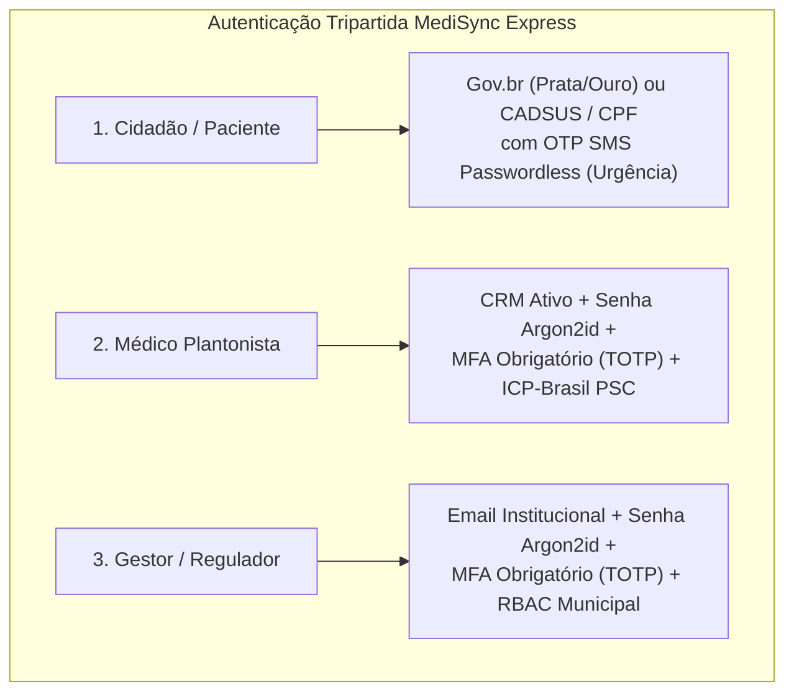

# [ADR-012] Transição 100% SUS, Consórcios Intermunicipais e Autenticação Tripartida

| Metadado | Detalhe |
| :--- | :--- |
| **Status** | Aprovado |
| **Data** | 2026-11-02 |
| **Decisores** | Time de Arquitetura & Engenharia |
| **Referência** | [Business Vision](../explanation/business-vision.md), [Product Specification](../explanation/product-specification.md), [Overview](../explanation/architecture/overview.md) |

---

## 1. Contexto e Declaração do Problema

A concepção original do MediSync Express contemplava um modelo operacional híbrido, suportando simultaneamente instâncias públicas municipais e operadoras privadas de saúde suplementar. No entanto, a evolução regulatória e a realidade fiscal e assistencial do ecossistema de saúde no Brasil demonstraram a inviabilidade e a ineficiência de sustentar essa dualidade:

1. **Inviabilidade Econômica da Saúde Suplementar**: O setor de planos privados opera sob índice de sinistralidade médio crítico de 82%, acompanhado por complexidade desproporcional nos esquemas de interoperabilidade TISS/TUSS (XMLs pesados, regras de validação heterogêneas por operadora) e índices recorrentes de glosas de aproximadamente 5%, gerando atritos financeiros crônicos e elevados custos de manutenção de infraestrutura.
2. **Gargalo Fiscal Municipal e a LRF (Teto de 54%)**: Pequenos e médios municípios enfrentam o teto prudencial de 54% de despesa com pessoal estabelecido pela Lei de Responsabilidade Fiscal (Lei Complementar nº 101/2000). A contratação individualizada de equipes médicas plantonistas 24/7 para atendimento presencial ou virtual por cada prefeitura isolada é financeiramente impraticável.
3. **Ascensão dos Consórcios Públicos Intermunicipais (Lei Federal nº 11.107/2005)**: O instrumento dos Consórcios Públicos de Saúde consolidou-se como a principal solução federativa para o ganho de escala regional, viabilizando o rateio do contingente de profissionais médicos entre múltiplos municípios consorciados sob uma única gestão compartilhada.
4. **Programa SUS Digital e Incentivos Governamentais**: A publicação da Portaria GM/MS nº 3.232/2024 estruturou o Programa SUS Digital, vedando expressamente qualquer cobrança de taxa, copagamento ou barreira financeira de acesso aos usuários do SUS (Art. 196 da CF/88 e Art. 43 da Portaria). Paralelamente, o Ministério da Saúde instituiu incentivos como o eMulti (Portaria GM/MS nº 635/2023), que aporta recursos federais de até R$ 2.500,00 mensais por equipe multiprofissional vinculada à telessaúde.
5. **Autenticação Heterogênea e Falhas de Governança**: O acesso por senha tradicional ou tokens genéricos revelou-se insuficiente para atender aos padrões de segurança em saúde pública, demandando uma segregação estrita de credenciais entre cidadãos em emergência, médicos com responsabilidade civil/ética e gestores reguladores municipais.

---

## 2. Drivers de Decisão

* **Foco Estratégico Exclusivo no SUS**: Maximizar o impacto social e a resolutividade clínica na rede pública universal, desonerando o codebase de regras de cobrança privada.
* **Sustentabilidade Federativa via Consórcios**: Prover suporte nativo ao rateio multi-municipal com isolamento absoluto de dados de saúde entre municípios parceiros.
* **Conformidade Regulatória Rigorosa**: Atender às exigências do Parecer Consulta CREMESP nº 278.262/2023, Resolução CFM nº 2.454/2026, RDC Anvisa nº 1.000/2025 e Portaria MS nº 3.232/2024.
* **Segurança e Não-Repúdio na Autenticação**: Garantir identificação irrefutável de médicos e gestores, mantendo acolhimento universal e ágil para o cidadão sem barreiras burocráticas na urgência.
* **Poda Lean do Código (YAGNI Radical)**: Eliminar bibliotecas e conectores de convênios, esquemas TISS, gateways de cartão e mappers de faturamento privado.

---

## 3. Opções Consideradas

### Opção 1: Manter Arquitetura Híbrida Configurável (SUS + Planos Privados via Feature Flags)
* *Prós*: Preserva teórica versatilidade comercial.
* *Contras*: Alto custo cognitivo e de manutenção; código poluído com branches condicionais de validação financeira; testes de integração lentos simulando mocks de operadoras TISS; dívida técnica permanente.

### Opção 2: Pivotar Exclusivamente para Operadoras Privadas
* *Prós*: Mercado de saúde suplementar corporativo.
* *Contras*: Desalinhado da missão pública de código aberto e da realidade de sobrecarga das UPAs no Brasil; alta dependência de acordos comerciais com grandes operadoras; sinistralidade elevada do setor.

### Opção 3: Transição Integral para 100% SUS Público com Consórcios Intermunicipais e Autenticação Tripartida (Adotada)
* *Prós*: Alinhamento pleno à universalidade do SUS (Art. 196 CF/88); viabilização para centenas de municípios via Consórcios Intermunicipais (Lei nº 11.107/2005); eliminação total de glosas TISS; substituição de `billing` por `ambulatory` (Produção Ambulatorial SUS via BPA-I e SIGTAP); autenticação robusta tripartida (Gov.br/CADSUS, CRM+MFA+PSC, Email+MFA+RBAC).
* *Contras*: Exige refatoração documental e de fronteiras para expurgar referências a convênios privados.

---

## 4. Decisão

Adotamos a **Opção 3: Transição Integral para 100% SUS Público com Suporte Nativo a Consórcios Intermunicipais e Autenticação Tripartida**.

### 4.1 Transição 100% SUS e Universalidade
A plataforma assume como princípio petre o Art. 196 da Constituição Federal e a Portaria GM/MS nº 3.232/2024. Fica vedada qualquer cobrança, taxa ou validação de elegibilidade financeira privada. O acesso à esteira de acolhimento e teleconsulta é universal, gratuito e irrestrito.

### 4.2 Consórcios Públicos Intermunicipais e Isolamento via Postgres RLS
A arquitetura multi-tenant lógica (ADR-003) passa a atender formalmente à estrutura dos Consórcios Públicos de Saúde (Lei Federal nº 11.107/2005):
* Uma instância compartilhada atende ao consórcio regional;
* Cada município consorciado opera como uma `organizacao_id` segregada sob **Row-Level Security (RLS)** ativo no PostgreSQL 17;
* A escala médica de plantão é centralizada e compartilhada regionalmente, otimizando o gasto público e respeitando o teto de 54% da LRF de cada prefeitura consorciada.

### 4.3 Renomeação Arquitetural: de `billing` para `ambulatory`
O módulo `billing` é descontinuado e substituído pelo módulo **`ambulatory` (Produção Ambulatorial SUS)**:
* **Escopo**: Registro, validação e consolidação da produção ambulatorial para exportação nos formatos oficiais do Datasus:
  * **BPA-I**: Boletim de Produção Ambulatorial Individualizado;
  * **SISAB / e-SUS**: Integração com a Atenção Primária em Saúde;
  * **CNES 160/006**: Ponto de Telessaúde regulamentado;
  * **SIGTAP**: Codificação unificada do procedimento de teleconsulta (código `03.01.01.025-0` — Consulta de Profissional de Nível Superior na Atenção Primária / Teleconsulta na Atenção Básica, conforme Nota Técnica nº 11/2024-MS).
* Todo código de gateway de pagamento, consulta de planos privados e geração de guias TISS é formalmente removido do repositório.

### 4.4 Autenticação Tripartida Rigorosa
Estabelece-se a segregação estrita em três pilares de acesso:

1. **Cidadão / Paciente**: Identificação via Gov.br (Prata ou Ouro) ou cruzamento CADSUS por CPF + Data de Nascimento + Telefone com verificação OTP SMS *passwordless* (zero fricção na dor aguda).
2. **Médico Plantonista**: Credenciais de acesso com CRM + Estado + Senha criptografada via Argon2id + Segundo Fator de Autenticação Obrigatório (**MFA/TOTP**) + Assinatura Digital ICP-Brasil em Nuvem via Provedor de Serviços de Confiança (PSC - OAuth2 PAdES sob ADR-006).
3. **Gestor / Regulador Municipal**: Email institucional autenticado + Senha Argon2id + **MFA/TOTP obrigatório**, com controle de acesso baseado em papéis hierárquicos (RBAC: `GESTOR_CONSORCIO`, `REGULADOR_MUNICIPAL`, `AUDITOR_PRODUCAO`).

---

## 5. Consequências

### Positivas
* **Redução Significativa de Complexidade**: Poda completa de adapters TISS/TUSS, gateways privados e tabelas de planos de saúde, reduzindo a base de código e a superfície de ataque.
* **Eliminação de Glosas**: A produção ambulatorial SUS baseia-se em regras determinísticas de validação cadastral (CPF, CNS, CNES, SIGTAP e CBO), eliminando o risco financeiro de glosas de convênios privados.
* **Ganhos de Escala Federativa**: Pequenos municípios conseguem fornecer atendimento médico 24/7 de alta qualidade rateando custos via Consórcio Intermunicipal dentro dos limites da LRF.
* **Admissão SUS Direta & Eliminação de Latência Fictícia**: O acolhimento com TCLE persiste o atendimento diretamente em `APTO_PARA_CHAMADA` com inserção atômica no ZSET `fila:{org}:aptos`. Expurgou-se o agendamento desnecessário de tarefas em worker assíncrono para validação de elegibilidade, eliminando a latência fictícia no ingresso da fila e reduzindo I/O inútil no Valkey.
* **Segurança Jurídica e Clínica Reforçada**:
  * **CREMESP nº 278.262/2023**: Triagem aberta desvinculada de royalties de Manchester, focada em detecção rápida de *Red Flags* e acionamento pré-hospitalar imediato (SAMU 192).
  * **CFM nº 2.454/2026**: Diretrizes de governança de inteligência artificial em saúde (supervisão humana obrigatória *Human-in-the-Loop*, diff forense de alterações e não-repúdio de atos médicos).
  * **RDC Anvisa nº 1.000/2025**: Rastreabilidade e conformidade com requisitos de software médico seguro e auditável.

### Riscos Mitigados
* **Risco de Vazamento Cruzado entre Municípios Consorciados**: Mitigado pelo isolamento em banco com PostgreSQL RLS (ADR-003) forçado em 100% das tabelas.
* **Risco de Invasão de Painel Médico**: Mitigado pela obrigatoriedade de MFA/TOTP para médicos e gestores.

