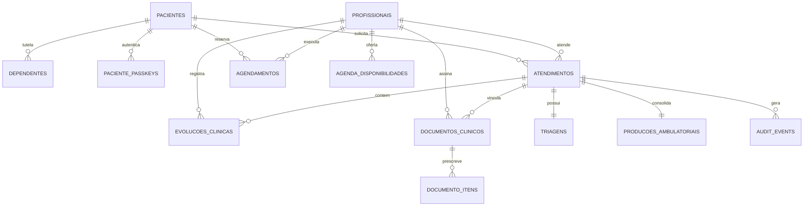

# Modelo de Dados Relacional e Governança Forense (Data Model)

> Estrutura relacional no PostgreSQL 17 em plataforma única com chaves UUIDv7, índices clínicos de alta seletividade e imutabilidade forense sob resoluções do CFM.

| Metadado | Detalhamento |
| :--- | :--- |
| **Banco de Dados** | PostgreSQL 17 (extensões `uuid-ossp`, `pgcrypto` e `btree_gist`) |
| **Paradigma ORM & IDs** | Modelos Ricos no SQLAlchemy 2.0 (`Mapped[...]`) \| Chaves Clínicas em UUIDv7 (RFC 9562) |
| **Topologia de Dados** | Plataforma Única com Singleton `configuracoes_unidade`, RBAC e Anti-IDOR (ADR-013) |
| **Marco Regulatório** | Resolução CFM nº 2.314/2022 \| Resolução CFM nº 1.821/2007 \| LGPD Art. 11 |
| **Migração Canônica** | `migrations/versions/0001_initial_schema.py` |

## Contexto

A modelagem de dados do MediSync Express opera sob regime de pronto-atendimento virtual 24/7 de alta concorrência em **plataforma única**. O modelo concilia quatro requisitos essenciais de engenharia clínica e conformidade sanitária:
1. **Proteção Horizontal e Titularidade Estrita**: Prevenção de acesso cruzado entre pacientes e consultas via UUIDv7 anti-enumeração e checagens Anti-IDOR em camada de apresentação e aplicação.
2. **Fidelidade Histórica e Imutabilidade do Prontuário**: Cumprimento das Resoluções CFM nº 2.314/2022 (telemedicina) e nº 1.821/2007 (prontuário eletrônico — guarda probatória mínima de 20 anos), exigindo que dados clínicos e civis jamais sofram mutação retroativa.
3. **Rastreabilidade Forense Contínua**: Atendimento ao Art. 11 da LGPD (tratamento de dados sensíveis de saúde) por meio de trilhas de auditoria imutáveis com custódia de identificadores e hashes criptográficos.
4. **Desempenho Sub-200ms (RNF-01)**: O atendimento a SLAs de fila depende do índice composto `idx_atendimentos_fila` sobre `(status, prioridade_clinica, data_entrada_fila)` com busca direta.

O esquema físico, índices e triggers de imutabilidade não dependem de DDL manual em produção; a definição canônica reside na migração consolidada em `migrations/versions/0001_initial_schema.py`.

## Conceito

### 1. Princípios Orientados a DDD e Agregados Clínicos

- **3ª Forma Normal (3NF) para Cadastros Mestres**: Metadados da unidade (`configuracoes_unidade`), profissionais e pacientes mantêm integridade cadastral e unicidade global de identificadores (CNPJ, CRM/UF, CPF/CNS), prevenindo anomalias perante DATASUS e CADSUS.
- **Configuração Singleton com Guard Booleano (`singleton_guard`)**: Tanto `configuracoes_unidade` quanto `configuracoes_plantao` usam PK UUIDv7 com restrição `UniqueConstraint("singleton_guard")` + `CheckConstraint("singleton_guard IS TRUE")`, garantindo exatamente uma linha ativa sem números mágicos.
- **Snapshots Forenses Imutáveis (CFM 2.314/2022 e 1.821/2007)**: Na conclusão do atendimento e emissão de documentos médicos, os dados civis e de endereço do paciente (fundamentais para SAMU 192 e dispensação) e o CRM/UF do profissional são congelados no registro. Mutações cadastrais posteriores não retroagem sobre prontuários finalizados.
- **Ciclo de Vida Governado pela Raiz do Agregado**: A entidade `atendimentos` atua como raiz de agregado. Entidades dependentes (`triagens`, `evolucoes_clinicas` e `documentos_clinicos`) possuem integridade referencial com `ON DELETE RESTRICT`, impedindo exclusões acidentais.
- **Chaves Primárias em UUIDv7 (RFC 9562)**: Todas as 16 tabelas utilizam UUIDv7. Isso combina a eficiência de inserção e localidade de índice B-Tree (equivalente a inteiros sequenciais) com proteção anti-enumeração (anti-IDOR) e ordenação cronológica precisa para filas.
- **Máquina de Estados Clínicos (RN03)**: A transição de estados de atendimento segue ciclo rigoroso e determinístico (admissão direta no SUS em `APTO_PARA_CHAMADA` $\to$ `CHAMANDO_PACIENTE` $\to$ `EM_ATENDIMENTO` $\to$ `CONCLUIDO` / `PACIENTE_AUSENTE`), com invariantes encapsuladas no modelo rico de domínio.

### 2. Agregados Clínicos e Relacionamentos



O modelo decompõe-se em grupos coesos de agregados:
- **Unidade e Identidade**: `configuracoes_unidade` (singleton), `profissionais`, `pacientes`, `dependentes`, `paciente_passkeys` e `usuarios_credenciais`.
- **Acolhimento e Fila**: `atendimentos` e `triagens` com cálculo determinístico de score de prioridade.
- **Agenda Programada (eMulti)**: `agenda_disponibilidades` e `agendamentos` com exclusão temporal GiST.
- **Ato Médico e Prescrição**: `evolucoes_clinicas`, `documentos_clinicos` e `documento_itens`.
- **Produção SUS e Auditoria**: `producoes_ambulatoriais`, `configuracoes_plantao` e `audit_events` em modelo append-only.

### 3. Unicidade Global e Segurança Horizontal (ADR-013)

- **Substituição do Multi-Tenancy Lógico ([ADR-013](../../adrs/ADR-013-Simplificacao-Plataforma-Unica-e-Remocao-RLS.md))**: Conforme decidido na ADR-013 (que substituiu a antiga ADR-003), foram removidas a tabela `organizacoes`, a coluna `organizacao_id` e as políticas Row-Level Security.
- **Unicidade Global e Parcial**: Identificadores únicos (`uq_paciente_cpf`, `uq_paciente_cns`, `uq_profissional_email`, `uq_profissional_cpf`, `uq_usuarios_credenciais_identificador`) impedem cadastros duplicados na plataforma.
- **Índice de Fila**: `idx_atendimentos_fila` `(status, prioridade_clinica, data_entrada_fila)` suporta ordenação e despacho imediato sem scan sequencial.

### 4. Trilha Forense Append-Only e Auditoria Imutável

- **Auditoria Imutável ([ADR-007](../../adrs/ADR-007-Auditoria-Imutavel-Append-Only.md))**: A tabela `audit_events` registra eventos clínicos e operacionais com ator polimórfico (`PROFISSIONAL`, `PACIENTE`, `SISTEMA`), IP de origem, timestamp em UTC, estado anterior, novo estado e payload estruturado.
- **Custódia Probatória de Documentos**: Documentos emitidos gravam chave de armazenamento S3/MinIO e hash SHA-256 no banco, permitindo reconciliação de integridade contra qualquer alteração externa.
- **Proteção por Trigger no Banco**: A trigger `trg_audit_events_immutable` (`trg_prevent_audit_mutation()`) bloqueia estritamente `UPDATE` e `DELETE` em nível de banco, satisfazendo o marco legal de custódia perene.

### 5. Governança de Migrações com Alembic Assíncrono

As migrações operam nativas em `asyncio` utilizando o driver `psycopg 3` e `run_sync`, mantendo `upgrade()` e `downgrade()` simétricos e paridade validada via `alembic check`.

## Onde no código

- Impl: `migrations/versions/0001_initial_schema.py:upgrade`
- Impl: `src/modules/queue/domain/models/atendimento.py:Atendimento`
- Impl: `src/modules/triage/domain/models/triagem.py:Triagem`
- Impl: `src/modules/consultation/domain/models/evolucao_clinica.py:EvolucaoClinica`
- Impl: `src/modules/consultation/domain/models/documento_clinico.py:DocumentoClinico`
- Impl: `src/modules/consultation/domain/models/documento_item.py:DocumentoItem`
- Impl: `src/modules/identity/domain/models/paciente.py:Paciente`
- Impl: `src/modules/identity/domain/models/profissional.py:Profissional`
- Impl: `src/modules/identity/domain/models/configuracao_unidade.py:ConfiguracaoUnidade`
- Impl: `src/modules/identity/domain/models/dependente.py:Dependente`
- Impl: `src/modules/auth/domain/models/usuario_credencial.py:UsuarioCredencial`
- Impl: `src/core/audit/models.py:AuditEvent`
- Spec: `docs/adrs/ADR-013-Simplificacao-Plataforma-Unica-e-Remocao-RLS.md`
- Spec: `docs/adrs/ADR-007-Auditoria-Imutavel-Append-Only.md`
- Spec: `src/modules/queue/application/ports/triage_port.py:TriagePort`
- Prova viva: `tests/integration/test_migrations.py`
- Prova viva: `tests/unit/test_atendimento_model.py`
- Prova viva: `tests/unit/test_audit_model.py`
- Ver: `rg -n "op\.create_table|ExcludeConstraint" migrations/versions/0001_initial_schema.py`
- Ver: `rg -n "class Atendimento" src/modules/queue/domain/models/`
- Ver: `rg -n "class AuditEvent" src/core/audit/models.py`
- Ver: `rg -n "trg_prevent_audit_mutation" migrations/versions/0001_initial_schema.py`

## Verificação

```bash
uv run pytest tests/unit/test_atendimento_model.py tests/unit/test_audit_model.py
uv run pytest --noconftest tests/integration/test_migrations.py
```

## Ver também

- [Macro-Arquitetura (Overview)](overview.md)
- [Concorrência e Filas (Concurrency & Queues)](concurrency-and-queues.md)
- [Conformidade Clínica e Telemedicina](compliance-and-telemedicine.md)
- [Database Schema Reference](../../reference/database/schema.md)
- [Hexagonal Pragmático](../concepts/hexagonal-pragmatico.md)
- [Inter-Module Protocols](../concepts/inter-module-protocols.md)
- `docs/adrs/ADR-001-Hexagonal-Pragmatico-Modelos-Ricos-Protocols-e-Tach.md`
- `docs/adrs/ADR-013-Simplificacao-Plataforma-Unica-e-Remocao-RLS.md`
- `docs/adrs/ADR-007-Auditoria-Imutavel-Append-Only.md`
- `docs/reference/environment/variables.md`
