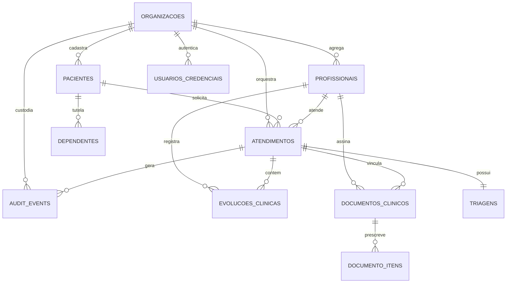

# Modelo de Dados Relacional e Governança Forense (Data Model)

> Estrutura relacional no PostgreSQL 17 com segregação multi-tenant em O(1) via RLS e imutabilidade forense sob resoluções do CFM.

| Metadado | Detalhamento |
| :--- | :--- |
| **Banco de Dados** | PostgreSQL 17 (extensões `uuid-ossp` e `pgcrypto`) |
| **Paradigma ORM & IDs** | Modelos Ricos no SQLAlchemy 2.0 (`Mapped[...]`) \| Chaves Clínicas em UUIDv7 (RFC 9562) |
| **Multi-Tenancy** | Segregação Lógica via Coluna `organizacao_id` e Row-Level Security (RLS) nativo em $\mathcal{O}(1)$ |
| **Marco Regulatório** | Resolução CFM nº 2.314/2022 \| Resolução CFM nº 1.821/2007 \| LGPD Art. 11 |
| **Migrações Canônicas** | `migrations/versions/0001_initial_schema.py` e `migrations/versions/0002_row_level_security.py` |

## Contexto

A modelagem de dados do MediSync Express opera sob regime de pronto-atendimento virtual 24/7 de alta concorrência. O modelo concilia três requisitos essenciais de engenharia clínica e conformidade sanitária:
1. **Isolamento Lógico Absoluto**: Prevenção de vazamento acidental de dados sensíveis entre diferentes instituições de saúde (tenants) sob infraestrutura compartilhada de banco de dados.
2. **Fidelidade Histórica e Imutabilidade do Prontuário**: Cumprimento das Resoluções CFM nº 2.314/2022 (telemedicina) e nº 1.821/2007 (prontuário eletrônico — guarda probatória mínima de 20 anos), exigindo que dados clínicos e civis jamais sofram mutação retroativa.
3. **Rastreabilidade Forense Contínua**: Atendimento ao Art. 11 da LGPD (tratamento de dados sensíveis de saúde) por meio de trilhas de auditoria imutáveis com custódia de identificadores e hashes criptográficos.
4. **Desempenho Sub-200ms (RNF-01)**: O atendimento a SLAs de fila depende de índices compostos `(organizacao_id, status, prioridade_clinica, data_entrada_fila)` com busca em $\mathcal{O}(1)$.

O esquema físico, índices e políticas de segurança por linha não dependem de DDL manual em produção; a definição canônica reside nas migrações assíncronas do Alembic em `migrations/versions/0001_initial_schema.py` e `migrations/versions/0002_row_level_security.py`.

## Conceito

### 1. Princípios Orientados a DDD e Agregados Clínicos

- **3ª Forma Normal (3NF) para Cadastros Mestres**: Organizações, profissionais e pacientes mantêm integridade cadastral e unicidade de identificadores (CNPJ, CRM/UF, CPF/CNS), prevenindo anomalias perante operadoras de saúde e CADSUS.
- **Denormalização Pragmática de `organizacao_id` (RLS em O(1))**: Todas as tabelas multi-tenant contêm a coluna `organizacao_id` indexada diretamente. As políticas de Row-Level Security (RLS) do PostgreSQL filtram via `current_setting('app.current_tenant_id')` com busca pontual em índice B-Tree, garantindo custo $\mathcal{O}(1)$ sem junções em cascata.
- **Snapshots Forenses Imutáveis (CFM 2.314/2022 e 1.821/2007)**: Na conclusão do atendimento e emissão de documentos médicos, os dados civis e de endereço do paciente (fundamentais para SAMU 192 e dispensação) e o CRM/UF do profissional são congelados no registro. Mutações cadastrais posteriores não retroagem sobre prontuários finalizados.
- **Ciclo de Vida Governado pela Raiz do Agregado**: A entidade `atendimentos` atua como raiz de agregado. Entidades dependentes (`triagens`, `evolucoes_clinicas` e `documentos_clinicos`) possuem integridade referencial com `ON DELETE RESTRICT`, impedindo exclusões acidentais.
- **Chaves Primárias em UUIDv7 (RFC 9562)**: Todas as entidades clínicas utilizam UUIDv7. Isso combina a eficiência de inserção e localidade de índice B-Tree (equivalente a inteiros sequenciais) com proteção anti-enumeração (anti-IDOR) e ordenação cronológica precisa para filas.
- **Máquina de Estados Clínicos (RN03)**: A transição de estados de atendimento segue ciclo rigoroso e determinístico (`TRIADO_AGUARDANDO_ELEGIBILIDADE` $\to$ `APTO_PARA_CHAMADA` $\to$ `CHAMANDO_PACIENTE` $\to$ `EM_ATENDIMENTO` $\to$ `CONCLUIDO` / `PACIENTE_AUSENTE`), com invariantes encapsuladas no modelo rico de domínio.

### 2. Agregados Clínicos e Relacionamentos



O modelo decompõe-se em quatro grupos coesos de agregados:
- **Identidade e Acesso**: `organizacoes`, `profissionais`, `pacientes`, `dependentes` e `usuarios_credenciais`.
- **Acolhimento e Fila**: `atendimentos` e `triagens` com cálculo determinístico de score de prioridade.
- **Ato Médico e Prescrição**: `evolucoes_clinicas`, `documentos_clinicos` e `documento_itens`.
- **Auditoria Transversal**: `audit_events` em modelo append-only com ator polimórfico.

### 3. Segurança por Linha (RLS) e Isolamento Multi-Tenant

- **RLS Nativo e Forçado ([ADR-003](../../adrs/ADR-003-Multi-Tenancy-Logico-Postgres-RLS.md))**: Cada tabela multi-tenant aplica `ENABLE ROW LEVEL SECURITY` e `FORCE ROW LEVEL SECURITY`. A variável de sessão `app.current_tenant_id` é configurada pelo middleware a cada requisição ou transação assíncrona.
- **Políticas Universais de Isolamento**: As políticas `tenant_isolation_*` exigem correspondência estrita com `organizacao_id`, bloqueando acesso indevido sem impactar planos de execução graças aos índices compostos `(organizacao_id, ...)`.
- **Garantia de Desempenho O(1)**: O filtro por tenant não realiza scans sequenciais nem subqueries recursivas, valendo-se dos índices B-Tree compostos `(organizacao_id, ...)`.

### 4. Trilha Forense Append-Only e Auditoria Imutável

- **Auditoria Imutável ([ADR-007](../../adrs/ADR-007-Auditoria-Imutavel-Append-Only.md))**: A tabela `audit_events` registra eventos clínicos e operacionais com ator polimórfico (`PROFISSIONAL`, `PACIENTE`, `SISTEMA`), IP de origem, timestamp em UTC, estado anterior, novo estado e payload estruturado.
- **Custódia Probatória de Documentos**: Documentos emitidos gravam chave de armazenamento S3/MinIO e hash SHA-256 no banco, permitindo reconciliação de integridade contra qualquer alteração externa.
- **Proteção por Trigger no Banco**: As operações `UPDATE`, `DELETE` e `TRUNCATE` são revogadas do papel de aplicação (`medisync_app`) e bloqueadas por trigger estrita em nível de banco (`trg_audit_events_immutable`), satisfazendo o marco legal de custódia perene.

### 5. Governança de Migrações com Alembic Assíncrono

As migrações operam nativas em `asyncio` utilizando o driver `psycopg 3` e `run_sync`. Cada migração é atômica, reversível e valida os índices necessários para a performance de filtros de tenant e ordenação de filas clínicas.

## Onde no código

- Impl: `migrations/versions/0001_initial_schema.py:upgrade`
- Impl: `migrations/versions/0002_row_level_security.py:upgrade`
- Impl: `src/modules/queue/domain/models/atendimento.py:Atendimento`
- Impl: `src/modules/triage/domain/models/triagem.py:Triagem`
- Impl: `src/modules/consultation/domain/models/evolucao_clinica.py:EvolucaoClinica`
- Impl: `src/modules/consultation/domain/models/documento_clinico.py:DocumentoClinico`
- Impl: `src/modules/consultation/domain/models/documento_item.py:DocumentoItem`
- Impl: `src/modules/identity/domain/models/paciente.py:Paciente`
- Impl: `src/modules/identity/domain/models/profissional.py:Profissional`
- Impl: `src/modules/identity/domain/models/organizacao.py:Organizacao`
- Impl: `src/modules/identity/domain/models/dependente.py:Dependente`
- Impl: `src/modules/auth/domain/models/usuario_credencial.py:UsuarioCredencial`
- Impl: `src/core/audit/models.py:AuditEvent`
- Spec: `docs/adrs/ADR-003-Multi-Tenancy-Logico-Postgres-RLS.md`
- Spec: `docs/adrs/ADR-007-Auditoria-Imutavel-Append-Only.md`
- Spec: `src/modules/queue/application/ports/triage_port.py:TriagePort`
- Prova viva: `tests/integration/test_rls_security.py`
- Prova viva: `tests/unit/test_atendimento_model.py`
- Prova viva: `tests/unit/test_audit_model.py`
- Ver: `rg -n "ENABLE ROW LEVEL SECURITY" migrations/versions/`
- Ver: `rg -n "class Atendimento" src/modules/queue/domain/models/`
- Ver: `rg -n "class AuditEvent" src/core/audit/models.py`
- Ver: `rg -n "trg_audit_events_immutable" migrations/versions/`

## Verificação

```bash
uv run pytest tests/unit/test_atendimento_model.py tests/unit/test_audit_model.py tests/integration/test_rls_security.py
```

## Ver também

- [Macro-Arquitetura (Overview)](overview.md)
- [Concorrência e Filas (Concurrency & Queues)](concurrency-and-queues.md)
- [Conformidade Clínica e Telemedicina](compliance-and-telemedicine.md)
- [Multi-Tenancy e RLS](../concepts/multi-tenancy-rls.md)
- [Hexagonal Pragmático](../concepts/hexagonal-pragmatico.md)
- [Inter-Module Protocols](../concepts/inter-module-protocols.md)
- `docs/adrs/ADR-001-Hexagonal-Pragmatico-Modelos-Ricos-Protocols-e-Tach.md`
- `docs/adrs/ADR-003-Multi-Tenancy-Logico-Postgres-RLS.md`
- `docs/adrs/ADR-007-Auditoria-Imutavel-Append-Only.md`
- `docs/reference/environment/variables.md`
