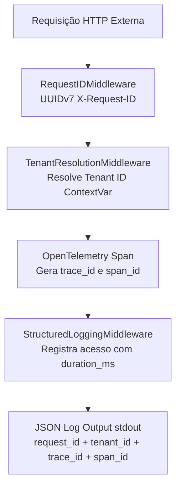

# Observability, Structured Logging & OpenTelemetry Architecture

> Fundamentação da observabilidade técnica no MediSync Express: OpenTelemetry nativo no FastAPI, correlação de traces em logs JSON estruturados e salvaguardas de conformidade LGPD.

## Contexto

Consulte este documento para compreender como o MediSync Express monitora a integridade técnica, o desempenho computacional de suas rotas e correlaciona requisições de ponta a ponta sem ferir o sigilo médico.

Para a telemetria clínica e operacional de pronto-atendimento (TME, TMA, No-show e SLA 95%), consulte a especificação do módulo em `src/modules/telemetry` e `docs/explanation/domains/context-map.md`.

---

## Conceito

### 1. Pilares da Observabilidade Técnica

A arquitetura de observabilidade técnica divide-se em três pilares integrados:

1. **Structured JSON Logging (`src/core/logging.py`)**:
   - Cada linha emitida pela aplicação é formatada em JSON de linha única (*single-line JSON*) enviado diretamente para `stdout`.
   - Campos essenciais injetados automaticamente:
     * `timestamp`: Carimbo UTC ISO-8601 de alta precisão.
     * `level`, `logger`, `message`: Identificação e severidade do evento.
     * `request_id`: Identificador canônico da requisição (UUIDv7 propagado via ContextVar).
     * `tenant_id`: Identificador da organização de saúde ativa (resolvido por subdomain ou header).
     * `trace_id` e `span_id`: Identificadores hexadecimais de 128 e 64 bits extraídos do span OpenTelemetry ativo.

2. **Tracing Distribuído Nativo (FastAPI 0.142+ & OpenTelemetry)**:
   - Configurado via parâmetro `telemetry` na factory `create_app()` em `src/main.py`.
   - Spans automáticos cobrindo requisições HTTP (`GET /api/v1/...`) e conexões WebSocket (`WS /ws/...`).
   - `operation_spans = True`: granularidade interna que mede o tempo consumido em cada injeção de dependência (`Depends`), na execução da função da rota e na serialização de saída do Pydantic.
   - Rotas de probe de infraestrutura (`/healthz`) e documentação (`/docs`, `/redoc`, `/openapi.json`) são excluídas via filtro declarativo para evitar ruído e custos desnecessários em backends de APM.

3. **Métricas OTLP Padronizadas**:
   - Medições de contagem de requisições, duração de resposta e conexões ativas compatíveis com a especificação OTLP (OpenTelemetry Protocol).

---

### 2. Correlação Unificada: Request ID, Tenant ID e Trace ID

A rastreabilidade de eventos opera com três níveis de correlação complementares:



Essa correlação unificada permite que um incidente reportado pelo cliente seja investigado tanto pelo `request_id` (suporte ao usuário) quanto pelo `trace_id` (APM / Grafana Tempo / Jaeger), localizando instantaneamente todos os logs de banco de dados, locks do Valkey e workers assíncronos relacionados.

---

### 3. Telemetria Técnica (OTel) vs. Telemetria Clínica (RF-10)

O MediSync Express diferencia rigorosamente dois domínios que compartilham o termo "Telemetria":

| Dimensão | **Telemetria Técnica (OpenTelemetry / SRE)** | **Telemetria Clínica e Operacional (RF-10 / Módulo `telemetry`)** |
| :--- | :--- | :--- |
| **Escopo** | Desempenho do framework, latência de rede, CPU, erros 5xx/4xx. | Eficiência da esteira assistencial médica de urgência. |
| **Métricas** | • Latência p50/p95/p99 HTTP<br>• Duração de dependências (`operation_spans`)<br>• Spans OTLP de queries e locks | • TME (Tempo Médio de Espera) por nível Manchester (1 a 5)<br>• TMA (Tempo Médio de Atendimento) por médico e geral<br>• Cumprimento de meta de SLA institucional ($\ge 95\%$)<br>• Taxas de No-Show e Evasão da fila |
| **Atores** | Engenharia de Software, SRE, DevOps. | Carlos Drumond (Gestor Operacional), Diretor Clínico, Auditoria Médica. |
| **Destino** | Coletor OTLP (Grafana Tempo, Datadog, Jaeger). | Painel executivo REST (`GET /api/v1/telemetria/painel`). |

---

### 4. Salvaguardas de Conformidade LGPD e Sigilo Médico (CFM)

Em conformidade com o CFM nº 2.314/2022 e com o Artigo 11 da LGPD (Tratamento de Dados Pessoais Sensíveis):

1. **Proibição de Dados Clínicos em Tags de Tracing**:
   - Spans OpenTelemetry e logs de acesso técnico registram **apenas** metadados de transporte (`method`, `path`, `status_code`, `duration_ms`, `trace_id`).
   - É estritamente vedada a inserção de dados clínicos (sintomas, queixas da triagem, prescrições, prontuário, CPF ou dados biométricos) em atributos de spans ou headers de exportação OTLP.
2. **Sanitização de Falhas**:
   - Mensagens de erro para clientes utilizam RFC 7807 (`ProblemDetails`) sem vazar detalhes internos ou stack traces de banco de dados.

---

### 5. Ativação e Exportação em Ambientes de Produção

Em ambiente local e de testes, a telemetria opera em modo desacoplado em memória (sem exportação de rede), garantindo zero dependências externas ou latência.

Para exportar dados a um coletor OTLP em homologação ou produção, defina as seguintes variáveis declarativas de ambiente:

```bash
# Ativa a exportação automática OTLP do FastAPI
export FASTAPI_OTEL_AUTO_CONFIGURE=true

# Nome do serviço no catálogo do APM
export OTEL_SERVICE_NAME=medisync-api

# Endpoint base do OTel Collector (HTTP Protobuf)
export OTEL_EXPORTER_OTLP_ENDPOINT=https://otel-collector.prod.medisync.internal:4318

# Headers de autenticação (se exigidos pelo gateway)
export OTEL_EXPORTER_OTLP_HEADERS=authorization=Bearer <token>
```
