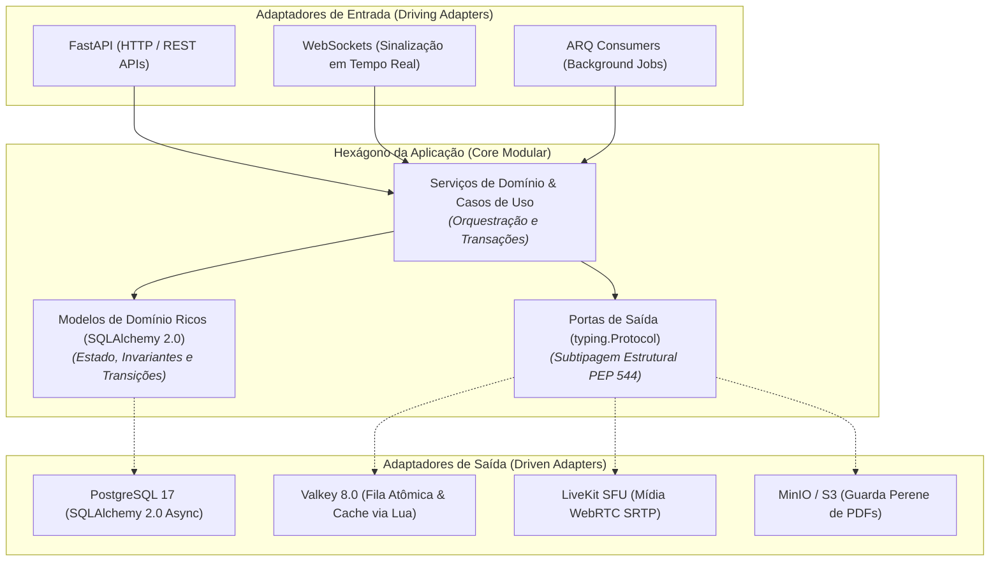
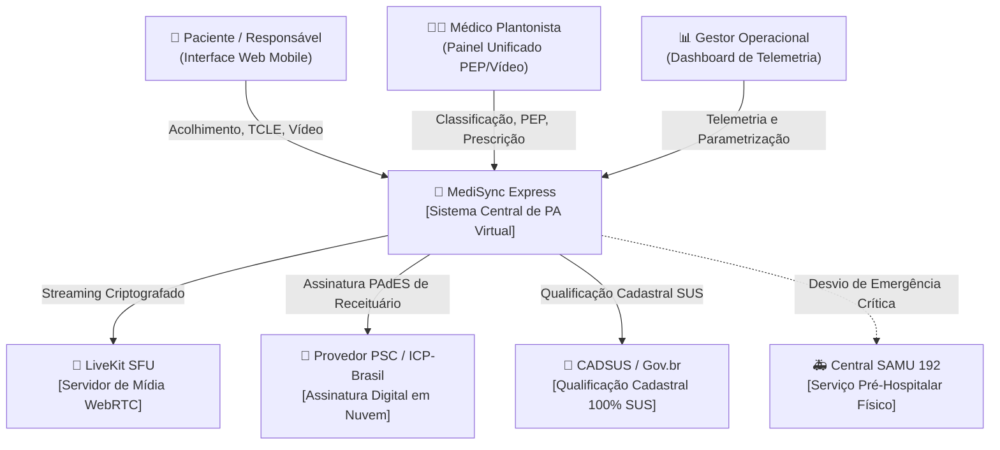
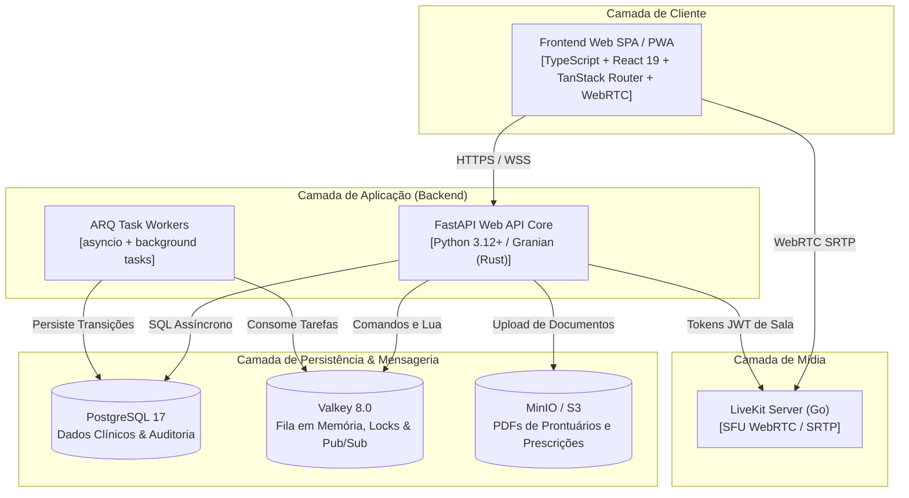

# Macro-Arquitetura do Sistema (Architecture Overview)

> Visão sistêmica do MediSync Express: monólito modular hexagonal, topologia C4, catálogo dos 8 bounded contexts e governança de fronteiras via Tach.

| Metadado | Detalhamento |
| :--- | :--- |
| **Estilo Arquitetural** | Hexagonal Pragmático (Ports & Adapters) em Monólito Modular |
| **Paradigma de Tipagem** | Modelos Ricos (SQLAlchemy 2.0) + Chaves Clínicas em UUIDv7 + Subtipagem Estrutural via `typing.Protocol` (PEP 544) |
| **Comunicação Inter-Módulos** | Síncrona via Ports & Adapters (`typing.Protocol`) \| Assíncrona via Notificadores Ponto a Ponto |
| **Isolamento de Fronteiras** | Tach (Verificação estática de dependências e interfaces públicas em Rust) |
| **Qualidade & Métricas** | FURPS+ / ISO 25010 \| C4 Model (Contexto, Contêineres e Componentes) |

## Contexto

O MediSync Express é uma plataforma única de pronto-atendimento virtual (PA Digital 24/7) desenhada para operar com alta disponibilidade, latência de transporte em tempo real sub-150ms e controle estrito de titularidade (RBAC + Anti-IDOR). 

Para evitar a complexidade prematura de microsserviços distribuídos sem abrir mão de alta coesão e baixo acoplamento, adota-se o padrão de **Monólito Modular** estruturado sob o **Hexagonal Pragmático**. Fronteiras modulares não são meras convenções: são asseguradas por análise estática contínua via `tach check` e testes de arquitetura AST.

## Conceito

### 1. Hexagonal Pragmático e Separação de Responsabilidades

O núcleo da aplicação reside em modelos de domínio ricos e serviços de aplicação, isolando tecnologias voláteis atrás de adaptadores:
- **Driving Adapters (Entrada)**: FastAPI (HTTP / REST APIs), WebSockets (sinalização de fila e chamadas, veja [WebSocket Channels](../../reference/api/websocket-channels.md)) e ARQ Workers (tarefas em segundo plano, veja [ARQ Background Tasks](../../reference/worker/arq-tasks.md)).
- **Core Modular**: Entidades persistidas com SQLAlchemy 2.0 (`Mapped[...]`) encapsulam validações e invariantes clínicas, sem duplicar DTOs espelho manuais (veja [Hexagonal Pragmático](../concepts/hexagonal-pragmatico.md)).
- **Driven Adapters (Saída)**: PostgreSQL 17 (persistência relacional e auditoria imutável, veja [Database Schema](../../reference/database/schema.md)), Valkey 8.0 (fila atômica via Lua e chaves operacionais, veja [Valkey Keys Dictionary](../../reference/valkey/keys-dictionary.md)), LiveKit SFU (WebRTC SRTP), PSC Nuvem (assinatura ICP-Brasil PAdES) e MinIO/S3 (armazenamento perene de PDFs).
- **Comunicação entre Módulos**: Realizada exclusivamente por portas abstratas (`typing.Protocol`) com DTOs imutáveis ou notificadores ponto a ponto assíncronos via ports, conforme detalhado em [Inter-Module Protocols](../concepts/inter-module-protocols.md).



### 2. Topologia do Sistema (Modelo C4)

#### C4 Nível 1: Diagrama de Contexto de Sistema



#### C4 Nível 2: Diagrama de Contêineres de Execução



### 2.1 Topologia de Roteamento SPA/PWA e Deep Linking (ADR-011 / Issue #141)

O frontend adota o **TanStack Router (`@tanstack/react-router`)** com roteamento declarativo e 100% tipado (*code-based*), eliminando god components e segregando estritamente a interface pública/cidadão do portal interno:
- **`/`**: Landing Page pública 100% SUS (`PortfolioLandingPage`), apresentando a esteira assistencial com acesso a `/home`, `/cadastro`, `/entrar` e `/validar` (sem exposição da área interna).
- **`/entrar`**: Porta de entrada do cidadão (`PatientAuthPage` / `PatientHybridAuthCard` — identificação única, OTP SMS, Passkeys WebAuthn, senha opcional e Gov.br via feature flag).
- **`/cadastro`**: Auto-cadastro civil do cidadão (`PatientRegisterPage` / `PatientRegisterForm` com e-mail obrigatório, senha opcional e disparo inicial de OTP).
- **`/interno/login`**: Portal isolado da equipe médica e gestora (`InternalLoginPage` / `StaffAuthCard` para Médico CRM+MFA e Gestor Email+MFA).
- **`/home`**: Portal autenticado do cidadão (`CitizenHomePage`), centralizando fila ativa, atalho para `/triagem`, `/agendar`, `/historico`, `/receitas` e `/perfil`.
- **`/agendar`**: Agendamento programado multiprofissional eMulti (`ScheduleAppointmentPage`).
- **`/triagem`**: Acolhimento e triagem clínica estruturada com TCLE digital (`TriagemPage`), protegida por `beforeLoad` (exige sessão do cidadão em `/entrar`; redireciona para `/fila` se já houver `atendimentoId`).
- **`/otp`**: Redirect legado (`otpRoute`) para `/fila`, `/home`, `/medico`, `/gestor` ou `/entrar`.
- **`/fila`**: Sala de espera virtual (`QueuePage`) protegida por Route Guard (`beforeLoad`) que valida sessão com `atendimentoId`.
- **`/chamada`**: Sala de teleconsulta LiveKit SFU (`ConsultationRoomPage`) em tela cheia com proteção contra vazamento de credenciais JWT em URLs.
- **`/pos-consulta`**: Sumário de encerramento (`PostConsultationPage`) e download de receitas ICP-Brasil.
- **`/historico`**: Histórico clínico longitudinal unificado de PA e eMulti (`HistoryPage`).
- **`/receitas`**: Central de receitas, atestados e download autorizado de PDF/A (`PrescriptionsPage`).
- **`/perfil`**: Dados cadastrais CFM, dependentes legais e gerenciamento de Passkeys (`ProfilePage`).
- **`/validar` e `/validar/$token`**: Portal público de validação ICP-Brasil (`DocumentValidationPage`) com leitura direta do token por QR Code.
- **`/medico`**: Estação clínica do médico plantonista (`DoctorWorkstationPage` + `ProfessionalSchedulePanel`) restrita a sessões médicas (redireciona para `/interno/login` se ausente).
- **`/gestor`**: Painel de telemetria operacional (`TelemetryDashboardPage`) restrito ao perfil de gestão (redireciona para `/interno/login` se ausente).
- **`*` (Catch-all)**: Redirecionamento determinístico para `/` em rotas não mapeadas.

### 3. Decomposição Modular dos 8 Bounded Contexts (`src/modules/`)

O repositório é segregado em 8 módulos verticais de negócio, correspondentes aos *Bounded Contexts* clínicos e de suporte:

```plaintext
src/
├── core/                              # Infraestrutura transversal e fundações
│   ├── audit/                         # Trilha de auditoria imutável append-only
│   ├── config.py                      # Configurações tipadas (Pydantic BaseSettings)
│   ├── database.py                    # Engine assíncrona SQLAlchemy e sessionmaker
│   └── valkey.py                      # Pool assíncrono do Valkey
│
└── modules/
    ├── auth/                          # Autenticação JWT, Argon2id, OTP/WebAuthn e RBAC
    ├── ambulatory/                    # Produção ambulatorial SUS, BPA-I, SISAB e qualificação cadastral
    ├── consultation/                  # Teleconsulta WebRTC, PEP, Portal Cidadão e prescrição ICP-Brasil
    ├── identity/                      # Identidade, configuração da unidade, profissionais, dependentes e pacientes
    ├── queue/                         # Fila dinâmica, controle de admissão e locks atômicos Lua
    ├── scheduling/                    # Agenda programada multiprofissional (eMulti) e slots GiST
    ├── telemetry/                     # Agregação de telemetria e métricas operacionais
    └── triage/                        # Acolhimento, classificação de risco ACR e acionamento SAMU 192
```

- **Composition Roots (ADR-001 §7)**: Centralizam a injeção de dependências concretas (`auth`, `ambulatory`, `consultation`, `identity`, `queue`, `scheduling`, `telemetry`, `triage`). Routers recebem serviços via dependências tipadas (`*Dep`). Detalhes em [Composition Root e Dependências](../concepts/composition-root-and-dependencies.md).
- **Roteadores Agregados (ADR-001 §7.1 / Issue #68)**: Cada módulo agrega rotas em `presentation/routers/__init__.py`, exportando `http_router` sob `/api/v1`. O Composition Root `src/main.py` monta 1 router HTTP por módulo.

### 4. Governança de Fronteiras Modulares com Tach

A integridade arquitetural do monólito modular é fiscalizada pelo **Tach** via `tach.toml` (especificação formal em [Matriz de Fronteiras Modulares Tach](../../reference/architecture-standards/tach-boundaries-matrix.md)):
1. **Camadas Estritas**: `presentation` $\to$ `application` + `composition` + `core`; `composition` $\to$ `application` + `domain` + `infrastructure` + `core`; `infrastructure` $\to$ `application` + `domain` + `core`; `application` $\to$ `domain` + `core`; `domain` $\to$ `core`.
2. **Routers Finos**: `tests/architecture/test_routers_are_thin.py` garante por AST que rotas nunca importam persistência direta, nunca chamam `.commit()` e nunca instanciam serviços manualmente.
3. **Contratos Inter-Módulos**: Comunicação permitida apenas através de portas públicas tipadas em `ports/`, bloqueando imports de modelos internos ou adaptadores privados alheios.

## Onde no código

- Impl: `src/main.py:app`
- Impl: `frontend/src/router.tsx:createAppRouter`
- Impl: `frontend/src/App.tsx:App`
- Impl: `src/core/database.py`
- Impl: `src/core/valkey.py`
- Impl: `src/modules/queue/composition.py`
- Impl: `src/modules/scheduling/composition.py`
- Impl: `src/modules/ambulatory/composition.py`
- Impl: `src/modules/consultation/composition.py`
- Impl: `src/modules/auth/composition.py`
- Impl: `src/modules/identity/composition.py`
- Impl: `src/modules/triage/composition.py`
- Impl: `src/modules/telemetry/composition.py`
- Spec: `tach.toml`
- Spec: `docs/adrs/ADR-011-Arquitetura-Frontend-SPA-PWA-e-Estrategia-de-Testes.md`
- Spec: `docs/reference/architecture-standards/tach-boundaries-matrix.md`
- Spec: `docs/reference/database/schema.md`
- Spec: `docs/reference/valkey/keys-dictionary.md`
- Spec: `docs/reference/worker/arq-tasks.md`
- Spec: `docs/reference/api/websocket-channels.md`
- Spec: `docs/adrs/ADR-001-Hexagonal-Pragmatico-Modelos-Ricos-Protocols-e-Tach.md`
- Prova viva: `frontend/src/App.test.tsx`
- Prova viva: `tests/architecture/test_main_composition_root.py`
- Prova viva: `tests/architecture/test_routers_are_thin.py`
- Prova viva: `tests/architecture/test_services_and_composition.py`
- Ver: `tach check`
- Ver: `rg -n "http_router" src/modules/*/presentation/routers/__init__.py`

## Verificação

```bash
just tach
uv run pytest tests/architecture/
```

## Ver também

- [Hexagonal Pragmático](../concepts/hexagonal-pragmatico.md)
- [Inter-Module Protocols](../concepts/inter-module-protocols.md)
- [Composition Root e Injeção de Dependências](../concepts/composition-root-and-dependencies.md)
- [Modelo de Dados (Data Model)](data-model.md)
- [Concorrência e Filas (Concurrency & Queues)](concurrency-and-queues.md)
- [Conformidade Clínica e Telemedicina](compliance-and-telemedicine.md)
- [Database Schema](../../reference/database/schema.md)
- [Valkey Keys Dictionary](../../reference/valkey/keys-dictionary.md)
- [Matriz de Fronteiras Modulares Tach](../../reference/architecture-standards/tach-boundaries-matrix.md)
- [WebSocket Channels](../../reference/api/websocket-channels.md)
- [ARQ Background Tasks](../../reference/worker/arq-tasks.md)
- `docs/adrs/ADR-001-Hexagonal-Pragmatico-Modelos-Ricos-Protocols-e-Tach.md`
- `docs/adrs/ADR-008-Padronizacao-de-DTOs-e-Eliminacao-de-Mapper-Hell-na-Apresentacao.md`
