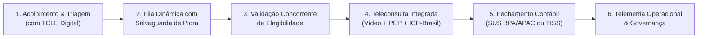
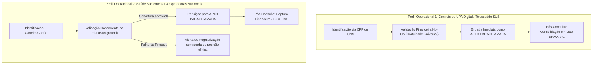

# Modelagem de Negócio e Visão de Produto (Business Vision)

## MediSync Express — Infraestrutura de Código Aberto para Pronto-Atendimento Virtual em Larga Escala (UPA Digital Nacional 24/7)

| Metadado | Detalhamento |
| :--- | :--- |
| **Referencial Metodológico** | Engenharia de Requisitos — Software Orientado ao Negócio (Vazquez & Simões) |
| **Marco Regulatório & Ético** | Resoluções CFM nº 2.314/2022 e 1.821/2007 \| LGPD (Lei nº 13.709/2018 - Art. 11) \| Portaria SVS/MS nº 344/98 |
| **Modelo de Licenciamento** | Código Aberto Permissivo (OSI - MIT ou Apache 2.0) |
| **Status do Documento** | Aprovado (Linha de Base Estratégica de Negócio) |

---

## 1. Contextualização e Justificativa de Negócio

O **MediSync Express** é uma plataforma de código aberto concebida para operar como **Infraestrutura Nacional de Pronto-Atendimento Virtual (UPA Digital 24/7)** para demandas de saúde de baixa e média complexidade clínica, sob regime de **demanda espontânea** (sem necessidade de agendamento prévio). O objetivo central é conectar cidadãos com queixas e sintomas agudos a grandes contingentes de médicos plantonistas (generalistas ou especialistas em Medicina de Família e Comunidade) em um ambiente digital seguro, resolutivo, altamente disponível e auditável.

A solução foi projetada para implantações dedicadas de grande escala e alta concorrência, atendendo tanto a **redes públicas metropolitanas e estaduais de saúde (Centrais de UPA Digital e Telessaúde do SUS)** quanto a **grandes operadoras de saúde, cooperativas médicas e redes hospitalares de abrangência nacional**.

### 1.1 A Esteira de Atendimento Integral

A experiência do paciente e do corpo clínico organiza-se em uma esteira contínua e fechada de entrega de valor assistencial e administrativo:

> **📌 FLUXO DE VALOR ASSISTENCIAL INTEGRAL**  
> Acolhimento & Triagem Estruturada (com TCLE Digital) ➔ Fila Dinâmica com Salvaguarda de Deterioração Clínica ➔ Validação Concorrente de Elegibilidade (ou Isenção SUS) ➔ Teleconsulta Integrada (Vídeo + Prontuário SOAP + Prescrição Digital ICP-Brasil) ➔ Liquidação e Fechamento Contábil pós-consulta ➔ Telemetria Operacional, Governança & Auditoria Médica.

---

## 2. Declaração do Problema (Canvas de Requisitos)

A modelagem do problema e dos direcionadores de negócio baseia-se na identificação estruturada de dores crônicas do ecossistema de urgência e emergência:

* **Problema Oportunizado**: Superlotação crônica em prontos-socorros físicos e UPAs, combinada com a inexistência de uma infraestrutura aberta, modular, auditável e juridicamente segura para operar pronto-atendimento virtual de grande escala em tempo real, mitigando o colapso por *burnout* de equipes médicas e garantindo faturamento sem erguer barreiras desumanizadas de entrada aos cidadãos.
* **Partes Afetadas**:
  * **Pacientes**: Enfrentam filas físicas degradantes de 4 a 8 horas em UPAs e prontos-socorros para queixas simples, sofrendo com a falta de transparência e o risco de contaminação cruzada.
  * **Médicos Plantonistas**: Sujeitos a sobrecarga extrema, ferramentas clínicas fragmentadas (vídeo em um aplicativo, prontuário em outro, receituário externo) e disputas de tela por pacientes (*overbooking*).
  * **Equipes de Regulação e Faturamento**: Sofrem com glosas cadastrais, ausência de guias autorizadas e atendimentos médicos concluídos sem liquidação financeira auditável.
  * **Gestores de Saúde e Diretores Clínicos**: Carecem de telemetria em tempo real sobre tempo de espera, evasão de fila e capacidade assistencial instalada para tomada de decisão ágil.
* **Impacto Observado**:
  * Sobrecarga das portas de emergência hospitalar por casos de atenção primária (fichas verdes e azuis que poderiam ser resolvidos virtualmente).
  * Desassistência em vazios sanitários e cidades desprovidas de especialistas presenciais.
  * Risco de morte por deterioração clínica silenciosa em filas de espera sem monitoramento ativo.
  * Custo proibitivo e dependência tecnológica de soluções proprietárias de telemedicina fechadas.
* **Critérios de Sucesso da Solução**:
  * Acolhimento ágil com consentimento formal explícito (TCLE) em menos de 45 segundos.
  * Triagem clínica inteligente com desvio mandatório e imediato de emergências críticas para socorro pré-hospitalar (SAMU 192).
  * Monitoramento contínuo de piora de sintomas enquanto o paciente aguarda na fila virtual.
  * Controle estocástico de admissão (*backpressure*) protegendo o corpo médico contra colapso de capacidade.
  * Alocação atômica em milissegundos com descarte determinístico de chamadas sem resposta (*no-show*).
  * Preservação incondicional da soberania do ato médico (sem corte forçado de atendimento por tempo).
  * Fechamento contábil automático pós-consulta, integrando o prontuário a lotes oficiais SUS (BPA/APAC) ou faturamento suplementar (TISS).
  * Aderência estrita às diretrizes universais de acessibilidade digital (WCAG 2.1 Nível AA).

---

## 3. Objetivos de Negócio e Metas SMART

Para orientar a validação do produto no mundo real e medir o impacto direto na saúde e na gestão assistencial em larga escala, definem-se os seguintes objetivos estratégicos fundamentados na metodologia SMART:

* **S (Específico)**: Disponibilizar uma plataforma de código aberto para Pronto-Atendimento Virtual 24/7 de alta concorrência capaz de absorver a demanda espontânea de atenção primária e urgências de baixa/média complexidade, desafogando a rede física de pronto-atendimento, eliminando barreiras burocráticas de entrada aos cidadãos e assegurando a sustentabilidade financeira das unidades operadoras.
* **M (Mensurável — Indicadores de Desfecho Assistencial e Econômico)**:
  * **Taxa de Resolutividade Clínica no PA Virtual:** $\ge 80\%$ das queixas acolhidas resolvidas integralmente na teleconsulta, sem necessidade de encaminhamento presencial imediato para unidades físicas de urgência.
  * **Cumprimento de SLA Assistencial:** $\ge 95\%$ dos pacientes admitidos atendidos dentro da janela temporal estipulada para seu nível de triagem clínica (ACR).
  * **Desafogamento da Rede Física de Urgência:** Redução observada de $\ge 25\%$ no volume de atendimentos de baixa complexidade (fichas verdes e azuis) em prontos-socorros físicos da rede vinculada.
  * **Índice de Abandono da Fila Virtual:** $\le 3{,}0\%$ de desistências voluntárias decorrentes de tempo de espera.
  * **Eficiência Financeira e Prevenção de Glosas:** Índice de glosas cadastrais e de cobertura $< 0{,}5\%$, com $100\%$ das consultas concluídas integradas ao fechamento contábil (lotes SUS BPA/APAC ou faturamento suplementar TISS).
  * **Satisfação e Acolhimento do Cidadão:** $\text{NPS} \ge 80$ e nota média de facilidade de uso $\ge 4{,}5 / 5{,}0$ nas avaliações pós-consulta.
* **A (Alcançável)**: Delimitação estrita a queixas agudas de atenção primária e baixa/média gravidade clínica (Níveis 2 a 5 da taxonomia aberta ACR), com protocolo mandatório de encaminhamento imediato ao socorro pré-hospitalar físico (SAMU 192 / Bombeiros) para emergências críticas com risco de vida (Nível 1).
* **R (Relevante)**: Conformidade integral com a Resolução CFM nº 2.314/2022 (telemedicina e soberania médica), Resolução CFM nº 1.821/2007 (prontuário e identificação civil com nome social), LGPD (Art. 11 para dados sensíveis de saúde), normas sanitárias de prescrição digital (Portaria SVS/MS nº 344/98 e RDC ANVISA nº 20/2011) e acessibilidade digital universal (WCAG 2.1 AA).
* **T (Tempestivo / Horizontes de Implantação e Maturidade)**:
  * *Fase 1 (Homologação Rápida):* Capacidade de inicialização e validação de uma unidade virtual piloto em menos de 10 minutos.
  * *Fase 2 (Operação Piloto - 30 a 60 dias):* Estabilização do atendimento assistencial com alcance das metas de SLA assistencial ($\ge 95\%$) e resolutividade clínica ($\ge 80\%$).
  * *Fase 3 (Maturidade Plena - 90 dias):* Fechamento contábil integrado, telemetria em tempo real e integração regular com a rede física de saúde.

---

## 4. Partes Interessadas, Personas e Matriz de Necessidades

### 4.1 Personas do Sistema

#### 1. Juliana Silva (Paciente / Responsável Familiar)
* **Perfil**: 34 anos, mãe de um menino de 4 anos e também usuária própria do PA Digital.
* **Contexto**: Acessa a plataforma pelo celular com conexão móvel (4G), em estado de ansiedade devido a sintomas febris agudos de seu filho ou de si própria.
* **Necessidades Críticas**:
  * Entrada rápida sem preenchimento burocrático excessivo na etapa inicial de triagem ($< 45\text{ s}$).
  * Clareza absoluta de posicionamento na fila e expectativa de tempo para chamada.
  * Termos de consentimento e privacidade transparentes e compreensíveis.
  * Canal imediato de socorro caso perceba piora súbita dos sintomas enquanto aguarda.
  * Possibilidade de ser atendida sem necessidade de instalar aplicativos pesados ou passar por barreiras financeiras agressivas logo no primeiro contato.

#### 2. Dr. Eduardo Rocha (Médico Plantonista)
* **Perfil**: 42 anos, Médico de Família e Comunidade, plantonista com carga horária de 12 horas.
* **Contexto**: Atende múltiplos pacientes em sequência, precisando manter foco clínico e raciocínio diagnóstico sem atritos operacionais de software.
* **Necessidades Críticas**:
  * Espaço de trabalho unificado: chamada de vídeo, acesso à pré-anamnese/triagem, registro de evolução no Prontuário Eletrônico do Paciente (PEP) e emissão de receitas na mesma tela.
  * Proteção absoluta contra sobreposição de atendimentos (*zero overbooking*).
  * Liberação imediata de sua tela caso o paciente chamado não atenda (*no-show*), sem travar seu plantão.
  * Respeito irrestrito ao seu tempo clínico: nenhuma intervenção de software pode desconectar uma consulta em andamento por atingir médias de tempo estimadas.

#### 3. Patrícia Mendes (Gestora de Faturamento e Regulação)
* **Perfil**: 38 anos, administradora hospitalar responsável pela sustentabilidade financeira e auditoria de contas da unidade de saúde.
* **Contexto**: Monitora o ciclo de elegibilidade de convênios e pagamentos particulares para evitar atendimentos não faturáveis e glosas.
* **Necessidades Críticas**:
  * Validação de elegibilidade (carteirinha do convênio ou garantia de pagamento particular) realizada em segundo plano enquanto o paciente aguarda na fila.
  * Garantia de que nenhuma consulta médica seja iniciada sem confirmação prévia de cobertura ou deferimento formal de contingência assistencial.
  * Fechamento contábil automático e rastreável ao término de cada atendimento (consolidação em guias TISS ou produção ambulatorial SUS BPA/APAC).

#### 4. Carlos Drumond (Diretor Clínico e Gestor de Operações)
* **Perfil**: 45 anos, médico e gestor hospitalar responsável pelo dimensionamento de escala médica, infraestrutura e governança clínica da instituição.
* **Contexto**: Precisa garantir que a central de regulação e seus polos assistenciais não entrem em colapso por excesso de demanda nem deixem pacientes desassistidos sem previsão de atendimento.
* **Necessidades Críticas**:
  * Parametrização flexível de tetos de admissão, SLAs por gravidade e margem de segurança operacional ($\alpha$).
  * Governança integrada de múltiplos polos assistenciais ou centrais regionais de atendimento sob uma única diretoria médica.
  * Painel de telemetria em tempo real com alertas visuais de sobrecarga de fila e risco de violação de SLA.
  * Trilha imutável e auditável de todos os eventos assistenciais para fins médico-legais.

---

### 4.2 Matriz de Necessidades de Negócio

| ID | Necessidade Declarada | Persona Principal | Condição de Aceite no Negócio |
| :--- | :--- | :--- | :--- |
| **NEC-01** | Acolhimento ágil com consentimento formal | Juliana Silva | Preenchimento de queixa inicial e aceite de TCLE em $< 45\text{ s}$ com inserção imediata na esteira assistencial. |
| **NEC-02** | Atendimento no SLA com salvaguarda de piora | Juliana Silva | Chamada dentro da meta de gravidade clínica e botão destacado para reavaliação imediata em caso de piora dos sintomas. |
| **NEC-03** | Acessibilidade digital universal | Juliana Silva | Interface móvel em conformidade com critérios de contraste, legibilidade e suporte a tecnologias assistivas (WCAG 2.1 AA). |
| **NEC-04** | Painel médico sem travamento e sem *overbooking* | Dr. Eduardo | Exatamente uma consulta ativa por médico; resolução determinística e liberação de tela caso paciente não atenda (*no-show*). |
| **NEC-05** | Estação clínica unificada com assinatura digital | Dr. Eduardo | Videoconferência, histórico clínico, registro em prontuário e emissão com certificado digital ICP-Brasil em fluxo contínuo. |
| **NEC-06** | Validação financeira e fechamento contábil | Patrícia Mendes | Confirmação assíncrona de cobertura em paralelo à fila e liquidação financeira auditável pós-consulta sem risco de glosas. |
| **NEC-07** | Parametrização operacional e alternância de perfis | Carlos Drumond | Ajuste dinâmico de capacidade, TMA e configuração do perfil operacional da unidade (Público SUS vs. Suplementar Privado). |
| **NEC-08** | Telemetria contínua e trilha de auditoria legal | Carlos Drumond | Visualização em tempo real de ocupação, abandonos e histórico imutável com carimbo de tempo para auditoria judicial. |

---

## 5. Modelagem de Implantação e Perfis Operacionais

Para atender a realidade das instituições de saúde no Brasil, o MediSync Express adota um modelo de **implantação dedicada por organização operadora**, onde a infraestrutura é provisionada de forma isolada e configurada sob um de dois perfis operacionais nativos:

### 5.1 Perfil Operacional 1: Centrais de UPA Digital e Telessaúde SUS
* **Público-Alvo**: Secretarias Estaduais de Saúde, Consórcios Públicos de Saúde Intermunicipais e Centrais Nacionais de Regulação do SUS.
* **Princípio**: Universalidade, equidade e gratuidade na porta de entrada.
* **Operação**: A validação financeira atua como uma instrução nula (*no-op*). O cidadão informa CPF ou número do Cartão Nacional de Saúde (CNS), passa pela classificação de risco e avança diretamente para a fila de chamada médica, sem fricções ou barreiras de cobrança. Ao término da consulta, o procedimento é automaticamente consolidado no lote de produção da unidade para alimentação dos sistemas oficiais do Ministério da Saúde (BPA/APAC).

### 5.2 Perfil Operacional 2: Saúde Suplementar e Operadoras Nacionais
* **Público-Alvo**: Grandes operadoras de planos de saúde, seguradoras e cooperativas médicas de atuação nacional.
* **Princípio**: Sustentabilidade financeira, prevenção de glosas e agilidade assistencial.
* **Operação**: O paciente informa os dados de convênio ou cartão de crédito na entrada, mas **não fica bloqueado em tela de cobrança**. Ele é imediatamente acolhido na fila de espera enquanto a verificação de elegibilidade ocorre em segundo plano. Caso a operadora aprove a cobertura, a consulta é liberada; se houver pendência, o paciente é alertado com antecedência sem ser expulso da fila. Ao finalizar a consulta, a fatura é liquidada e a guia TISS é gerada para cobrança.

### 5.3 Segregação de Unidades Assistenciais e Polos Regionais (Multi-Unidade)
Mesmo operando em infraestrutura dedicada para uma única instituição contratante, o sistema oferece isolamento de dados e governança distribuída entre suas diferentes unidades operacionais:
* **Polos Regionais e Centrais de Atendimento:** Permite que uma secretaria estadual ou rede hospitalar opere múltiplos polos regionais ou filiais assistenciais sob a mesma gestão institucional.
* **Isolamento e Segurança LGPD:** Médicos, operadores e pacientes de um polo assistencial acessam exclusivamente os dados pertinentes à sua respectiva unidade de atendimento, eliminando qualquer risco de contaminação cruzada de dados clínicos e assegurando conformidade estrita com o Art. 11 da LGPD e as normas éticas do CFM.
