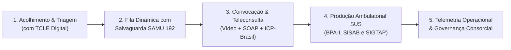
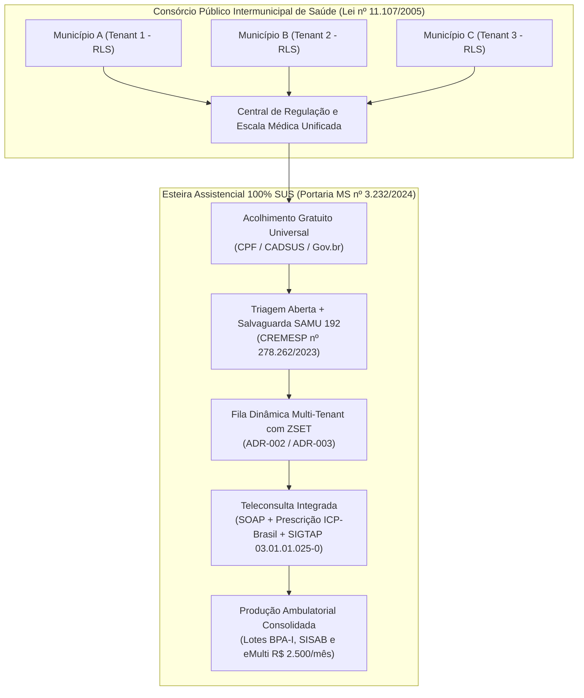

# Modelagem de Negócio e Visão de Produto (Business Vision)

## MediSync Express — Infraestrutura de Código Aberto para Pronto-Atendimento Virtual em Larga Escala (UPA Digital Nacional 24/7)

| Metadado | Detalhamento |
| :--- | :--- |
| **Referencial Metodológico** | Engenharia de Requisitos — Software Orientado ao Negócio (Vazquez & Simões) |
| **Marco Regulatório & Ético** | Resoluções CFM nº 2.314/2022 e 1.821/2007 \| LGPD (Lei nº 13.709/2018 - Art. 11) \| Portaria SVS/MS nº 344/98 |
| **Modelo de Licenciamento** | Código Aberto Permissivo (OSI - MIT ou Apache 2.0) |
| **Status do Documento** | Aprovado (Linha de Base Estratégica de Negócio) |

---

## 1. Contextualização e Justificativa de Negócio

O **MediSync Express** é uma plataforma de código aberto concebida para operar como **Infraestrutura Nacional de Pronto-Atendimento Virtual (UPA Digital 24/7)** para demandas de saúde de baixa e média complexidade clínica, sob regime de **demanda espontânea** (sem necessidade de agendamento prévio). O objetivo central é conectar cidadãos com queixas e sintomas agudos a grandes contingentes de médicos plantonistas (generalistas ou especialistas em Medicina de Família e Comunidade) em um ambiente digital seguro, resolutivo, altamente disponível e auditável.

A solução foi projetada para implantações públicas de grande escala e alta concorrência, atendendo a **redes públicas municipais, estaduais e Consórcios Públicos Intermunicipais de Saúde (Centrais de UPA Digital e Telessaúde do SUS)**.

### 1.1 A Esteira de Atendimento Integral

A experiência do paciente e do corpo clínico organiza-se em uma esteira contínua e fechada de entrega de valor assistencial e administrativo:

> **📌 FLUXO DE VALOR ASSISTENCIAL INTEGRAL**  
> Acolhimento & Triagem Estruturada (com TCLE Digital) ➔ Fila Dinâmica com Salvaguarda SAMU 192 ➔ Convocação e Teleconsulta Integrada (Vídeo WebRTC + Prontuário SOAP + Prescrição Digital ICP-Brasil + SIGTAP 03.01.01.025-0) ➔ Consolidação da Produção Ambulatorial SUS (BPA-I / SISAB) ➔ Telemetria Operacional, Governança Consorcial & Auditoria Médica.

---

## 2. Declaração do Problema (Canvas de Requisitos)

A modelagem do problema e dos direcionadores de negócio baseia-se na identificação estruturada de dores crônicas do ecossistema de urgência e emergência:

* **Problema Oportunizado**: Superlotação crônica em prontos-socorros físicos e UPAs, combinada com a inexistência de uma infraestrutura aberta, modular, auditável e juridicamente segura para operar pronto-atendimento virtual de grande escala em tempo real, mitigando o colapso por *burnout* de equipes médicas e garantindo faturamento sem erguer barreiras desumanizadas de entrada aos cidadãos.
* **Partes Afetadas**:
  * **Pacientes**: Enfrentam filas físicas degradantes de 4 a 8 horas em UPAs e prontos-socorros para queixas simples, sofrendo com a falta de transparência e o risco de contaminação cruzada.
  * **Médicos Plantonistas**: Sujeitos a sobrecarga extrema, ferramentas clínicas fragmentadas (vídeo em um aplicativo, prontuário em outro, receituário externo) e disputas de tela por pacientes (*overbooking*).
  * **Equipes de Regulação e Produção Ambulatorial**: Enfrentam dificuldades no fechamento de lotes de BPA-I e SISAB, dados cadastrais inconsistentes e ausência de consolidação automática da produção ambulatorial nos pontos de telessaúde (CNES 160/006).
  * **Gestores de Saúde e Diretores Clínicos**: Carecem de telemetria em tempo real sobre tempo de espera, evasão de fila e capacidade assistencial instalada para tomada de decisão ágil.
* **Impacto Observado**:
  * Sobrecarga das portas de emergência hospitalar por casos de atenção primária (fichas verdes e azuis que poderiam ser resolvidos virtualmente).
  * Desassistência em vazios sanitários e cidades desprovidas de especialistas presenciais.
  * Risco de morte por deterioração clínica silenciosa em filas de espera sem monitoramento ativo.
  * Custo proibitivo e dependência tecnológica de soluções proprietárias de telemedicina fechadas.
* **Critérios de Sucesso da Solução**:
  * Acolhimento ágil com consentimento formal explícito (TCLE) em menos de 45 segundos.
  * Triagem clínica inteligente com desvio mandatório e imediato de emergências críticas para socorro pré-hospitalar (SAMU 192).
  * Monitoramento contínuo de piora de sintomas enquanto o paciente aguarda na fila virtual.
  * Controle estocástico de admissão (*backpressure*) protegendo o corpo médico contra colapso de capacidade.
  * Alocação atômica em milissegundos com descarte determinístico de chamadas sem resposta (*no-show*).
  * Preservação incondicional da soberania do ato médico (sem corte forçado de atendimento por tempo).
  * Consolidação ambulatorial automática pós-consulta, integrando o prontuário a lotes oficiais SUS (BPA-I e SISAB) com codificação SIGTAP.
  * Aderência estrita às diretrizes universais de acessibilidade digital (WCAG 2.1 Nível AA).

---

## 3. Objetivos de Negócio e Metas SMART

Para orientar a validação do produto no mundo real e medir o impacto direto na saúde e na gestão assistencial em larga escala, definem-se os seguintes objetivos estratégicos fundamentados na metodologia SMART:

* **S (Específico)**: Disponibilizar uma plataforma de código aberto para Pronto-Atendimento Virtual 24/7 de alta concorrência capaz de absorver a demanda espontânea de atenção primária e urgências de baixa/média complexidade, desafogando a rede física de pronto-atendimento, eliminando barreiras burocráticas de entrada aos cidadãos e assegurando a sustentabilidade da gestão em saúde pública municipal e consorcial.
* **M (Mensurável — Indicadores de Desfecho Assistencial e Econômico)**:
  * **Taxa de Resolutividade Clínica no PA Virtual:** $\ge 80\%$ das queixas acolhidas resolvidas integralmente na teleconsulta, sem necessidade de encaminhamento presencial imediato para unidades físicas de urgência.
  * **Cumprimento de SLA Assistencial:** $\ge 95\%$ dos pacientes admitidos atendidos dentro da janela temporal estipulada para seu nível de triagem clínica (ACR).
  * **Desafogamento da Rede Física de Urgência:** Redução observada de $\ge 25\%$ no volume de atendimentos de baixa complexidade (fichas verdes e azuis) em prontos-socorros físicos da rede vinculada.
  * **Índice de Abandono da Fila Virtual:** $\le 3{,}0\%$ de desistências voluntárias decorrentes de tempo de espera.
  * **Eficiência da Produção Ambulatorial:** $100\%$ das consultas concluídas integradas com validação cadastral nos lotes oficiais do SUS (BPA-I / SISAB sob o procedimento SIGTAP `03.01.01.025-0`) vinculadas ao CNES 160/006 e faturamento pelo incentivo eMulti / SUS Digital.
  * **Satisfação e Acolhimento do Cidadão:** $\text{NPS} \ge 80$ e nota média de facilidade de uso $\ge 4{,}5 / 5{,}0$ nas avaliações pós-consulta.
* **A (Alcançável)**: Delimitação estrita a queixas agudas de atenção primária e baixa/média gravidade clínica (Níveis 2 a 5 da taxonomia aberta ACR), com protocolo mandatório de encaminhamento imediato ao socorro pré-hospitalar físico (SAMU 192 / Bombeiros) para emergências críticas com risco de vida (Nível 1).
* **R (Relevante)**: Conformidade integral com a Resolução CFM nº 2.314/2022 (telemedicina e soberania médica), Resolução CFM nº 1.821/2007 (prontuário e identificação civil com nome social), LGPD (Art. 11 para dados sensíveis de saúde), normas sanitárias de prescrição digital (Portaria SVS/MS nº 344/98 e RDC ANVISA nº 20/2011) e acessibilidade digital universal (WCAG 2.1 AA).
* **T (Tempestivo / Horizontes de Implantação e Maturidade)**:
  * *Fase 1 (Homologação Rápida):* Capacidade de inicialização e validação de uma unidade virtual piloto em menos de 10 minutos.
  * *Fase 2 (Operação Piloto - 30 a 60 dias):* Estabilização do atendimento assistencial com alcance das metas de SLA assistencial ($\ge 95\%$) e resolutividade clínica ($\ge 80\%$).
  * *Fase 3 (Maturidade Plena - 90 dias):* Fechamento contábil integrado, telemetria em tempo real e integração regular com a rede física de saúde.

---

## 4. Partes Interessadas, Personas e Matriz de Necessidades

### 4.1 Personas do Sistema

#### 1. Juliana Silva (Paciente / Responsável Familiar)
* **Perfil**: 34 anos, mãe de um menino de 4 anos e também usuária própria do PA Digital.
* **Contexto**: Acessa a plataforma pelo celular com conexão móvel (4G), em estado de ansiedade devido a sintomas febris agudos de seu filho ou de si própria.
* **Necessidades Críticas**:
  * Entrada rápida sem preenchimento burocrático excessivo na etapa inicial de triagem ($< 45\text{ s}$).
  * Clareza absoluta de posicionamento na fila e expectativa de tempo para chamada.
  * Termos de consentimento e privacidade transparentes e compreensíveis.
  * Canal imediato de socorro caso perceba piora súbita dos sintomas enquanto aguarda.
  * Possibilidade de ser atendida sem necessidade de instalar aplicativos pesados ou passar por barreiras financeiras agressivas logo no primeiro contato.

#### 2. Dr. Eduardo Rocha (Médico Plantonista)
* **Perfil**: 42 anos, Médico de Família e Comunidade, plantonista com carga horária de 12 horas.
* **Contexto**: Atende múltiplos pacientes em sequência, precisando manter foco clínico e raciocínio diagnóstico sem atritos operacionais de software.
* **Necessidades Críticas**:
  * Espaço de trabalho unificado: chamada de vídeo, acesso à pré-anamnese/triagem, registro de evolução no Prontuário Eletrônico do Paciente (PEP) e emissão de receitas na mesma tela.
  * Proteção absoluta contra sobreposição de atendimentos (*zero overbooking*).
  * Liberação imediata de sua tela caso o paciente chamado não atenda (*no-show*), sem travar seu plantão.
  * Respeito irrestrito ao seu tempo clínico: nenhuma intervenção de software pode desconectar uma consulta em andamento por atingir médias de tempo estimadas.

#### 3. Patrícia Mendes (Reguladora e Coordenadora de Produção Ambulatorial SUS)
* **Perfil**: 38 anos, sanitarista e coordenadora de regulação e produção ambulatorial do consórcio público intermunicipal de saúde.
* **Contexto**: Gerencia a regulação do acesso dos cidadãos dos municípios consorciados e consolida os lotes de produção ambulatorial (BPA-I e SISAB) para faturamento e repasse de incentivos federais (eMulti / SUS Digital).
* **Necessidades Críticas**:
  * Integração cadastral transparente com o CADSUS/Gov.br, garantindo a qualificação unívoca do cidadão e município de residência sem atritos na porta de entrada.
  * Monitoramento da taxa de ocupação da escala médica compartilhada entre os municípios do consórcio, otimizando despesas sob a LRF (teto de 54%).
  * Fechamento e consolidação automática dos atendimentos em lotes BPA-I e alimentação do SISAB com procedimento SIGTAP `03.01.01.025-0` e CNES 160/006.

#### 4. Carlos Drumond (Diretor Clínico e Gestor de Operações)
* **Perfil**: 45 anos, médico e gestor hospitalar responsável pelo dimensionamento de escala médica, infraestrutura e governança clínica da instituição.
* **Contexto**: Precisa garantir que a central de regulação e seus polos assistenciais não entrem em colapso por excesso de demanda nem deixem pacientes desassistidos sem previsão de atendimento.
* **Necessidades Críticas**:
  * Parametrização flexível de tetos de admissão, SLAs por gravidade e margem de segurança operacional ($\alpha$).
  * Governança integrada de múltiplos polos assistenciais ou centrais regionais de atendimento sob uma única diretoria médica.
  * Painel de telemetria em tempo real com alertas visuais de sobrecarga de fila e risco de violação de SLA.
  * Trilha imutável e auditável de todos os eventos assistenciais para fins médico-legais.

---

### 4.2 Matriz de Necessidades de Negócio

| ID | Necessidade Declarada | Persona Principal | Condição de Aceite no Negócio |
| :--- | :--- | :--- | :--- |
| **NEC-01** | Acolhimento ágil com consentimento formal | Juliana Silva | Preenchimento de queixa inicial e aceite de TCLE em $< 45\text{ s}$ com inserção imediata na esteira assistencial. |
| **NEC-02** | Atendimento no SLA com salvaguarda de piora | Juliana Silva | Chamada dentro da meta de gravidade clínica e botão destacado para reavaliação imediata em caso de piora dos sintomas. |
| **NEC-03** | Acessibilidade digital universal | Juliana Silva | Interface móvel em conformidade com critérios de contraste, legibilidade e suporte a tecnologias assistivas (WCAG 2.1 AA). |
| **NEC-04** | Painel médico sem travamento e sem *overbooking* | Dr. Eduardo | Exatamente uma consulta ativa por médico; resolução determinística e liberação de tela caso paciente não atenda (*no-show*). |
| **NEC-05** | Estação clínica unificada com assinatura digital | Dr. Eduardo | Videoconferência, histórico clínico, registro em prontuário e emissão com certificado digital ICP-Brasil em fluxo contínuo. |
| **NEC-06** | Consolidação ambulatorial e conformidade SUS | Patrícia Mendes | Consolidação automatizada da produção ambulatorial pós-consulta (BPA-I e SISAB) sob o procedimento SIGTAP `03.01.01.025-0` e incentivo eMulti. |
| **NEC-07** | Parametrização operacional e governança consorcial | Carlos Drumond | Ajuste dinâmico de capacidade, TMA, margem estocástica alfa e cotas de atendimento por município consorciado. |
| **NEC-08** | Telemetria contínua e trilha de auditoria legal | Carlos Drumond | Visualização em tempo real de ocupação, abandonos e histórico imutável com carimbo de tempo para auditoria judicial. |

---

## 5. Modelagem Federativa: Consórcios Intermunicipais e SUS Digital

Para viabilizar pronto-atendimento virtual 24/7 de alta resolutividade sem colapsar as finanças municipais, o MediSync Express adota o modelo federativo de **Consórcios Públicos de Saúde (Lei Federal nº 11.107/2005)** integrado às diretrizes do **Programa SUS Digital (Portaria GM/MS nº 3.232/2024)** e ao incentivo federal **eMulti (Portaria GM/MS nº 635/2023)**.

### 5.1 O Desafio Fiscal da LRF (54%) e a Solução dos Consórcios Públicos
O teto da Lei de Responsabilidade Fiscal (LRF - Lei Complementar nº 101/2000) limita a despesa de pessoal do Poder Executivo municipal a 54% da Receita Corrente Líquida. Em municípios de pequeno e médio porte, a manutenção de plantonistas médicos 24 horas por dia, 7 dias por semana, é financeiramente inviável de forma isolada.
A adesão ao Consórcio Público Intermunicipal de Saúde (Lei nº 11.107/2005) permite o rateio solidário da capacidade médica contratada:
* Uma única escala de plantão médico regional atende à demanda agregada de dezenas de municípios.
* O custo per capita é reduzido substancialmente, permanecendo rigorosamente dentro dos limites prudenciais da LRF.
* O rateio de despesas administrativas é complementado pelo incentivo federal eMulti de até R$ 2.500,00/mês por equipe multiprofissional em telessaúde.

### 5.2 Universalidade e Gratuidade no SUS Digital (Portaria MS nº 3.232/2024)
Em conformidade com o Art. 196 da Constituição Federal e com a Portaria GM/MS nº 3.232/2024, a plataforma garante:
* **Gratuidade Universal na Entrada**: Vedada qualquer cobrança de taxa, copagamento ou barreira financeira ao cidadão.
* **Zero Paywall / Zero Glosas**: Não há validação de operadoras de planos de saúde, cancelando integralmente a complexidade burocrática de arquivos XML TISS/TUSS e o risco de glosas financeiras.
* **Classificação de Ponto de Telessaúde (CNES 160/006)**: Cada polo assistencial é devidamente registrado no Cadastro Nacional de Estabelecimentos de Saúde sob a tipologia regulamentada de Telessaúde.
* **Procedimento SIGTAP Canônico**: Atendimentos registram o procedimento unificado `03.01.01.025-0` (Consulta de Profissional de Nível Superior na Atenção Primária / Teleconsulta na Atenção Básica) para integração direta com o BPA-I e alimentação da base nacional do SISAB.

### 5.3 Segregação Municipal Federativa via Row-Level Security (PostgreSQL RLS)
Mesmo compartilhando a mesma infraestrutura computacional e escala médica no consórcio, o sistema garante:
* **Isolamento de Dados Estrito (ADR-003)**: Cada município consorciado opera sob uma chave discriminadora `organizacao_id` com políticas ativas de Row-Level Security (RLS) no PostgreSQL 17.
* **Privacidade e LGPD (Art. 11)**: Gestores e reguladores do Município A visualizam exclusivamente a fila e os prontuários de seus munícipes, eliminando qualquer risco de vazamento cruzado.
* **Governança Consorcial Regional**: O Diretor Clínico e o Regulador Geral do consórcio mantêm visão analítica consolidada para dimensionamento dinâmico de capacidade e distribuição equitativa de plantões.
