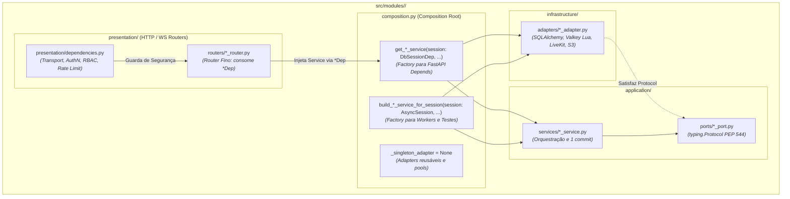

# Composition Root e Injeção de Dependências

Guia aprofundado sobre o padrão **Composition Root**, a organização das dependências no Hexagonal Pragmático do MediSync, e a separação estrita de responsabilidades entre `composition.py` e `presentation/dependencies.py`.

---

## 1. O Padrão Composition Root no Hexagonal Pragmático

No design de software com Inversão de Controle (IoC) e Injeção de Dependências (DI), o **Composition Root** (conceito formalizado por Mark Seemann) é o local unificado e centralizado onde os grafos de objetos da aplicação são montados. É o único ponto onde adaptadores concretos de infraestrutura são instanciados e conectados às portas abstratas (`typing.Protocol`) dos serviços de aplicação.

No **Hexagonal Pragmático** do MediSync Express:
- Em vez de um único Composition Root monolítico na inicialização global da aplicação (que geraria acoplamento cruzado entre contextos delimitados), **cada módulo vertical possui seu próprio Composition Root** em `src/modules/<modulo>/composition.py`.
- Cada `composition.py` atua como a fronteira de fiação técnica do módulo: orquestra a injeção dos adaptadores de `infrastructure/` nas interfaces de `application/ports/`, gerencia o ciclo de vida dos componentes e expõe dependências limpas para a camada de apresentação (`presentation/`) ou para consumidores inter-módulo.



---

## 2. Por que `composition.py` Fica na Raiz de Cada Módulo?

A localização de `composition.py` na raiz de cada pacote modular (`src/modules/<modulo>/composition.py`) é uma decisão arquitetural fundamental respaldada pela governança estática de fronteiras no `tach.toml` (Stage B, ADR-001 §7).

### 2.1 O Grafo de Dependências do Stage B no Tach

As regras estritas do `tach.toml` impõem a seguinte hierarquia de permissões:

| Camada | Pode Importar | Nunca Pode Importar |
| :--- | :--- | :--- |
| `domain` | `src.core` | `application`, `infrastructure`, `composition`, `presentation` |
| `application` | `src.core`, `domain` | `infrastructure`, `composition`, `presentation` |
| `infrastructure` | `src.core`, `application`, `domain` | `composition`, `presentation` |
| **`composition`** | `src.core`, `application`, `domain`, `infrastructure` | `presentation` |
| `presentation` | `src.core`, `application`, `composition` | **`infrastructure`**, **`domain.models`**, **`sqlalchemy`** |

Se a montagem de dependências ficasse dentro de `presentation/`:
- `presentation` precisaria importar classes concretas de `infrastructure` (ex.: repositórios SQL, adaptadores de terceiros, drivers de cache), violando o isolamento do hexágono.
- O linter arquitetural `tests/architecture/test_routers_are_thin.py` e o comando `just tach` bloqueariam o build.

Colocar `composition.py` na raiz do módulo permite:
1. **Isolamento de Infraestrutura**: É o **único arquivo** do módulo autorizado a importar adaptadores de `infrastructure/` e modelos de banco para fins de DI.
2. **Ciclo de Vida Controlado**: Gerencia singletons imutáveis (ex.: managers de scripts Lua, clientes HTTP de notificação) e instâncias com escopo de sessão/requisição.
3. **Reutilização Multicontexto**: Permite que serviços sejam construídos tanto para a web API (FastAPI) quanto para consumidores desacoplados do HTTP (workers assíncronos e suítes de teste).

---

## 3. Matriz de Responsabilidades: `composition.py` vs `presentation/dependencies.py`

Embora ambos os arquivos utilizem primitivas do FastAPI (`Depends`, `Annotated`), eles atendem a camadas arquiteturais completamente distintas.

### 3.1 Tabela Comparativa

| Critério | `composition.py` (Composition Root) | `presentation/dependencies.py` (Presentation Guards) |
| :--- | :--- | :--- |
| **Camada Arquitetural** | Raiz do Módulo (IoC / Wire de Componentes) | Apresentação (`presentation/`) |
| **Foco Primário** | Montagem e injeção de serviços de domínio e adaptadores de infraestrutura | Segurança de transporte, autorização contextual, rate limiting e parsing de entrada |
| **Imports de Infraestrutura** | **Sim** (autorizado a importar adaptadores concretos de `infrastructure/`) | **Não** (proibido importar `infrastructure/`, importa ports ou readers via `composition.py`) |
| **Tratamento de Exceções** | Nunca levanta `HTTPException`. Erros são de domínio (`src/core/errors.py`) ou infraestrutura | **Único local** autorizado a levantar `HTTPException(429)` (Rate Limit) ou `401/403` HTTP |
| **Conhecimento de Protocolo** | Agnóstico a HTTP/WebSockets. Não conhece headers, cookies nem status codes | Totalmente acoplado a HTTP/WebSockets (lê `Authorization`, headers de tenant, cookies) |
| **AuthN & AuthZ** | Nenhuma lógica de autenticação ou autorização | Extração de tokens Bearer/HMAC, checagem RBAC (`Role.MEDICO`), ABAC/ReBAC e Anti-IDOR |
| **Consumidores** | Routers HTTP, WebSockets, Workers ARQ (`src/worker`) e Testes automatizados | Exclusivamente Routers HTTP e Endpoints WebSocket |

### 3.2 Exemplo em Código: O Fluxo de uma Requisição

Observe como o router fino (`consultation_router.py`) combina as duas fontes de dependências:

```python
# src/modules/consultation/presentation/routers/consultation_router.py

@router.post("/consultations/{atendimento_id}/evolucoes")
async def registrar_evolucao(
    atendimento_id: AtendimentoIdPath,       # Guard de apresentação (Path param validado)
    body: EvolucaoCreateRequest,             # Schema Pydantic de entrada
    service: PEPServiceDep,                  # DI via composition.py (Serviço montado)
    current_user: ClinicalAccessMutationDep, # Guard via presentation/dependencies.py (AuthN/ABAC)
) -> EvolucaoResponse:
    # Router não instancia services, não checa permissões manuais, não commita
    evolucao = await service.registrar_evolucao(
        atendimento_id=atendimento_id,
        medico_id=current_user.usuario_id,
        comando=body,
    )
    return EvolucaoResponse.model_validate(evolucao)
```

1. **`ClinicalAccessMutationDep`** (`presentation/dependencies.py`):
   - Valida se o usuário tem o papel `MEDICO` (RBAC).
   - Valida se o paciente assinou o TCLE digital.
   - Valida se o médico autenticado é o médico responsável alocado para aquele atendimento (Anti-IDOR / ReBAC).
   - Valida se o atendimento está em estado ativo que permite evolução clínica.
2. **`PEPServiceDep`** (`composition.py`):
   - Injeta a instância de `PEPService` com banco de dados, gerador de PDF, assinador digital e adaptadores de diretório devidamente amarrados.
   - O router apenas delega a execução do caso de uso.

---

## 4. Módulos Internos sem Presentation: O Caso de `triage`

Nem todo módulo do MediSync expõe rotas HTTP diretamente. O módulo de triagem (`src/modules/triage`), por exemplo, opera como um motor clínico interno consumido pela admissão em fila (`src/modules/queue`).

Ainda assim, `src/modules/triage` **possui seu próprio `composition.py`**.

### 4.1 Por que `triage/composition.py` é Indispensável?

O módulo `triage` possui:
- Regras e modelos clínicos de classificação (`Triagem`, protocolos de Manchester/ACR).
- Uma porta de saída: `EmergencyNotifierPort` (para desvio emergencial em casos críticos de SAMU 192).
- Um adaptador concreto de infraestrutura: `SamuEmergencyNotifierAdapter` em `src/modules/triage/infrastructure/adapters/`.

Se `triage` não tivesse um Composition Root:
- O módulo `queue` precisaria importar diretamente `SamuEmergencyNotifierAdapter` de `src/modules/triage/infrastructure/adapters/samu_emergency_notifier_adapter.py`.
- Isso criaria acoplamento direto entre `queue` e a infraestrutura de `triage`, violando o princípio de isolamento hexagonal e quebrando as regras do `tach.toml`.

Com `src/modules/triage/composition.py`:

```python
# src/modules/triage/composition.py

_emergency_notifier: EmergencyNotifierPort | None = None

def get_emergency_notifier() -> EmergencyNotifierPort:
    global _emergency_notifier
    if _emergency_notifier is None:
        _emergency_notifier = SamuEmergencyNotifierAdapter()
    return _emergency_notifier

EmergencyNotifierDep = Annotated[EmergencyNotifierPort, Depends(get_emergency_notifier)]

def build_triage_service_for_session(
    session: AsyncSession,
    notifier: EmergencyNotifierPort | None = None,
) -> TriageService:
    resolved_notifier = notifier or get_emergency_notifier()
    return TriageService(session=session, emergency_notifier=resolved_notifier)

def get_triage_service(
    session: DbSessionDep,
    notifier: EmergencyNotifierDep,
) -> TriageService:
    return TriageService(session=session, emergency_notifier=notifier)

TriageServiceDep = Annotated[TriageService, Depends(get_triage_service)]
```

Dessa forma:
1. `triage` gerencia sua própria infraestrutura e mantém o adaptador SAMU 192 privado.
2. `src/modules/queue/composition.py` importa apenas `TriageServiceDep` e `build_triage_service_for_session` de `triage/composition.py`.
3. O `TriageService` satisfaz a porta `TriagePort` declarada em `queue` através de subtipagem estrutural (PEP 544), preservando desacoplamento absoluto.

---

## 5. Consumidores fora do Ciclo HTTP: Workers ARQ e Testes

Componentes em segundo plano — como workers do ARQ (`src/worker/tasks/`) — e rotinas de teste não executam dentro de uma requisição HTTP do FastAPI. Consequentemente, o sistema de DI via `Depends()` não está ativo nesses contextos.

Para atender a esses cenários sem duplicar a montagem de infraestrutura, cada `composition.py` expõe fábricas síncronas com o prefixo `build_*_service_for_session`.

### 5.1 Uso em Workers Assíncronos (`src/worker/`)

No worker do ARQ que monitora o timeout de chamada do médico (45s ring timeout):

```python
# src/worker/tasks/ring_timeout.py

@monitored_task
async def resolver_ring_timeout_task(
    ctx: dict[str, Any],
    organizacao_id: int,
    atendimento_id: str,
    medico_id: str,
    notifier: PacienteAusenteNotifierPort | None = None,
) -> dict[str, Any]:
    valkey = get_valkey_from_ctx(ctx)
    atend_uuid = UUID(atendimento_id)
    med_uuid = UUID(medico_id)

    with tenant_context(organizacao_id):
        async with get_db_session_from_ctx(ctx) as session:
            # Constrói o serviço com adaptadores reais fora do FastAPI
            fila_service = build_fila_service_for_session(
                valkey=valkey, session=session
            )
            action = await fila_service.resolver_ring_timeout(
                organizacao_id=organizacao_id,
                atendimento_id=atend_uuid,
                medico_id=med_uuid,
                notifier=notifier,
            )
            return {"status": "resolved", "action": action}
```

O worker:
- Abre uma sessão transacional isolada com o PostgreSQL (`get_db_session_from_ctx(ctx)`).
- Obtém o pool de conexões com o Valkey (`get_valkey_from_ctx(ctx)`).
- Invoca `build_fila_service_for_session(valkey=valkey, session=session)`, recebendo um `FilaService` completamente operacional com adaptadores Lua, triagem e controle de admissão conectados.

### 5.2 Uso em Testes de Integração e Helpers

Em testes de integração que necessitam exercitar casos de uso completos contra bancos reais em contêineres:

```python
# tests/helpers.py ou tests/integration/test_admissao_integrada_flow.py

async with async_session_factory() as session:
    fila_service = build_fila_service_for_session(
        session=session,
        valkey=valkey_client,
    )
    resultado = await fila_service.admitir_paciente(comando)
```

Nenhum mock ou contêiner de teste precisa reimplementar o grafo de injeção manual.

---

## 6. Convenção de Tipagem e Testabilidade

### 6.1 A Convenção `*Dep = Annotated[T, Depends(get_t)]`

No MediSync, é obrigatório definir type aliases anotados para todas as dependências injetáveis:

```python
# Definição na composition.py:
def get_fila_service(
    valkey: ValkeyDep,
    session: DbSessionDep,
    triage_service: TriageServiceDep,
    arq_pool: ArqPoolDep,
) -> FilaService: ...

FilaServiceDep = Annotated[FilaService, Depends(get_fila_service)]
```

Vantagens:
1. **Tipagem Estrita com `basedpyright`**: A anotação `Annotated[T, Depends(...)]` informa ao checador estático de tipos que a variável dentro da função é do tipo `T`, enquanto o FastAPI reconhece o metadado `Depends`.
2. **Assinaturas de Roteadores Limpas**: O router declara `service: FilaServiceDep` em vez de repetir `service: FilaService = Depends(get_fila_service)`.
3. **Facilidade de Refatoração**: Alterações no provider de dependência afetam apenas `composition.py`, sem tocar nos dezenas de endpoints que o utilizam.

### 6.2 Sobrescrita em Testes via `app.dependency_overrides`

Como o FastAPI mapeia as dependências pela **função fábrica declarada no `Depends()`** (`get_fila_service`), a suíte de testes unitários pode substituir implementações de serviços inteiros por dublês de teste instantaneamente:

```python
# tests/unit/test_fila_router.py

@pytest.mark.asyncio
async def test_obter_posicao_sucesso() -> None:
    app = create_app()

    # Cria mock com spec exata do serviço
    mock_service = MagicMock(spec=FilaService)
    mock_service.obter_posicao_e_estimativa = AsyncMock(
        return_value=PosicaoFilaResult(...)
    )

    # Sobrescreve a factory da composition.py no app FastAPI:
    app.dependency_overrides[get_fila_service] = lambda: mock_service

    async with AsyncClient(transport=ASGITransport(app=app), base_url="http://test") as client:
        response = await client.get("/api/v1/fila/posicao/...", headers=...)
        assert response.status_code == 200
```

Quando o FastAPI resolve `service: FilaServiceDep`, ele invoca o lambda do `dependency_overrides` em vez de executar `get_fila_service`. Isso permite:
- Testar roteadores finos de ponta a ponta sem tocar em banco de dados ou Valkey.
- Garantir tempo de execução dos testes unitários inferior a 1 segundo para a suíte inteira.

---

## 7. Módulos com Composition Root no MediSync

Todos os módulos de negócio possuem seu respectivo Composition Root:

| Módulo | Arquivo de Composição | Serviços e Dependências Principais Expostas |
| :--- | :--- | :--- |
| **`auth`** | `src/modules/auth/composition.py` | `AuthServiceDep`, `TokenRevocationDep`, `RateLimiterDep` |
| **`consultation`** | `src/modules/consultation/composition.py` | `PEPServiceDep`, `TeleconsultaServiceDep`, `DocumentValidationServiceDep`, `SignedCacheDep` |
| **`identity`** | `src/modules/identity/composition.py` | `OnboardingServiceDep`, `DependenteServiceDep`, `IdentityReaderDep` |
| **`queue`** | `src/modules/queue/composition.py` | `FilaServiceDep`, `AlocacaoServiceDep`, `QueueStoreDep`, `ControleAdmissaoDep` |
| **`telemetry`** | `src/modules/telemetry/composition.py` | `TelemetryServiceDep`, `ConfigPlantaoServiceDep` |
| **`triage`** | `src/modules/triage/composition.py` | `TriageServiceDep`, `EmergencyNotifierDep`, `build_triage_service_for_session` |

---

## 8. Verificação e Guardas Automatizados

Para assegurar que nenhum desvio arquitetural comprometa o Composition Root:

```bash
# 1. Valida conformidade das fronteiras de importação do Stage B
just tach

# 2. Executa a varredura AST garantindo que nenhum router instancie services ou importe infrastructure
uv run pytest tests/architecture/test_routers_are_thin.py --no-cov -q

# 3. Valida a tipagem estrita de todas as anotações *Dep
just typecheck
```

---

## 9. Referências Cruzadas

- [Macro-Arquitetura do Sistema (Overview)](../architecture/overview.md)
- [Hexagonal Pragmático](hexagonal-pragmatico.md)
- [Protocolos e Comunicação Inter-Módulos](inter-module-protocols.md)
- [Como Criar um Endpoint de Módulo](../../how-to/backend/create-module-endpoint.md)
- [ADR-001: Hexagonal Pragmático com Modelos Ricos, Protocols e Tach](../../adrs/ADR-001-Hexagonal-Pragmatico-Modelos-Ricos-Protocols-e-Tach.md)
