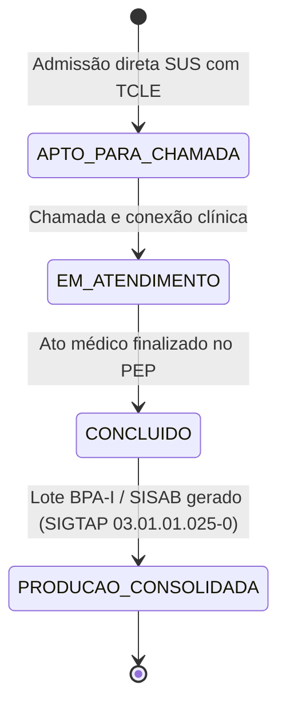

# Ambulatory Domain

> Produção ambulatorial 100% SUS (BPA-I e SISAB), qualificação cadastral CADSUS, ponto de telessaúde CNES 160/006 e faturamento unificado pelo procedimento SIGTAP 03.01.01.025-0.

## 1. Contexto

O domínio Ambulatory (em transição a partir do legado `billing` sob a [ADR-012](../../adrs/ADR-012-Transicao-100-SUS-Consorcios-Intermunicipais-e-Autenticacao-Tripartida.md)) consolida e qualifica a produção ambulatorial do pronto-atendimento virtual para o Sistema Único de Saúde (SUS). O atendimento nasce diretamente como `APTO_PARA_CHAMADA` na fila virtual pelo Art. 196 da CF/88. O domínio ambulatorial atua na qualificação cadastral demográfica (CADSUS / CNS) e, primordialmente, no fechamento pós-consulta com exportação oficial.

Vocabulário ubíquo: `produção ambulatorial` (faturamento público SUS), `BPA-I` (Boletim de Produção Ambulatorial Individualizado), `SISAB` (Sistema de Informação em Saúde para a Atenção Básica), `CNES 160/006` (Ponto de Telessaúde), `SIGTAP 03.01.01.025-0` (Consulta / Teleconsulta na Atenção Básica), `eMulti` (incentivo federal de R$ 2.500/mês por equipe), `qualificação cadastral` (validação de CPF/CADSUS).

Entrada via dados cadastrais do acolhimento e fechamento clínico da consulta (RF-08), gerando o evento `PRODUCAO_AMBULATORIAL_CONSOLIDADA` para exportação aos sistemas do Ministério da Saúde.

Escopo termina na conformidade e consolidação da produção pública. A fila decide a ordem de chamada, a triagem decide a prioridade clínica, a consulta executa o ato médico no PEP; o domínio ambulatorial consolida os lotes oficiais e assegura o cumprimento da [Portaria MS nº 3.232/2024](../../explanation/business-vision.md).

## 2. Regras

- **RN03 — Qualificação cadastral e gratuidade universal.** No SUS, o atendimento não depende de validação financeira; o acesso é imediato e a qualificação de CPF/CNS enriquece o prontuário sem bloquear a fila. [Fonte](../product-specification.md) (RN03)
- **RN03 (SUS) — Gratuidade universal sem paywall.** Em conformidade com o Art. 196 da CF/88 e a Portaria MS nº 3.232/2024, é expressamente vedada qualquer cobrança ou validação de planos privados; o adaptador SUS opera como aprovação universal garantida (`SUS-ISENTO`). [Fonte](../product-specification.md) (RN03, RN-NEG-01)
- **RN-NEG-01 — Universalidade e ponto de telessaúde regulamentado.** Toda teleconsulta concluída vincula-se ao CNES 160/006 e registra o procedimento SIGTAP `03.01.01.025-0` (Nota Técnica nº 11/2024-MS). [Fonte](../product-specification.md) (RN-NEG-01)
- **Consolidação em lote BPA-I e SISAB.** Ao término da consulta com evolução e documentos assinados, o atendimento é fechado e incluído no lote do consórcio intermunicipal (Lei nº 11.107/2005) para prestação de contas aos municípios parceiros e repasses do incentivo eMulti. [Fonte](../product-specification.md) (RF-08)

Guardiões: O serviço ambulatorial valida a presença de CPF ou CNS válido, data de nascimento e identificador do município consorciado. A ausência de dados impede o fechamento do lote BPA-I sem bloquear o atendimento clínico de urgência.

## 3. Máquina de estados

A admissão clínica nasce diretamente em `APTO_PARA_CHAMADA`, e a qualificação cadastral assíncrona opera em paralelo enquanto o pós-consulta consolida o registro ambulatorial definitivo.



No fluxo 100% SUS sob a ADR-012, o resultado da avaliação cadastral produz `APROVADO` com código de autorização `SUS-ISENTO` em `src/modules/ambulatory/infrastructure/adapters/sus_adapter.py`.

A admissão direta em `src/modules/queue/application/services/fila_service.py` insere o paciente diretamente no ZSET do Valkey sem depender de worker externo.

Ao finalizar a consulta, a rotina de consolidação ambulatorial gera o lote de exportação BPA-I com código SIGTAP `03.01.01.025-0` vinculado ao CNES da unidade de telessaúde.

## 4. Relações

- Expõe aptidão via porta tipada. `EligibilityProviderPort.verificar_elegibilidade` devolve `ResultadoElegibilidade` com `SUS-ISENTO`; o módulo `queue` consome a porta sem acoplamento à infraestrutura concreta.
- Pureza de portas e desacoplamento de telemetria. A camada de aplicação define contratos abstratos (`typing.Protocol`) em `src/modules/ambulatory/application/ports/eligibility_notifier.py` (`ElegibilidadeNotifierPort`) e DTO imutável (`ElegibilidadeFalhaEvent`). O adaptador concreto de notificação e telemetria estruturada reside estritamente em `src/modules/ambulatory/infrastructure/adapters/logging_eligibility_notifier.py` (`LoggingElegibilidadeNotifier`), preservando a pureza hexagonal contra o acoplamento de bibliotecas de infraestrutura dentro de portas de aplicação.
- Sem paywall ou travas financeiras. A validação não realiza chamadas a operadoras privadas nem expõe o paciente a cancelamento por recusa de crédito.
- Multi-tenancy federativo por Consórcio. Os lotes ambulatoriais são agregados e particionados por `organizacao_id` (município consorciado sob RLS PostgreSQL), garantindo que cada prefeitura receba o espelho exato de sua produção. [Modelo](../architecture/data-model.md)
- Fábrica canônica de serviço ambulatorial (ADR-001 / ADR-012). O arquivo `src/modules/ambulatory/composition.py` exporta `build_producao_ambulatorial_service(session, audit_trail)` e `get_producao_ambulatorial_service(session)` para viabilizar a injeção desacoplada de `ProducaoAmbulatorialService` em workers assíncronos e na composition root de `consultation`, eliminando qualquer instanciação cruzada direta da camada `application/services/producao_service.py`.
- Worker assíncrono executa fora do request. `src/worker/tasks/eligibility.py` promove o atendimento e orquestra a transição atômica no Valkey (`fila:{org}:aptos`).
- Evento de auditoria imutável. A consolidação da produção gera `PRODUCAO_AMBULATORIAL_CONSOLIDADA` registrado em `audit_events`. [Catálogo de Eventos](../../reference/audit/event-catalog.md)

## 5. Peculiaridades

- Poda completa de planos privados (ADR-012). Elimina esquemas XML de TISS/TUSS, gateways de pagamento com cartão e risco de glosas administrativas.
- SUS é isenção e direito universal. O código `SUS-ISENTO` documenta a gratuidade constitucional do Art. 196 da CF/88.
- Pureza estrita das portas de aplicação (ADR-001). A porta `ElegibilidadeNotifierPort` é um `Protocol` puro desacoplado de qualquer biblioteca de logging ou saída de infraestrutura; o adaptador padrão de telemetria estruturada (`LoggingElegibilidadeNotifier`) foi extraído para a infraestrutura concreta (`src/modules/ambulatory/infrastructure/adapters/logging_eligibility_notifier.py`) e injetado pelo composition root (`composition.py`).
- Rateio em Consórcios Públicos (Lei nº 11.107/2005). Viabiliza escala médica compartilhada para pequenos municípios contornarem o teto fiscal de 54% de despesa com pessoal da LRF.
- Incentivo Financeiro eMulti. Cada equipe multiprofissional homologada vinculada ao CNES de telessaúde qualifica o consórcio para o repasse federal de até R$ 2.500,00 mensais (Portaria GM/MS nº 635/2023).
- DTOs imutáveis ponta a ponta. Todas as estruturas de dados de entrada e resultado de produção ambulatorial são declaradas com imutabilidade estrita.

## 6. Onde no código

- `src/modules/ambulatory/domain/enums.py`
- `src/modules/ambulatory/application/dtos.py`
- `src/modules/ambulatory/application/ports/eligibility_provider.py`
- `src/modules/ambulatory/application/ports/eligibility_notifier.py`
- `src/modules/ambulatory/application/services/eligibility_service.py`
- `src/modules/ambulatory/infrastructure/adapters/sus_adapter.py`
- `src/modules/ambulatory/infrastructure/adapters/logging_eligibility_notifier.py`
- `src/worker/tasks/eligibility.py`
- `src/modules/ambulatory/composition.py`
- `tests/unit/test_ambulatory_production.py`
- `tests/unit/test_eligibility_task.py`
- Transição estrutural para `src/modules/ambulatory/...` formalizada na [ADR-012](../../adrs/ADR-012-Transicao-100-SUS-Consorcios-Intermunicipais-e-Autenticacao-Tripartida.md).

Prova viva:

```bash
ls tests/unit | rg -i "ambulatory|eligibility"
# test_ambulatory_production.py
# test_eligibility_task.py
```

## 7. Verificação

```bash
rg -n "APROVADO|SUS-ISENTO" src/modules/ambulatory/
# sus_adapter.py:24 codigo_autorizacao = "SUS-ISENTO"

uv run pytest tests/unit/test_ambulatory_production.py -q --no-cov

# 8 passed

uv run pytest tests/unit/test_eligibility_task.py -q --no-cov
# 4 passed
```

A integridade das regras ambulatoriais é assegurada pela garantia de gratuidade universal e geração determinística de lotes SUS.

## 8. Ver também

- [ADR-012: Transição 100% SUS e Consórcios Intermunicipais](../../adrs/ADR-012-Transicao-100-SUS-Consorcios-Intermunicipais-e-Autenticacao-Tripartida.md)
- [Product Specification](../product-specification.md) — RN03, RN-NEG-01, RF-02, RF-08
- [Business Vision](../business-vision.md) — Consórcios Intermunicipais (Lei nº 11.107/2005) e SUS Digital
- [Data Model](../architecture/data-model.md) — multi-tenancy RLS por município consorciado
- [Catálogo de Eventos](../../reference/audit/event-catalog.md) — evento `PRODUCAO_AMBULATORIAL_CONSOLIDADA`
- [Domains Index](./index.md) — visão conceitual por domínio
