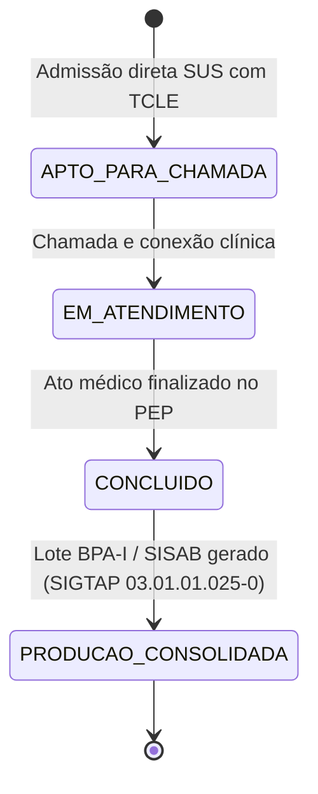

# Ambulatory Domain

> Produção ambulatorial 100% SUS (BPA-I e SISAB), qualificação cadastral CADSUS, ponto de telessaúde CNES 160/006 e faturamento unificado pelo procedimento SIGTAP 03.01.01.025-0.

## 1. Contexto

O domínio Ambulatory (em transição a partir do legado `billing` sob a [ADR-012](../../adrs/ADR-012-Transicao-100-SUS-Consorcios-Intermunicipais-e-Autenticacao-Tripartida.md)) consolida e qualifica a produção ambulatorial do pronto-atendimento virtual para o Sistema Único de Saúde (SUS). O atendimento nasce diretamente como `APTO_PARA_CHAMADA` na fila virtual pelo Art. 196 da CF/88. O domínio ambulatorial atua na qualificação cadastral demográfica (CADSUS / CNS) e, primordialmente, no fechamento pós-consulta com exportação oficial.

Vocabulário ubíquo: `produção ambulatorial` (faturamento público SUS), `BPA-I` (Boletim de Produção Ambulatorial Individualizado), `SISAB` (Sistema de Informação em Saúde para a Atenção Básica), `CNES 160/006` (Ponto de Telessaúde), `SIGTAP 03.01.01.025-0` (Consulta / Teleconsulta na Atenção Básica), `eMulti` (incentivo federal de R$ 2.500/mês por equipe), `qualificação cadastral` (validação de CPF/CADSUS).

Entrada via dados cadastrais do acolhimento e fechamento clínico da consulta (RF-08), gerando o evento `PRODUCAO_AMBULATORIAL_CONSOLIDADA` para exportação aos sistemas do Ministério da Saúde.

Escopo termina na conformidade e consolidação da produção pública. A fila decide a ordem de chamada, a triagem decide a prioridade clínica, a consulta executa o ato médico no PEP; o domínio ambulatorial consolida os lotes oficiais e assegura o cumprimento da [Portaria MS nº 3.232/2024](../../explanation/business-vision.md).

## 2. Regras

- **RN03 — Qualificação cadastral e gratuidade universal.** No SUS, o atendimento não depende de validação financeira; o acesso é imediato e a qualificação de CPF/CNS enriquece o prontuário sem bloquear a fila. [Fonte](../product-specification.md) (RN03)
- **RN03 (SUS) — Gratuidade universal sem paywall.** Em conformidade com o Art. 196 da CF/88 e a Portaria MS nº 3.232/2024, é expressamente vedada qualquer cobrança ou validação de planos privados; o adaptador SUS opera como aprovação universal garantida (`SUS-ISENTO`). [Fonte](../product-specification.md) (RN03, RN-NEG-01)
- **RN-NEG-01 — Universalidade e ponto de telessaúde regulamentado.** Toda teleconsulta concluída vincula-se ao CNES 160/006 e registra o procedimento SIGTAP `03.01.01.025-0` (Nota Técnica nº 11/2024-MS). [Fonte](../product-specification.md) (RN-NEG-01)
- **Consolidação em lote BPA-I e SISAB.** Ao término da consulta com evolução e documentos assinados, o atendimento é fechado e incluído no lote ambulatorial da unidade SUS (metadados CNES/CNPJ/IBGE lidos da tabela singleton `configuracoes_unidade` via `SqlBpaDirectory`) para prestação de contas e incentivo eMulti. [Fonte](../product-specification.md) (RF-08)

Guardiões: `ProducaoAmbulatorial` valida `CNES` numérico de 1 a 7 dígitos e competência `YYYYMM` (lançando `ValidationError`), enquanto `BpaPositionalFormatter.compilar_remessa` centraliza validação de pendências reais sem falsos positivos (`"20000101"` válido, `idade == 0` preservada como `"000"`), paginação (`20/folha`), checksum e `SqlBpaDirectory` retorna `None` honesto sem mascarar CPF como CNS nem fixar CBO `'225125'` para Psicologia (`251510`) ou Nutrição (`223710`).

## 3. Máquina de estados

A admissão clínica nasce diretamente em `APTO_PARA_CHAMADA`, e a qualificação cadastral assíncrona opera em paralelo enquanto o pós-consulta consolida o registro ambulatorial definitivo.



No fluxo 100% SUS sob a ADR-012, o resultado da avaliação cadastral produz `APROVADO` com código de autorização `SUS-ISENTO` em `src/modules/ambulatory/infrastructure/adapters/sus_adapter.py`.

A admissão direta em `src/modules/queue/application/services/fila_service.py` insere o paciente diretamente no ZSET do Valkey sem depender de worker externo.

Ao finalizar a consulta, a rotina de consolidação ambulatorial gera o lote de exportação BPA-I com código SIGTAP `03.01.01.025-0` vinculado ao CNES da unidade de telessaúde.

## 4. Relações

- Expõe qualificação cadastral via porta tipada. `EligibilityProviderPort.verificar_elegibilidade` devolve `ResultadoElegibilidade` com `SUS-ISENTO` dentro do serviço de elegibilidade de `ambulatory`, enquanto `ProducaoAmbulatorialService` consolida lotes BPA-I/SISAB após o fechamento da consulta em `consultation`.
- Pureza de portas e desacoplamento de telemetria. A camada de aplicação define contratos abstratos (`typing.Protocol`) em `src/modules/ambulatory/application/ports/eligibility_notifier.py` (`ElegibilidadeNotifierPort`) e DTO imutável (`ElegibilidadeFalhaEvent`). O adaptador concreto de notificação e telemetria estruturada reside estritamente em `src/modules/ambulatory/infrastructure/adapters/logging_eligibility_notifier.py` (`LoggingElegibilidadeNotifier`), preservando a pureza hexagonal contra o acoplamento de bibliotecas de infraestrutura dentro de portas de aplicação.
- Sem paywall ou travas financeiras. A validação não realiza chamadas a operadoras privadas nem expõe o paciente a cancelamento por recusa de crédito.
- Unidade SUS Única (`configuracoes_unidade`). Os lotes ambulatoriais consolida-se na tabela `producoes_ambulatoriais` vinculando CNES/CNPJ/IBGE diretamente da configuração singleton da unidade. [Modelo](../architecture/data-model.md)
- **Fábrica canônica e contrato transacional (ADR-001 / ADR-008 / ADR-012 / ADR-013).** `src/modules/ambulatory/composition.py` exporta `build_producao_ambulatorial_service` e `get_producao_ambulatorial_service`. `ProducaoAmbulatorialService.consolidar_teleconsulta(..., auto_commit=True)` retorna diretamente `ProducaoAmbulatorial` (zero DTOs espelho), trata colisão `23505` de forma idempotente via savepoint/rollback + releitura, suporta modo `auto_commit=False` para transação compartilhada com `PEPService`, e `gerar_arquivo_bpa_i` opera 100% em modo read-only (zero auditorias ou escritas em `GET`).
- Admissão síncrona direta sem worker de elegibilidade. Sob a ADR-012, `FilaService.admitir_paciente` insere atendimentos SUS diretamente em `APTO_PARA_CHAMADA` no PostgreSQL e no ZSET `fila:aptos` do Valkey (task morta de elegibilidade removida de `src/worker/tasks/`), mantendo `ElegibilidadeService` isolado para validações cadastrais sob demanda.
- Evento de auditoria imutável. A consolidação da produção gera `PRODUCAO_AMBULATORIAL_CONSOLIDADA` (e `PRODUCAO_PENDENCIA_CADASTRAL` quando aplicável na consolidação) registrado em `audit_events` com `AtorTipo.SISTEMA` e `AtorPapel.WORKER_ARQ`. [Catálogo de Eventos](../../reference/audit/event-catalog.md)

## 5. Peculiaridades

- Poda completa de planos privados (ADR-012). Elimina esquemas XML de TISS/TUSS, gateways de pagamento com cartão e risco de glosas administrativas.
- SUS é isenção e direito universal. O código `SUS-ISENTO` documenta a gratuidade constitucional do Art. 196 da CF/88.
- Pureza estrita das portas de aplicação (ADR-001). A porta `ElegibilidadeNotifierPort` é um `Protocol` puro desacoplado de qualquer biblioteca de logging ou saída de infraestrutura; o adaptador padrão de telemetria estruturada (`LoggingElegibilidadeNotifier`) foi extraído para a infraestrutura concreta (`src/modules/ambulatory/infrastructure/adapters/logging_eligibility_notifier.py`) e injetado pelo composition root (`composition.py`).
- Rateio e Custeio Público eMulti. Viabiliza atendimento virtual resolutivo para atenção primária e média complexidade dentro dos limites fiscais da rede pública SUS.
- Incentivo Financeiro eMulti. Cada equipe multiprofissional homologada vinculada ao CNES de telessaúde qualifica a unidade pública para o repasse federal de até R$ 2.500,00 mensais (Portaria GM/MS nº 635/2023).
- DTOs imutáveis ponta a ponta. Todas as estruturas de dados de entrada e resultado de produção ambulatorial são declaradas com imutabilidade estrita.
- Layout Posicional BPA-I (SIA-SUS). O arquivo magnético segue estritamente a especificação do DATASUS: Header Tipo 01 com 130 caracteres iniciados por `01#BPA#`, Detalhe Tipo 03 com 152 caracteres iniciados por `03`, paginação de 20 registros por folha e checksum verificador `cbc-smt-vrf` calculado via `(soma % 1111) + 1111` no domínio `[1111..2221]`.

## 6. Onde no código

- `src/modules/ambulatory/domain/enums.py`
- `src/modules/ambulatory/domain/exceptions.py`
- `src/modules/ambulatory/domain/bpa_formatter.py`
- `src/modules/ambulatory/application/dtos.py`
- `src/modules/ambulatory/application/ports/bpa_directory_port.py`
- `src/modules/ambulatory/application/services/producao_service.py`
- `src/modules/ambulatory/infrastructure/adapters/sql_bpa_directory.py`
- `src/modules/ambulatory/presentation/schemas.py`
- `src/modules/ambulatory/presentation/dependencies.py`
- `src/modules/ambulatory/presentation/routers/producao_router.py`
- `src/modules/ambulatory/composition.py`
- `tests/unit/test_ambulatory_domain.py`
- `tests/unit/test_ambulatory_production_service.py`
- `tests/unit/test_ambulatory_router.py`
- `tests/integration/test_ambulatory_integration.py`
- Transição estrutural para `src/modules/ambulatory/...` formalizada na [ADR-012](../../adrs/ADR-012-Transicao-100-SUS-Consorcios-Intermunicipais-e-Autenticacao-Tripartida.md).

Prova viva:

```bash
ls tests/unit | rg -i "ambulatory"
# test_ambulatory_domain.py
# test_ambulatory_production.py
# test_ambulatory_production_service.py
# test_ambulatory_router.py
```

## 7. Verificação

```bash
rg -n "SUS-ISENTO|def compilar_remessa" src/modules/ambulatory/
# sus_adapter.py:28 codigo_autorizacao="SUS-ISENTO" | bpa_formatter.py:265 compilar_remessa

uv run pytest tests/unit/test_ambulatory_production.py tests/unit/test_ambulatory_domain.py -q --no-cov
```

A integridade das regras ambulatoriais é assegurada pela garantia de gratuidade universal e geração determinística de lotes SUS.

## 8. Ver também

- [ADR-013: Simplificação para Plataforma Única e Remoção de RLS](../../adrs/ADR-013-Simplificacao-Plataforma-Unica-e-Remocao-RLS.md) — `configuracoes_unidade` singleton e revisão de multi-tenancy
- [Product Specification](../product-specification.md) — RN03, RN-NEG-01, RF-02, RF-08
- [Business Vision](../business-vision.md) — Visão SUS Digital e UPA Digital 24/7
- [Data Model](../architecture/data-model.md) — tabela `producoes_ambulatoriais` e singleton `configuracoes_unidade`
- [Catálogo de Eventos](../../reference/audit/event-catalog.md) — evento `PRODUCAO_AMBULATORIAL_CONSOLIDADA`
- [Domains Index](./index.md) — visão conceitual por domínio
