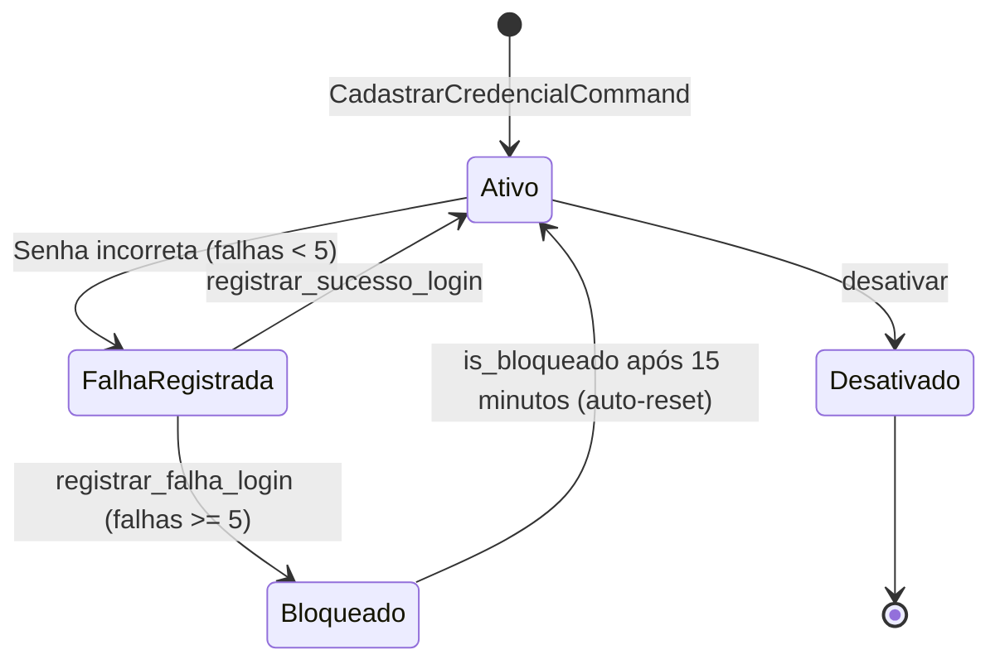
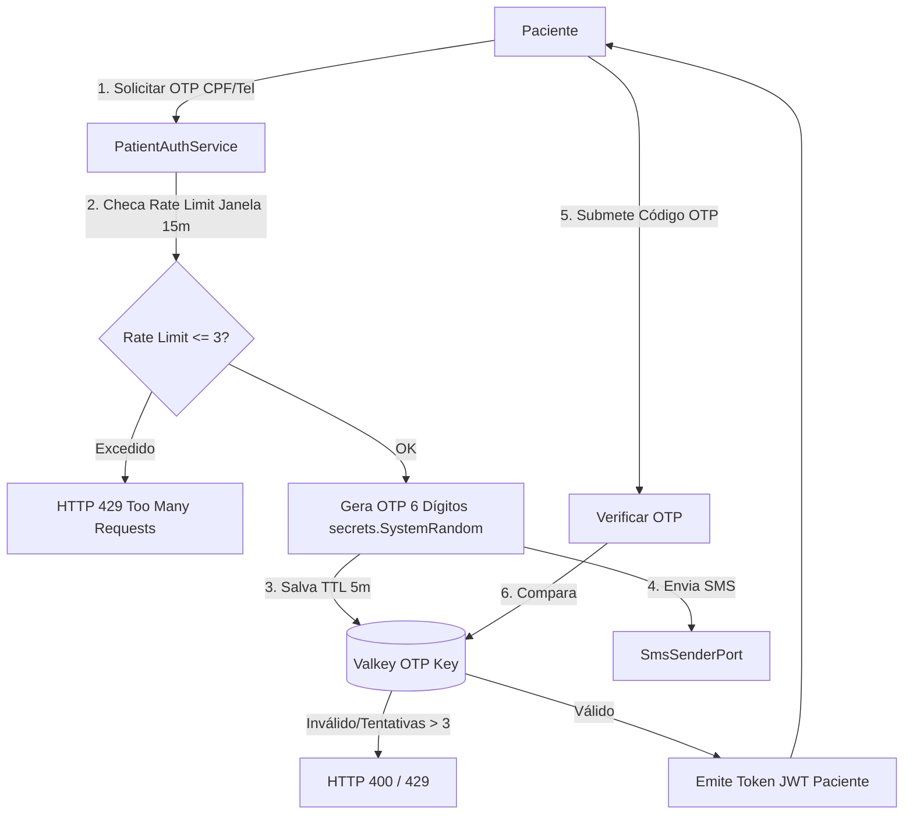
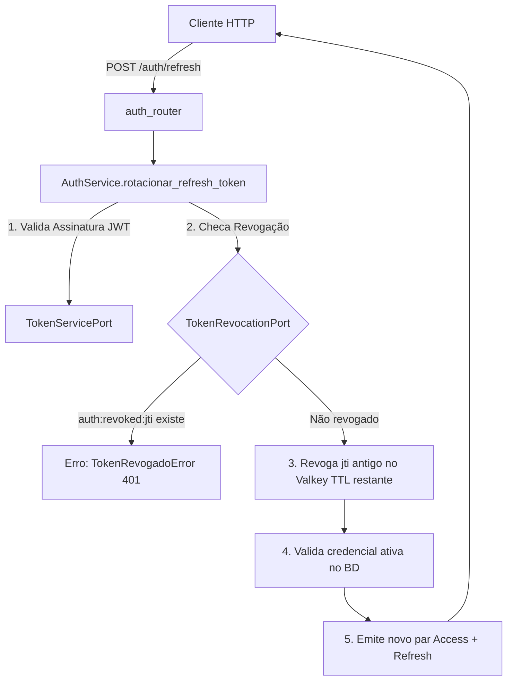

# Auth Domain

> Autenticação corporativa com Argon2id, lockout progressivo, login passwordless por OTP SMS e revogação distribuída de tokens via Valkey. Garante conformidade OWASP ASVS sem persistir senhas de pacientes e protegendo contra ataques de enumeração e força bruta.

## 1. Contexto

O domínio de Autenticação gerencia a identificação e o ciclo de sessões para os diferentes perfis do sistema através de dois fluxos desacoplados por tipo de usuário:

Profissionais de saúde e colaboradores corporativos (médicos, gestores, administradores globais e faturamento) autenticam-se com credenciais estáticas persistidas na tabela `usuarios_credenciais`. O hash de senhas utiliza Argon2id através de `PasswordHasherPort`. A proteção contra timing attacks e enumeração de contas executa `dummy_verify` em tempo constante para identificadores inexistentes ou inativos.

Pacientes e acolhidos autenticam-se via fluxo passwordless com código OTP de 6 dígitos enviado por SMS, gerado criptograficamente com `secrets.SystemRandom` e com validade de 5 minutos (300s). Nenhuma senha de paciente é armazenada no banco relacional.

A contenção contra ataques de força bruta combina rate limiting na borda (Valkey) e lockout progressivo na entidade rica: 5 falhas consecutivas bloqueiam a conta corporativa por 15 minutos (`bloqueado_ate`). O modelo `UsuarioCredencial` auto-reseta o bloqueio após expiração na consulta de `is_bloqueado`.

A revogação de tokens é distribuída e imediata: a rotação de refresh token segue a política de uso único, registrando o `jti` consumido no Valkey sob a chave `auth:revoked:{jti}` com TTL dinâmico residual do JWT. Apresentações repetidas disparam `TokenRevogadoError`. O logout explícito invalida refresh e access tokens instantaneamente no cluster de cache.

Vocabulário ubíquo: `UsuarioCredencial`, `senha_hash`, `Argon2id`, `dummy_verify`, `lockout`, `falhas_login_consecutivas`, `OTP SMS`, `refresh_token`, `jti`, `TokenRevocationPort`, `ValkeyTokenRevocation`, `TokenPairDTO`.

Multitenancy estrito: credenciais corporativas são isoladas por `organizacao_id` e identificador (`UniqueConstraint("organizacao_id", "identificador")`), protegidas por Row-Level Security (RLS).

## 2. Regras

- **RN-AUT-01 — Credenciais corporativas com Argon2id e dummy verify.** Senhas hasheadas com Argon2id via `PasswordHasherPort` (`Argon2PasswordHasher`). Identificador inexistente ou inativo executa verificação fictícia em tempo constante (`dummy_verify`) para neutralizar timing attacks. Parâmetros desatualizados disparam rehash transparente via `needs_rehash`. [Fonte](../product-specification.md) (RF-01)
- **RN-AUT-02 — Lockout progressivo de 15 minutos após 5 falhas consecutivas.** `UsuarioCredencial.registrar_falha_login` incrementa contadores e bloqueia a conta ao atingir `max_falhas = 5` por 15 minutos. `is_bloqueado` auto-reseta falhas quando o tempo expira. Autenticação válida executa `registrar_sucesso_login()`, zerando as falhas. [Fonte](../product-specification.md) (RF-01)
- **RN-AUT-03 — Autenticação passwordless de paciente por OTP SMS (6 dígitos).** `PatientAuthService.solicitar_otp` gera código numérico criptograficamente seguro via `secrets.SystemRandom().randint(100000, 999999)` com TTL de 5 minutos (300s), transmitido via `SmsSenderPort`. [Fonte](../product-specification.md) (RF-01)
- **RN-AUT-04 — Rate limiting estrito de OTP e contenção de brute-force.** Janela deslizante de 15 minutos (900s) com limite de 3 solicitações de OTP por número telefônico. Máximo de 3 tentativas de validação por código OTP gerado. Violações levantam `OtpRateLimitExcedidoError`, convertida em HTTP 429 Too Many Requests com cabeçalho `Retry-After`. [Fonte](../product-specification.md) (RF-01)
- **RN-AUT-05 — Rotação de refresh token com revogação distribuída de uso único.** Cada refresh token consumido em `AuthService.rotacionar_refresh_token` é marcado como revogado via `TokenRevocationPort.revogar` com chave `auth:revoked:{jti}` pelo TTL restante. Reuso de token já revogado aborta o ciclo com `TokenRevogadoError`. [Fonte](../product-specification.md) (RF-01)
- **RN-AUT-06 — Logout com revogação síncrona.** `AuthService.revogar_sessao` invalida imediatamente o refresh token e opcionalmente o access token no Valkey, assegurando encerramento instantâneo de sessão em nós concorrentes. [Fonte](../product-specification.md) (RF-01)

Guardiões: `UsuarioCredencial` normaliza identificadores para minúsculas sem espaços, valida papéis e bloqueia autenticação de contas marcadas com `ativo = False` ou sob lockout ativo.

## 3. Máquina de estados

Ciclo de vida de credenciais corporativas com tolerância a falhas e lockout progressivo:



Fluxo de autenticação passwordless do paciente por OTP SMS:



Fluxo de rotação de refresh token com revogação distribuída:



## 4. Relações

- Persistência corporativa: tabela `usuarios_credenciais` particionada por `organizacao_id` com constraints de unicidade (`uq_usuarios_credenciais_org_identificador`).
- Provedor de criptografia: `PasswordHasherPort` abstrai a biblioteca Argon2id (`Argon2PasswordHasher`).
- Provedor de tokens: `TokenServicePort` emite e valida access tokens e refresh tokens com UUIDs de rastreio (`jti`).
- Revogação distribuída: `TokenRevocationPort` implementada por `ValkeyTokenRevocation` (`auth:revoked:{jti}`).
- Integração com identidade: `IdentityReaderPort` valida existência e telefone de pacientes antes de emitir OTP SMS.
- Provedor de SMS: `SmsSenderPort` implementa envio de mensagens de texto assíncronas.
- Rotas REST finas: `auth_router.py` e `patient_auth_router.py` delegam execução a `AuthServiceDep` e `PatientAuthServiceDep`, sem regras de autenticação nos routers.

## 5. Peculiaridades

- Proteção contra enumeração (timing attacks): para identificadores inexistentes ou contas inativas, o serviço executa `dummy_verify` de duração similar ao cálculo Argon2id real, garantindo tempo de resposta constante.
- Auto-limpeza de chaves de revogação: chaves `auth:revoked:{jti}` são salvas no Valkey com TTL igual ao tempo residual de expiração do token. O descarte automático elimina a necessidade de rotinas periódicas de limpeza (sweeper).
- Desbloqueio sem jobs em background: a expiração do lockout é avaliada internamente pelo método `is_bloqueado()`; ao transcorrer 15 minutos, a entidade limpa `bloqueado_ate` e reseta o contador de falhas na primeira tentativa subsequente.
- Zero senhas para pacientes: pacientes não possuem senhas salvas em banco, neutralizando riscos de vazamento em massa de credenciais da população atendida.

## 6. Onde no código

- `src/modules/auth/domain/models/usuario_credencial.py`
- `src/modules/auth/domain/exceptions.py`
- `src/modules/auth/domain/validators.py`
- `src/modules/auth/application/dtos.py`
- `src/modules/auth/application/ports/password_hasher_port.py`
- `src/modules/auth/application/ports/token_service_port.py`
- `src/modules/auth/application/ports/token_revocation_port.py`
- `src/modules/auth/application/ports/auth_rate_limiter_port.py`
- `src/modules/auth/application/ports/sms_sender_port.py`
- `src/modules/auth/application/ports/identity_reader_port.py`
- `src/modules/auth/application/services/auth_service.py`
- `src/modules/auth/application/services/patient_auth_service.py`
- `src/modules/auth/infrastructure/argon2_hasher.py`
- `src/modules/auth/infrastructure/jwt_token_service.py`
- `src/modules/auth/infrastructure/valkey_token_revocation.py`
- `src/modules/auth/infrastructure/valkey_rate_limiter.py`
- `src/modules/auth/presentation/routers/auth_router.py`
- `src/modules/auth/presentation/routers/patient_auth_router.py`
- `src/modules/auth/composition.py`
- `migrations/versions/0003_auth_credentials.py`

Prova viva:

```bash
ls tests/unit | rg -E "argon2|jwt|patient_auth|token_revocation|authz_rbac"
# test_argon2_hasher.py
# test_authz_rbac.py
# test_jwt_token_service.py
# test_patient_auth_service.py
# test_token_revocation.py
```

## 7. Verificação

```bash
rg -n "UsuarioCredencial|AuthService|PatientAuthService" src/modules/auth/
# usuario_credencial.py:23 class UsuarioCredencial
# auth_service.py:52 class AuthService
# patient_auth_service.py:45 class PatientAuthService

uv run pytest tests/unit/test_argon2_hasher.py tests/unit/test_jwt_token_service.py tests/unit/test_patient_auth_service.py tests/unit/test_token_revocation.py tests/unit/test_authz_rbac.py -q --no-cov
# 32 passed
```

Sem corrigir código. Divergência entre documentação e invariantes do modelo exige ajuste na documentação para refletir as regras de segurança vigentes.

## 8. Ver também

- [Product Specification](../product-specification.md) — RF-01 autenticação e segurança de acesso
- [Data Model](../architecture/data-model.md) — tabela `usuarios_credenciais` e isolamento RLS
- [Identity Domain](./identity-domain.md) — vínculo com cadastros de profissionais e pacientes
- [Domains Index](./index.md) — catálogo geral dos domínios da aplicação
