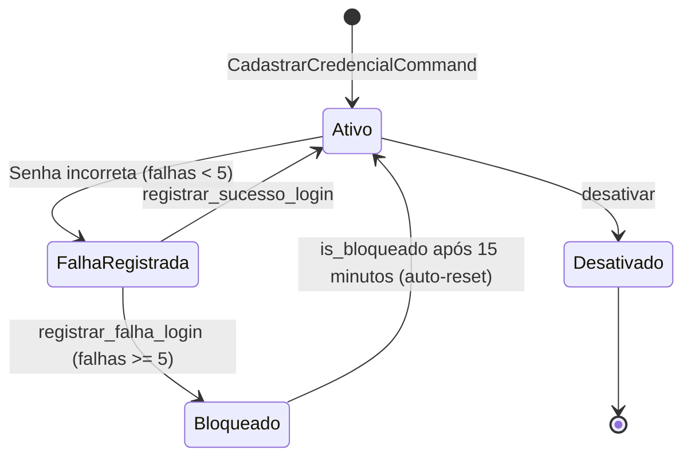
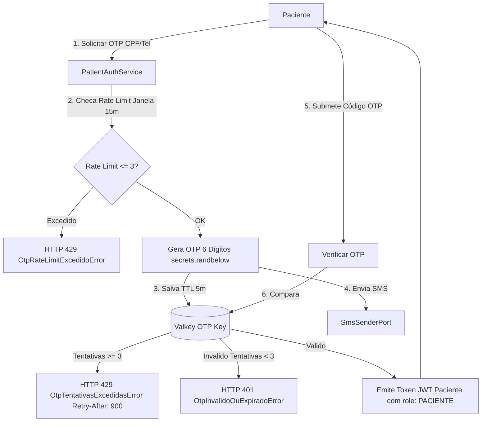
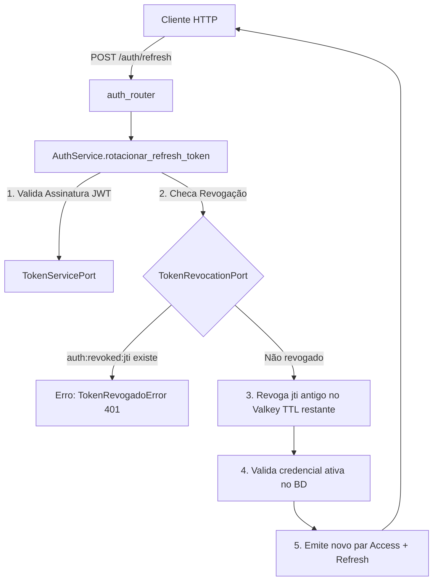

# Auth Domain

> Autenticação corporativa com Argon2id + MFA/TOTP, IAM híbrido do cidadão (OTP SMS, Passkeys WebAuthn, CADSUS e senha opcional Argon2id isolada) e revogação distribuída de tokens via Valkey. Garante conformidade OWASP ASVS protegendo contra ataques de enumeração e força bruta.

## 1. Contexto

O domínio de Autenticação gerencia a identificação e o ciclo de sessões para os diferentes perfis do sistema através de fluxos estritamente segregados entre equipe corporativa e cidadãos:

Profissionais de saúde e colaboradores corporativos (médicos, gestores de unidade e faturamento) autenticam-se em `/api/v1/auth/login` com credenciais estáticas persistidas na tabela `usuarios_credenciais`. O hash de senhas utiliza Argon2id através de `PasswordHasherPort`. A proteção contra timing attacks e enumeração de contas executa `dummy_verify` em tempo constante para identificadores inexistentes, inativos ou pertencentes a pacientes (`Role.PACIENTE` é explicitamente rejeitado no login corporativo).

Pacientes e acolhidos utilizam o fluxo híbrido do cidadão (`/api/v1/auth/patient/*`): ingresso e reconexão sem senha via código OTP de 6 dígitos enviado por SMS (`secrets.randbelow(1_000_000)`, validade de 5 minutos / 300s), autenticação biométrica FIDO2/WebAuthn (`Passkeys`), desambiguação civil CADSUS/Gov.br (`/cadsus`), auto-cadastro com e-mail obrigatório (`/register`) e senha Argon2id opcional (`/login-password`, sem MFA TOTP). Quando a senha é omitida no auto-cadastro, `UsuarioCredencial` recebe marcador não-autenticável (`!UNUSABLE:<hex>`).

A contenção contra ataques de força bruta combina rate limiting por janela deslizante na borda (Valkey via `AuthRateLimiterPort` com fallback em memória) e lockout progressivo na entidade rica: 5 falhas consecutivas bloqueiam a conta por 15 minutos (`bloqueado_ate`). O modelo `UsuarioCredencial` auto-reseta o bloqueio após expiração na consulta de `is_bloqueado`.

A revogação de tokens é distribuída e imediata: a rotação de refresh token segue a política de uso único, registrando o `jti` consumido no Valkey sob a chave `auth:revoked:{jti}` com TTL dinâmico residual do JWT. Apresentações repetidas disparam `TokenRevogadoError`. O logout explícito invalida refresh e access tokens instantaneamente no cluster de cache.

Vocabulário ubíquo: `UsuarioCredencial`, `senha_hash`, `UNUSABLE_CREDENTIAL_MARKER` (`!UNUSABLE:`), `Argon2id`, `dummy_verify`, `lockout`, `OTP SMS`, `WebAuthn Passkeys`, `CADSUS`, `refresh_token`, `jti`, `TokenRevocationPort`, `ValkeyTokenRevocation`, `IdentityWriterPort`.

Plataforma única: credenciais corporativas e de cidadãos mantêm unicidade global por identificador (`UniqueConstraint("identificador", name="uq_usuarios_credenciais_identificador")`), sem partição por `organizacao_id`.

## 2. Regras

- **RN-AUT-01 — Credenciais corporativas com Argon2id e dummy verify.** Senhas hasheadas com Argon2id via `PasswordHasherPort` (`Argon2PasswordHasher`). Identificador inexistente ou inativo executa verificação fictícia em tempo constante (`dummy_verify`) para neutralizar timing attacks. Parâmetros desatualizados disparam rehash transparente via `needs_rehash`. [Fonte](../product-specification.md) (RF-01)
- **RN-AUT-02 — Lockout progressivo de 15 minutos após 5 falhas consecutivas.** `UsuarioCredencial.registrar_falha_login` incrementa contadores e bloqueia a conta ao atingir `max_falhas = 5` por 15 minutos. `is_bloqueado` auto-reseta falhas quando o tempo expira. Autenticação válida executa `registrar_sucesso_login()`, zerando as falhas. [Fonte](../product-specification.md) (RF-01)
- **RN-AUT-03 — Autenticação passwordless de paciente por OTP SMS (6 dígitos).** `PatientAuthService.solicitar_otp` gera código numérico criptograficamente seguro via `secrets.randbelow(1_000_000)` formatado com zero-padding (`:06d`) e TTL de 5 minutos (300s), armazenado em hash SHA-256 e transmitido via `SmsSenderPort`. A propriedade `codigo_debug` só é exposta quando `expose_debug_otp=True`, restrito no `composition.py` a `DEBUG=True` e `ENVIRONMENT in ("development", "test")`. [Fonte](../product-specification.md) (RF-01)
- **RN-AUT-04 — Rate limiting estrito de OTP e contenção de brute-force.** Janela deslizante de 15 minutos (900s) com limite de 3 solicitações de OTP por número telefônico (`OtpRateLimitExcedidoError`). Máximo de 3 tentativas de validação por código OTP gerado: as 2 primeiras falhas retornam HTTP 401 (`OtpInvalidoOuExpiradoError`); a 3ª falha invalida o OTP e levanta `OtpTentativasExcedidasError` (HTTP 429 Too Many Requests com cabeçalho `Retry-After: 900`). Ambas as violações de limite retornam HTTP 429 com `Retry-After`. [Fonte](../product-specification.md) (RF-01)
- **RN-AUT-05 — Rotação de refresh token com transporte seguro via Cookie HttpOnly, SameSite=Strict e revogação de uso único.** Cada refresh token consumido em `AuthService.rotacionar_refresh_token` é marcado como revogado via `TokenRevocationPort.revogar` com chave `auth:revoked:{jti}` pelo TTL restante. O transporte prioritário é realizado via Cookie `HttpOnly`, `SameSite=Strict`, `Path=/api/v1/auth`, `Max-Age=604800` (7 dias) com fallback retrocompatível para payload JSON. Apresentações repetidas abortam o ciclo com `TokenRevogadoError`. Ausência de cookie e payload levanta `TokenInvalidoError` (HTTP 401). [Fonte](../product-specification.md) (RF-01, Issue #144)
- **RN-AUT-06 — Logout com revogação síncrona e expurgo de cookie.** `AuthService.revogar_sessao` invalida imediatamente o refresh token no Valkey, e o presentation layer emite cabeçalho `Set-Cookie: refresh_token=; Max-Age=0; Path=/api/v1/auth; HttpOnly; SameSite=Strict`, eliminando a credencial persistente no navegador. [Fonte](../product-specification.md) (RF-01, Issue #144)
- **RN-AUT-07 — Access tokens de curta duração e segregação de armazenamento no navegador (OWASP ASVS V3.5.2 / LGPD Art. 46).** Tokens de acesso JWT possuem validade padrão de 15 minutos (`JWT_ACCESS_TOKEN_EXPIRE_MINUTES=15`, injetado via `composition.py` tanto em `JWTTokenService` quanto em `PatientAuthService` e `PatientWebAuthnService`). Para a equipe corporativa, o token reside exclusivamente em closure JavaScript volátil (`frontend/src/lib/auth-token.ts`), sendo proibido em Web Storage e reidratado no reload (F5) via silent refresh por cookie `HttpOnly`. Para o cidadão, a sessão (`StoredPatientSession` em `frontend/src/lib/session-storage.ts`) persiste no `localStorage` sob a chave `medisync_session` (`settings.storage.patientSession`). [Fonte](../product-specification.md) (RF-01, Issue #144)
- **RN-AUT-08 — Atributos de segurança mandatórios para cookies (OWASP ASVS V3.4.1).** Todo cookie emitido para transporte de refresh token possui obrigatoriamente `HttpOnly`, `SameSite=Strict`, `Path=/api/v1/auth`, `Max-Age=604800` (7 dias) e flag `Secure` dinamicamente resolvida com base no cabeçalho `X-Forwarded-Proto` e no ambiente de execução (ativo em HTTPS e produção). [Fonte](../product-specification.md) (RF-01, Issue #144)
- **RN-AUT-09 — IAM Híbrido do Cidadão, Auto-Cadastro, CADSUS e WebAuthn.** `PatientAuthService` suporta: (a) auto-cadastro (`POST /auth/patient/register` via `IdentityWriterPort`) com e-mail obrigatório (`RegistrarPacienteRequest.email`), aceite LGPD, disparo inicial de OTP e senha Argon2id opcional (ou marcador `!UNUSABLE:` via `UNUSABLE_CREDENTIAL_MARKER`); (b) identificação anti-enumeração (`POST /auth/patient/identify`); (c) login tradicional por senha (`POST /auth/patient/login-password` com lockout de 5 falhas/15 min e sem MFA TOTP); (d) desambiguação civil CADSUS/Gov.br (`POST /auth/patient/cadsus`); e (e) capacidades dinâmicas (`GET /auth/patient/methods` com `GOVBR_OIDC_ENABLED` injetado via `composition.py` sob ADR-009). Os endpoints `/register` (10 req/IP/15 min), `/identify` (15 req/IP e 10 req/identificador em 15 min) e `/login-password` (15 req/IP/15 min) aplicam janela deslizante lançando `IdentificacaoRateLimitExcedidoError` (`429` com `Retry-After`). Em complemento, `PatientWebAuthnService` (`/auth/patient/webauthn/*`) provê cadastro e login 1-toque FIDO2/Passkeys com desafios de 60s consumidos atomicamente via `getdel` no Valkey. [Fonte](../product-specification.md) (RF-01, [ADR-012](../../adrs/ADR-012-Transicao-100-SUS-Consorcios-Intermunicipais-e-Autenticacao-Tripartida.md))

Guardiões: `UsuarioCredencial` normaliza identificadores para minúsculas sem espaços, valida papéis e bloqueia autenticação de contas marcadas com `ativo = False` ou sob lockout ativo.

## 3. Máquina de estados

Ciclo de vida de credenciais corporativas com tolerância a falhas e lockout progressivo:



Fluxo de autenticação passwordless do paciente por OTP SMS:



Fluxo de rotação de refresh token com revogação distribuída:



## 4. Relações

- Persistência corporativa: tabela `usuarios_credenciais` com constraint global de unicidade (`uq_usuarios_credenciais_identificador`).
- Provedor de criptografia: `PasswordHasherPort` abstrai a biblioteca Argon2id (`Argon2PasswordHasher`).
- Provedor de tokens: `TokenServicePort` emite e valida access tokens e refresh tokens com UUIDs de rastreio (`jti`).
- Revogação distribuída: `TokenRevocationPort` implementada por `ValkeyTokenRevocation` (`auth:revoked:{jti}`).
- Integração com identidade: `IdentityReaderPort` valida existência, telefone, dados CADSUS e passkeys de pacientes; `IdentityWriterPort` (`SqlIdentityWriter` em `src/modules/identity/infrastructure/identity_writer_sql.py`) persiste novos pacientes no auto-cadastro dentro da mesma transação antes do `commit` em `PatientAuthService`.
- Credenciais de pacientes e lookup de fila: `PatientCredentialRepositoryPort` (`SqlPatientCredentialRepository`) persiste credenciais do cidadão; `ActiveAttendanceLookupPort` resolve eventual `atendimento_id` ativo no retorno do login.
- Provedor de SMS: `SmsSenderPort` implementa envio de mensagens de texto assíncronas.
- Biometria FIDO2/WebAuthn: `PatientWebAuthnService` e `patient_webauthn_router.py` orquestram registro e login 1-toque com desafios em Valkey.
- Rotas REST finas: `auth_router.py`, `patient_auth_router.py` e `patient_webauthn_router.py` delegam execução a `AuthServiceDep`, `PatientAuthServiceDep` e `PatientWebAuthnServiceDep`, sem regras de autenticação nos routers.

## 5. Peculiaridades

- Proteção contra enumeração (timing attacks): para identificadores inexistentes, contas inativas, ou tentativa de autenticar `Role.PACIENTE` no login corporativo (`/auth/login`), o serviço executa `dummy_verify` de duração similar ao cálculo Argon2id real, garantindo tempo de resposta constante.
- Auto-limpeza de chaves de revogação: chaves `auth:revoked:{jti}` são salvas no Valkey com TTL igual ao tempo residual de expiração do token. O descarte automático elimina a necessidade de rotinas periódicas de limpeza (sweeper).
- Desbloqueio sem jobs em background: a expiração do lockout é avaliada internamente pelo método `is_bloqueado()`; ao transcorrer 15 minutos, a entidade limpa `bloqueado_ate` e reseta o contador de falhas na primeira tentativa subsequente.
- Isolamento de senha opcional do cidadão: quando o cidadão se cadastra sem senha, `UsuarioCredencial` recebe marcador não-autenticável `!UNUSABLE:<hex>` (`UNUSABLE_CREDENTIAL_MARKER`), impedindo login por senha até definição explícita. Quando definida, a senha do cidadão permanece isolada do portal corporativo (`/auth/login` rejeita `Role.PACIENTE`) e dispensa MFA TOTP; além disso, `codigo_debug` nunca é exposto fora de `development`/`test` com `DEBUG=True`.

## 6. Onde no código

- `src/modules/auth/domain/models/usuario_credencial.py`
- `src/modules/auth/domain/exceptions.py`
- `src/modules/auth/domain/validators.py`
- `src/modules/auth/application/dtos.py`
- `src/modules/auth/application/ports/password_hasher_port.py`
- `src/modules/auth/application/ports/token_service_port.py`
- `src/core/authz/revocation.py`
- `src/core/authz/dependencies.py`
- `src/modules/auth/application/ports/auth_rate_limiter_port.py`
- `src/modules/auth/application/ports/sms_sender_port.py`
- `src/modules/auth/application/ports/identity_reader_port.py`
- `src/modules/auth/application/ports/identity_writer_port.py`
- `src/modules/auth/application/ports/patient_credential_repository_port.py`
- `src/modules/auth/application/ports/active_attendance_lookup_port.py`
- `src/modules/auth/application/services/auth_service.py`
- `src/modules/auth/application/services/patient_auth_service.py`
- `src/modules/auth/application/services/patient_webauthn_service.py`
- `src/modules/auth/application/services/webauthn_crypto.py`
- `src/modules/auth/infrastructure/argon2_hasher.py`
- `src/modules/auth/infrastructure/jwt_token_service.py`
- `src/modules/auth/infrastructure/patient_credential_repository_sql.py`
- `src/modules/auth/infrastructure/valkey_rate_limiter.py`
- `src/modules/identity/application/ports/identity_writer_port.py`
- `src/modules/identity/infrastructure/identity_writer_sql.py`
- `src/modules/auth/presentation/helpers.py`
- `src/modules/auth/presentation/routers/auth_router.py`
- `src/modules/auth/presentation/routers/patient_auth_router.py`
- `src/modules/auth/presentation/routers/patient_webauthn_router.py`
- `src/modules/auth/composition.py`
- `frontend/src/lib/auth-token.ts`
- `frontend/src/lib/session-storage.ts`
- `frontend/src/api/client.ts`
- `migrations/versions/0001_initial_schema.py`
- `tests/unit/test_patient_hybrid_auth.py`
- `tests/unit/test_patient_webauthn_service.py`

Prova viva:

```bash
ls tests/unit | rg -E "argon2|jwt|patient_auth|patient_hybrid|webauthn|token_revocation|authz_rbac"
# test_argon2_hasher.py
# test_authz_rbac.py
# test_jwt_token_service.py
# test_patient_auth_service.py
# test_patient_hybrid_auth.py
# test_patient_webauthn_service.py
# test_token_revocation.py
```

## 7. Verificação

```bash
rg -n "UsuarioCredencial|AuthService|PatientAuthService|PatientWebAuthnService" src/modules/auth/
# usuario_credencial.py:23 | auth_service.py:46 | patient_auth_service.py:99 | patient_webauthn_service.py:54

uv run pytest tests/unit/test_argon2_hasher.py tests/unit/test_jwt_token_service.py tests/unit/test_patient_auth_service.py tests/unit/test_patient_hybrid_auth.py tests/unit/test_patient_webauthn_service.py tests/unit/test_token_revocation.py tests/unit/test_authz_rbac.py -q --no-cov
# 77 passed
```

Sem corrigir código. Divergência entre documentação e invariantes do modelo exige ajuste na documentação para refletir as regras de segurança vigentes.

## 8. Ver também

- [Product Specification](../product-specification.md) — RF-01 autenticação e segurança de acesso
- [Data Model](../architecture/data-model.md) — tabela `usuarios_credenciais` e unicidade global
- [Identity Domain](./identity-domain.md) — vínculo com cadastros de profissionais e pacientes
- [Domains Index](./index.md) — catálogo geral dos domínios da aplicação
