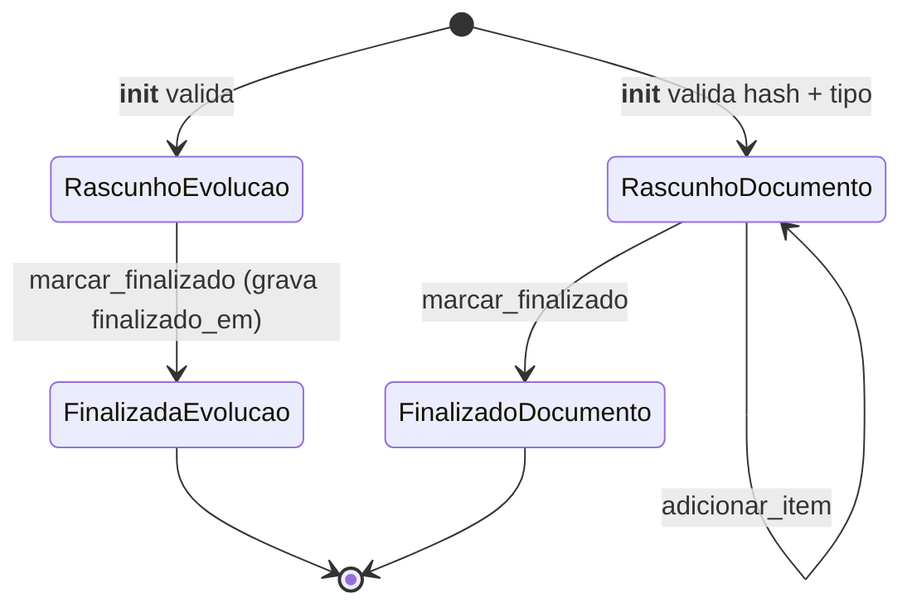

# Consultation Domain

> Ato médico soberano com PEP append-only, documentos assinados PAdES e vídeo que nunca passa pelo Python. Decide registro, trava edição, emite JWT sem desconectar ninguém.

## 1. Contexto

Consulta executa o ato médico dentro de atendimento EM_ATENDIMENTO. Duas peças: evolução SOAP alimenta PEP, documento clínico gera receita/atestado/encaminhamento assinado.

Vocabulário ubíquo: `evolução` (SOAP), `documento clínico`, `item de prescrição`, `finalizado` (trava persistida no PostgreSQL via `finalizado_em`), `chave_s3` (canônica), `sha256_hash` (64 hex), `assinado_em`/`registrado_em` (UTC).

Entrada via RF-07 (consulta, PEP e assinatura). Saída alimenta auditoria RN07 e validação pública de documentos via QR + hash.

Escopo termina no registro. Fila decide ordem, triagem decide prioridade, ambulatory consolida a produção ambulatorial SUS; consulta decide apenas o que o médico registra e assina.

## 2. Regras

- **RN06 — Ato médico nunca interrompido por tempo.** `marcar_finalizado`/`validar_pode_excluir` travam registro, nunca derrubam chamada; backend emite JWT através de `TeleconsultaService` desacoplado do SFU. [Fonte](../product-specification.md) (RN06)
- **RN07 — PEP append-only com UTC e prova criptográfica.** `EvolucaoClinica`/`DocumentoClinico` carimbam `registrado_em`/`assinado_em` em UTC, hash SHA-256 de 64 hex, assinatura PAdES; guarda canônica em `src/modules/consultation/domain/s3_keys.py`. Casos de uso (`salvar_evolucao_soap`, `emitir_documento`, `assinar`, `finalizar_consulta`) persistem atomicamente eventos na tabela `audit_events` via `AuditTrailPort` (`SqlAuditTrailAdapter`) antes do `commit()`. Catálogo canônico: [Catálogo de Eventos](../../reference/audit/event-catalog.md). Provas vivas: `tests/unit/test_consultation_audit_events.py` e `tests/integration/test_clinical_audit_integration.py`. [Fonte](../product-specification.md) (RN07)
- **RN08 — Governança de IA no Prontuário e Supervisão Humana (CFM nº 2.454/2026).** Sugestões de notas SOAP, hipóteses CID-10 e prescrições emitidas por IA copiloto atuam exclusivamente como auxílio orientativo. Ao salvar a evolução clínica, o sistema calcula atomicamente o diff unificado (`unified_diff`) entre a sugestão bruta da IA e a conduta ratificada pelo profissional, persistindo o evento forense `IA_DECISAO_MEDICA_REGISTRADA` com o modelo de IA ratificado (`ia_modelo`), o indicador de ratificação (`ia_ratificada`) e o texto completo do `diff_forense`. Prova viva: `tests/unit/test_clinical_ai_governance.py`. [Fonte](../product-specification.md) (RN08)
- **RN09 — Trava Temporal Anti-Fraude em Atestados (CFM nº 2.314/2022 e RDC Anvisa nº 1.000/2025).** A emissão de atestado exige tempo decorrido $\ge 180\text{ s}$ (3 minutos) de teleconsulta. Tentativa anterior a 180s exige justificativa clínica circunstanciada com no mínimo 15 caracteres ($\ge 15$), disparando obrigatoriamente o evento forense `TRAVA_TEMPORAL_ATESTADO_VIOLADA` com `duracao_segundos`, `justificativa` e `justificativa_aceita = True`. Justificativas ausentes ou com menos de 15 caracteres são bloqueadas com erro HTTP 422 `TRAVA_TEMPORAL_ATESTADO_VIOLADA` e evento forense gravado com `justificativa_aceita = False`. Prova viva: `tests/unit/test_trava_antifraude_atestado.py`. [Fonte](../product-specification.md) (RN09)
- **Procedimento SIGTAP 03.01.01.025-0 no Plano SOAP.** O registro do Plano terapêutico inclui a codificação SIGTAP da teleconsulta na Atenção Primária para integração com o BPA-I e SISAB (Nota Técnica nº 11/2024-MS). [Fonte](../product-specification.md) (RF-07)

Guardiões: `__init__` rejeita `organizacao_id <= 0`, anamnese/conduta vazias, CID-10 fora do padrão, `chave_s3` vazia, hash fora de 64 hex (`ConsultaInvalidaError`).

`adicionar_item` exige mesmo `organizacao_id` (multi-tenant), valida substância via Portaria 344/98 Listas A e B, força `controle_especial = True` quando tipo é C1.

`validar_pode_excluir` recusa quando `is_finalizado` ou status do atendimento é terminal (CONCLUIDO, PACIENTE_AUSENTE, CANCELADO_PACIENTE); `before_delete` repete a trava no nível ORM.

## 3. Máquina de estados

Dois agregados, mesma trava binária: rascunho editável vira finalizado imutável via `marcar_finalizado` (persistindo `finalizado_em TIMESTAMP WITH TIME ZONE`). Nenhum caminho reverso existe no código.



`marcar_finalizado` grava `finalizado_em = datetime.now(UTC)` e liga `_is_finalizado = True` em `src/modules/consultation/domain/models/evolucao_clinica.py` e `src/modules/consultation/domain/models/documento_clinico.py`. Serviço chama quando consulta é concluída e delega a transição do atendimento para `QueueStorePort.concluir_atendimento`.

`adicionar_item` só antes de finalizar: serviço bloqueia emissão e mutação quando `is_finalizado` ou atendimento terminal; direto no agregado, itens vinculam `documento_id` após checar tenant e Portaria 344/98.

`validar_pode_excluir` + `before_delete` fecham a porta de saída: finalizado nunca deleta, terminal nunca deleta. Exclusão exige rascunho + atendimento ativo.

CID-10 normaliza para maiúsculas (`J02.9`) e rejeita fora do padrão letra + 2 dígitos + subcategoria opcional. Hash normaliza para lowercase e exige 64 hex.

## 4. Relações

- Lê atendimento sem importar queue. `src/modules/consultation/application/ports/atendimento_reader_port.py` devolve `AtendimentoResumoDTO` com `status` e `is_terminal`; adaptado em `consultation.composition` via `QueueStoreAtendimentoReaderAdapter` sem queries SQL cruas.
- Emite PDF via porta abstrata. `src/modules/consultation/application/ports/pdf_generator_port.py` recebe `DocumentoPDFPayload` e devolve bytes PDF/A com QR de verificação ITI.
- Assina via porta abstrata. `src/modules/consultation/application/ports/icp_brasil_signer_port.py` aplica PAdES com `DoctorCertificateCredentials` (PSC OAuth2); infra PyHanko pluga sem tocar serviço.
- Guarda bytes via porta abstrata. `src/modules/consultation/application/ports/storage_port.py` persiste em `chave_s3` canônica e gera URL pré-assinada de 300s para download.
- Persiste em três tabelas (`evolucoes_clinicas`, `documentos_clinicos`, `documento_itens` com RLS por `organizacao_id`, `RESTRICT` nas FKs clínicas, `CASCADE` de documento para itens). [Modelo](../architecture/data-model.md)
- Orquestra mídia sem transportar mídia. `TeleconsultaService` orquestra geração de JWT e ciclo de sala sobre `LiveKitMediaPort`; SFU LiveKit carrega áudio/vídeo, Python só sinaliza.
- Valida acesso à mídia com distinção clínica de No-Show. `src/modules/consultation/presentation/dependencies.py` (`validar_acesso_livekit`) rejeita atendimento finalizado por no-show (`PACIENTE_AUSENTE`) com HTTP 409 Conflict (`ATENDIMENTO_EXPIRADO_NO_SHOW`), e outros status terminais com HTTP 403 Forbidden.
- Finalização centralizada no PEP. `src/modules/consultation/application/services/pep_service.py` marca evolução + documentos de forma atômica e conclui o atendimento via `QueueStorePort`.

## 5. Peculiaridades

- Mídia nunca passa pelo Python. Backend gera JWT e gerencia sala via Twirp RPC; pacotes WebRTC fluem paciente ↔ SFU, nunca por FastAPI.
- `finalizado_em` é coluna persistida com timezone. Presente tanto em `evolucoes_clinicas` quanto em `documentos_clinicos`; a imutabilidade jurídica é garantida no banco e refletida na property `is_finalizado`.
- Documentos clínicos nascem em rascunho com `sha256_hash` e `assinado_em` nulos, sendo preenchidos atomicamente pelo método rico `registrar_assinatura` apenas após assinatura ICP-Brasil válida.
- Chave S3 canônica única. `build_signed_document_key` monta `orgs/{org}/consultations/{atendimento}/documents/{documento}.pdf`; prefixo não indica assinatura, fonte da verdade é `SignedCachePort`.
- Portaria 344/98 no domínio. `validar_substancia_permitida_telemedicina` barra Listas A e B em `DocumentoItem.__init__` e em `adicionar_item`; entorpecente via teleconsulta nem chega ao PDF.
- UTC sempre, relógio do cliente nunca. `registrado_em`, `assinado_em` e `finalizado_em` usam `datetime.now(UTC)` como default; auditoria RN07 depende desse carimbo.
- Erros de domínio tipados. `ConsultaFinalizadaError` para mutação/exclusão pós-trava, `ConsultaInvalidaError` para dado inválido; borda converte em 4xx sem vazar stack.
- Gate CFM nº 2.314/2022 na Estação Médica. O frontend bloqueia preventivamente a emissão de receitas digitais e a finalização da consulta até que o médico confirme a conferência visual de RG/CNH/CNS em vídeo ou registre justificativa clínica formal em caso de emergência.
- Imutabilidade visual do PEP (CFM nº 1.821/2007). Ao concluir o atendimento, todos os painéis clínicos (SOAP, prescrições, conferência de identidade) entram em modo imutável somente leitura (`isReadOnly`), impossibilitando edições posteriores na UI.
- Governança forense de IA copiloto (CFM nº 2.454/2026). A trilha forense calcula o diff unificado (`diff_forense`) entre a sugestão bruta da IA e o texto final assinado pelo médico assistente, persistindo o evento `IA_DECISAO_MEDICA_REGISTRADA` com modelo ratificado e prova de intervenção humana obrigatória.
- Trava temporal e auditoria anti-fraude de atestados (CFM nº 2.314/2022, RN09). A emissão de atestados médicos exige duração de teleconsulta $\ge 180\text{ s}$; emissões precoces disparam `TRAVA_TEMPORAL_ATESTADO_VIOLADA` e requerem justificativa clínica circunstanciada de no mínimo 15 caracteres (`justificativa_aceita = True`), barrando justificativas curtas com HTTP 422.

## 6. Onde no código

- `src/modules/consultation/domain/models/evolucao_clinica.py`
- `src/modules/consultation/domain/models/documento_clinico.py`
- `src/modules/consultation/domain/models/documento_item.py`
- `src/modules/consultation/domain/s3_keys.py`
- `src/modules/consultation/application/ports/atendimento_reader_port.py`
- `src/modules/consultation/application/ports/storage_port.py`
- `src/modules/consultation/application/ports/pdf_generator_port.py`
- `src/modules/consultation/application/ports/icp_brasil_signer_port.py`
- `src/modules/consultation/application/ports/livekit_media_port.py`
- `src/modules/consultation/application/services/evolucao_service.py`
- `src/modules/consultation/application/services/documento_service.py`
- `src/modules/consultation/application/services/pep_service.py`
- `src/modules/consultation/presentation/dependencies.py`
- `src/modules/consultation/infrastructure/livekit_adapter.py`
- `frontend/src/features/consultation/components/doctor-workstation.tsx`
- `frontend/src/features/consultation/components/cfm-identity-gate.tsx`
- `frontend/src/features/consultation/components/prescription-builder.tsx`
- `frontend/src/features/consultation/components/soap-editor.tsx`
- `frontend/src/features/consultation/tests/consultation-workstation.test.tsx`
- `tests/unit/test_consultation_models.py`
- `tests/unit/test_evolucao_service.py`
- `tests/unit/test_documento_service.py`
- `tests/unit/test_clinical_ai_governance.py`
- `tests/unit/test_trava_antifraude_atestado.py`
- `tests/unit/test_livekit_token.py`
- `tests/unit/test_livekit_dependencies.py`

Prova viva:

```bash
ls tests/unit | rg -i "consultation|evolucao|documento|livekit"
# test_consultation_models.py
# test_documento_service.py
# test_evolucao_service.py
# test_livekit_token.py
```

## 7. Verificação

```bash
rg -n "def marcar_finalizado|def adicionar_item|def validar_pode_excluir" src/modules/consultation/domain/
# documento_clinico.py:159 marcar_finalizado, :163 adicionar_item, :181 validar_pode_excluir
# evolucao_clinica.py:129 marcar_finalizado, :133 validar_pode_excluir

uv run pytest tests/unit/test_consultation_models.py -q --no-cov
# 58 passed (2026-10-07)

uv run pytest tests/unit/test_clinical_ai_governance.py tests/unit/test_trava_antifraude_atestado.py -q --no-cov
# 14 passed (2026-11-07)
```

Sem corrigir código. Divergência entre doc e guardião real exige atualizar doc, nunca relaxar trava clínica.

## 8. Ver também

- [Product Specification](../product-specification.md) — RN06, RN07, RN08, RN09 contratuais
- [Data Model](../architecture/data-model.md) — tabelas `evolucoes_clinicas`, `documentos_clinicos`, `documento_itens`, RLS por `organizacao_id`
- [Compliance and Telemedicine](../architecture/compliance-and-telemedicine.md) — RN06, CFM 2.314/2022, PAdES ICP-Brasil
- [ambulatory domain](./ambulatory-domain.md) — produção ambulatorial SUS e qualificação cadastral
- [ADR-012: Transição 100% SUS](../../adrs/ADR-012-Transicao-100-SUS-Consorcios-Intermunicipais-e-Autenticacao-Tripartida.md)
- [Domains Index](./index.md) — visão conceitual por domínio
