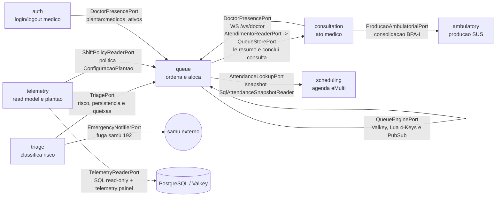

# Context Map — Domínios Clínicos

> Como triage, queue, consultation, ambulatory, scheduling e telemetry se conectam via ports abstratas, sem importar modelos uns dos outros.

Fluxo clínico corre em uma direção: triagem classifica risco, fila ordena e aloca, agenda eMulti programa atendimentos multiprofissionais, consulta executa o ato médico, ambulatory consolida a produção ambulatorial SUS. Telemetria observa tabelas SQL em modo somente-leitura e parametriza o plantão operacional.

Dependência de código corre na direção oposta quando precisa: quem precisa de dado declara uma port, quem detém o dado pluga o adaptador.

Este mapa registra as duas visões e a regra que impede acoplamento direto.

## 1. Mapa visual

Jornada feliz de um atendimento, da esquerda para a direita.

Cada aresta indica a port consumida para atravessar a fronteira.



Leitura: `queue` consome `TriagePort` (triagem, persistência 1:1 e queixas) e `ShiftPolicyReaderPort` (parâmetros de `ConfiguracaoPlantao` em `telemetry`), `scheduling` lê snapshots clínicos via `AttendanceLookupPort` (`SqlAttendanceSnapshotReader`), `consultation` lê e conclui atendimentos via `AtendimentoReaderPort` $\to$ `QueueStorePort` e consolida BPA-I em `ambulatory` via `ProducaoAmbulatorialPort`, `telemetry` lê exclusivamente projeções SQL somente-leitura e cache `telemetry:painel` (sem ler `fila:aptos` ou `plantao:medicos_ativos`), enquanto `auth` e `consultation` WS atualizam a presença médica em `plantao:medicos_ativos` via `QueueEnginePort` (`build_doctor_presence_engine`).

## 2. Upstream e downstream por módulo

Tabela resumo, detalhe por módulo abaixo.

| módulo | papel | consome | expõe | caminho da port |
|---|---|---|---|---|
| triage | classifica risco | nada de outro módulo | alerta de emergência + `TriageService` (`TriagePort`) | `src/modules/triage/application/ports/emergency_notifier.py` |
| queue | ordena e aloca | `TriagePort`, `ShiftPolicyReaderPort` | motor Valkey, `QueueStorePort`, snapshot `AtendimentoSnapshotDTO` | `src/modules/queue/application/ports/queue_engine_port.py` |
| scheduling | agenda programada eMulti | `AttendanceLookupPort` | disponibilidades, slots e reservas eMulti | `src/modules/scheduling/application/ports/attendance_lookup_port.py` |
| consultation | ato médico | `AtendimentoReaderPort`, `ProducaoAmbulatorialPort` | evolução, PEP, liveness e presença WS | `src/modules/consultation/application/ports/producao_ambulatorial_port.py` |
| ambulatory | produção SUS e qualificação | `BpaDirectoryPort`, `EligibilityProviderPort` | `ProducaoAmbulatorialPort` (`build_producao_ambulatorial_service`), BPA-I | `src/modules/ambulatory/application/ports/eligibility_provider.py` |
| telemetry | read model e parametrização | SQL somente-leitura e cache `telemetry:painel` (não lê `fila:aptos` nem `plantao:medicos_ativos`) | painel e snapshot SQL read-only `ler_politica_plantao_snapshot` | `src/modules/telemetry/application/ports/telemetry_reader_port.py` |

### 2.1 triage — origem, sem upstream

Consome apenas núcleo e domínio próprio, nunca fila ou faturamento.

Expõe `src/modules/triage/application/ports/emergency_notifier.py` para fuga de emergência nível um (`SamuEmergencyNotifierAdapter`) e implementa o contrato único `TriagePort` (`avaliar_risco`, `registrar_triagem`, `obter_queixas_por_atendimentos`) consumido por `queue`.

Serviço que orquestra: `src/modules/triage/application/services/triage_service.py`.

### 2.2 queue — centro gravitacional

Consome `src/modules/queue/application/ports/triage_port.py` (unificando risco, persistência 1:1 e leitura de queixas em `TriagePort`) e `src/modules/queue/application/ports/shift_policy_reader_port.py` (`ShiftPolicyReaderPort`, plugada em `src/modules/queue/composition.py` via `TelemetryShiftPolicyReaderAdapter` $\to$ `telemetry.composition.ler_politica_plantao_snapshot`).

Concentra operações Valkey/Lua 4-Keys/cota/PubSub em `src/modules/queue/application/ports/queue_engine_port.py` (`ValkeyQueueEngine`), expõe `src/modules/queue/application/ports/queue_store_port.py` (`QueueStorePort`) restrita a `consultation` e `build_attendance_lookup_reader` (`SqlAttendanceSnapshotReader` / `AtendimentoSnapshotDTO` em `queue.composition` $\to$ `QueueAttendanceSnapshotLookupAdapter` em `scheduling/composition.py`) para `AttendanceLookupPort` em `scheduling`, além de `src/modules/queue/application/ports/paciente_ausente_notifier.py` para no-show de 45s.

Expõe também `build_doctor_presence_engine` em `src/modules/queue/composition.py` para que `auth` (via `DoctorPresencePort` em `src/modules/auth/application/ports/doctor_presence_port.py`) e `consultation` WS (`/ws/doctor/{medico_id}`) atualizem `plantao:medicos_ativos`.

Serviços que orquestram: `src/modules/queue/application/services/fila_service.py`, `src/modules/queue/application/services/alocacao_service.py` e `src/modules/queue/application/services/controle_admissao_service.py`.

Notificação WhatsApp reside em `src/modules/queue/application/ports/notification_port.py` com adaptadores em `src/modules/queue/infrastructure/notifications/`.

### 2.3 consultation — lê sem possuir

Consome `src/modules/consultation/application/ports/atendimento_reader_port.py` (`QueueStoreAtendimentoReaderAdapter` sobre `QueueStorePort`) para checar estado terminal e concluir atendimento em transação única (`concluir_atendimento(..., auto_commit=False)` seguido de `liberar_consulta_ativa_medico` pós-commit), além de `src/modules/consultation/application/ports/producao_ambulatorial_port.py` para consolidar BPA-I em `ambulatory`.

Implementação sql isolada de fallback em `src/modules/consultation/infrastructure/atendimento_reader_sql.py`, ligada em `src/modules/consultation/composition.py`.

Consumidor interno: `PEPService` (`src/modules/consultation/application/services/pep_service.py`) barra evolução em atendimento finalizado e orquestra fechamento atômico.

### 2.4 ambulatory — autoridade de produção ambulatorial SUS

Consome apenas provedores e bases públicas via abstrações próprias, sem acoplamento a triage ou queue, e sem worker externo de elegibilidade (admissão SUS é síncrona e direta em `APTO_PARA_CHAMADA`, conforme [ADR-012](../../adrs/ADR-012-Transicao-100-SUS-Consorcios-Intermunicipais-e-Autenticacao-Tripartida.md)).

Expõe `build_producao_ambulatorial_service` (`src/modules/ambulatory/composition.py`) para consolidação pós-consulta (BPA-I / SISAB / SIGTAP) consumida por `consultation`, além de `ElegibilidadeService` (`src/modules/ambulatory/application/services/eligibility_service.py`), `EligibilityProviderPort` e `ElegibilidadeNotifierPort`.

### 2.5 telemetry — read model e parametrização operacional

Downstream analítico desacoplado e fonte de parâmetros operacionais de plantão sem ciclo de dependências no `tach.toml`.

- **Papel**: Telemetria operacional agregada em tempo real (RF-10) e parametrização dinâmica do plantão da unidade (RF-09).
- **Consome**: `TelemetryReaderPort` (`src/modules/telemetry/application/ports/telemetry_reader_port.py`, método único `obter_painel_telemetria`) executando queries SQL somente-leitura nas tabelas `atendimentos` e `profissionais`, além de `TelemetryCachePort` (`ValkeyTelemetryCache`) exclusivamente para cache volátil do painel na chave `telemetry:painel` (TTL 5s).
- **Expõe**: Endpoints REST para gestores clínicos e médicos (`GET /api/v1/telemetria/painel`, `GET/PUT /api/v1/telemetria/config-plantao`) e leitor SQL somente-leitura `ler_politica_plantao_snapshot` (`src/modules/telemetry/composition.py`) consumido por `queue` via `ShiftPolicyReaderPort`.
- **Relação com outros módulos**: `telemetry.application` e `telemetry.infrastructure` nunca importam `queue`; apenas `queue.composition` lê `telemetry.composition.ler_politica_plantao_snapshot` (grafo estritamente acíclico no `tach.toml`).

### 2.6 scheduling — agenda programada eMulti

Orquestra consultas programadas de Psicologia e Nutrição (Portaria GM/MS nº 635/2023) com exclusão temporal GiST no PostgreSQL 17. Consome `AttendanceLookupPort` (`src/modules/scheduling/application/ports/attendance_lookup_port.py`), adaptada em `src/modules/scheduling/composition.py` (`QueueAttendanceSnapshotLookupAdapter`) sobre `src/modules/queue/composition.py:build_attendance_lookup_reader` (`SqlAttendanceSnapshotReader`), validando vínculo de `atendimento_id` sem instanciar Valkey nem Lua.

## 3. Regra de ouro

Nunca importar modelos, tabelas ou repositórios de outro módulo.

Comunicação síncrona ocorre exclusivamente via ports abstratas e dtos imutáveis.

Violação é bloqueada por `tach.toml` com `just tach` e pelo teste de arquitetura de routers finos.

Sintoma de violação: import cruzado do tipo queue dentro de ambulatory, ou consultation importando atendimento da fila.

Correção: declarar port no consumidor, implementar adaptador na composição, injetar via dependência.

## 4. Onde no código

Ports que sustentam as arestas do diagrama:

- `src/modules/triage/application/ports/emergency_notifier.py`
- `src/modules/queue/application/ports/queue_engine_port.py`
- `src/modules/queue/application/ports/queue_store_port.py`
- `src/modules/queue/application/ports/shift_policy_reader_port.py`
- `src/modules/queue/application/ports/triage_port.py`
- `src/modules/queue/application/ports/paciente_ausente_notifier.py`
- `src/modules/queue/application/ports/notification_port.py`
- `src/modules/auth/application/ports/doctor_presence_port.py`
- `src/modules/scheduling/application/ports/attendance_lookup_port.py`
- `src/modules/scheduling/application/ports/scheduling_repository_port.py`
- `src/modules/consultation/application/ports/atendimento_reader_port.py`
- `src/modules/consultation/application/ports/producao_ambulatorial_port.py`
- `src/modules/ambulatory/application/ports/eligibility_provider.py`
- `src/modules/ambulatory/application/ports/eligibility_notifier.py`
- `src/modules/telemetry/application/ports/telemetry_reader_port.py`
- `src/modules/telemetry/application/ports/config_plantao_port.py`
- `src/modules/telemetry/application/ports/telemetry_cache_port.py`
- `src/modules/queue/infrastructure/notifications/`
- `tach.toml`


## 5. Verificação

```bash
ls src/modules/queue/application/ports/ src/modules/ambulatory/application/ports/ src/modules/consultation/application/ports/ src/modules/triage/application/ports/ src/modules/telemetry/application/ports/

# queue_engine_port, queue_store_port, shift_policy_reader_port, triage_port, atendimento_reader_port, emergency_notifier, telemetry_reader_port visiveis

just tach
# fronteiras modulares ok, sem import cruzado

just test-fast
# suite rapida verde
```

Divergência entre mapa e import real exige atualizar o mapa, nunca relaxar a fronteira.

## 6. Ver também

- [queue domain](./queue-domain.md) — score, double-lock, backpressure
- [triage domain](./triage-domain.md) — classificação e fuga samu
- [consultation domain](./consultation-domain.md) — ato médico e evolução
- [ambulatory domain](./ambulatory-domain.md) — produção ambulatorial SUS e qualificação cadastral
- [domain events](./domain-events.md) — eventos ponto a ponto sem barramento
- [product specification](../product-specification.md) — requisitos contratuais
- [ADR-012: Transição 100% SUS](../../adrs/ADR-012-Transicao-100-SUS-Consorcios-Intermunicipais-e-Autenticacao-Tripartida.md)
