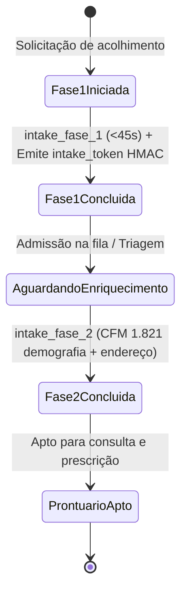
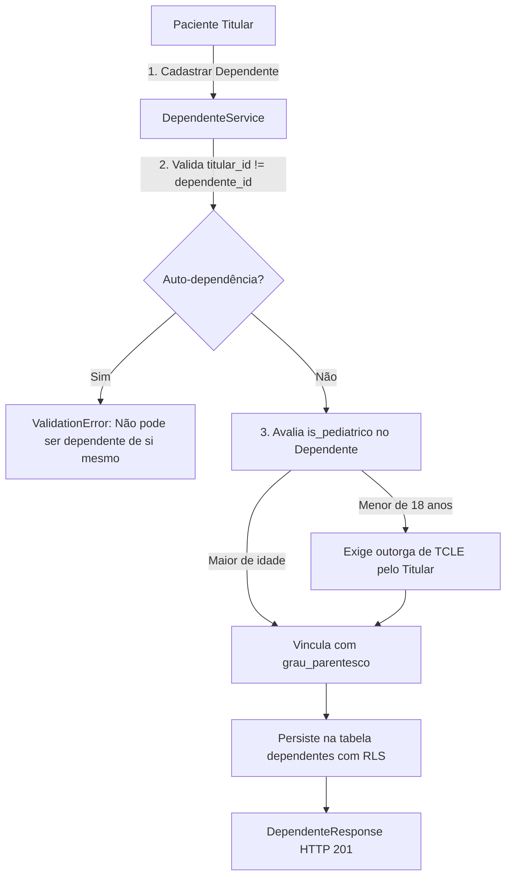

# Identity Domain

> Cadastro em duas fases com acolhimento ágil (<45s) e enriquecimento regulatório (CFM 1.821/2007), dependentes pediátricos, profissionais médicos com CRM/UF e isolamento multitenant estrito via RLS.

## 1. Contexto

O domínio de Identidade é responsável pelo ciclo de vida cadastral e pela governança de acesso das entidades fundamentais do sistema:

A entidade `Paciente` viabiliza o onboarding em duas fases (NEC-01 / CFM 1.821), separando a admissão clínica emergencial da qualificação civil completa:
- Fase 1 (Acolhimento clínico ágil < 45s): coleta estritamente os dados essenciais para triagem e admissão imediata (CPF ou CNS, data de nascimento, telefone de contato, queixa principal e aceite do TCLE). Gera um token provisório de acolhimento (`intake_token`) HMAC-SHA256, permitindo avanço imediato para triagem e fila sem travas burocráticas.
- Fase 2 (Enriquecimento cadastral regulatório CFM 1.821/2007): complementação demográfica e geográfica antes da consulta ou dispensação (nome social, nome completo da mãe, sexo biológico, CEP, logradouro, número, bairro, cidade, UF e alergias medicamentosas). Informações cruciais para acionamento do SAMU 192 e emissão de receituário de controle especial.

A entidade `Dependente` estabelece a vinculação legal entre paciente titular e dependentes, suportando a outorga de TCLE por representante legal para pacientes menores de 18 anos (`is_pediatrico()`).

A entidade `Profissional` gerencia o corpo clínico e administrativo, impondo a obrigatoriedade e conformidade regulatória de CRM e UF para médicos (Resolução CFM 2.314/2022).

A entidade `Organizacao` modela a raiz de tenant (municípios públicos no SUS ou instituições privadas).

O suporte a token polimórfico na camada de apresentação aceita tanto tokens provisórios de intake HMAC-SHA256 (2 partes) quanto tokens JWT corporativos/OTP (3 partes), validando posse e integridade do tenant.

Vocabulário ubíquo: `Paciente`, `Dependente`, `Profissional`, `Organizacao`, `nome_social`, `onboarding_fase1`, `onboarding_fase2`, `intake_token`, `grau_parentesco`, `outorga_tcle`, `is_pediatrico`, `clean_digits`, `alergias`.

Multitenancy estrito: todas as tabelas contêm chave estrangeira `organizacao_id` e políticas ativas de Row-Level Security (RLS) no PostgreSQL.

## 2. Regras

- **RN-IDE-01 — Documento primário mandatório do paciente (CPF ou CNS).** `Paciente` exige ao menos um documento nacional válido (`chk_documento_paciente_obrigatorio`). CPF requer exatamente 11 dígitos numéricos e CNS 15 dígitos. Índices parciais únicos por tenant (`uq_paciente_org_cpf`, `uq_paciente_org_cns`) bloqueiam duplicidades. [Fonte](../product-specification.md) (RF-01)
- **RN-IDE-02 — Onboarding em 2 fases: acolhimento ágil e enriquecimento CFM.** Fase 1 prioriza velocidade de entrada (<45s) e emite `intake_token`; Fase 2 adiciona nome da mãe, sexo biológico, endereço completo com CEP e histórico de alergias medicamentosas em JSONB, cumprindo a Resolução CFM 1.821/2007 para prontuário eletrônico e salvaguarda SAMU 192. [Fonte](../product-specification.md) (RF-01)
- **RN-IDE-03 — Dignidade e soberania do Nome Social (CFM 1.821/2007).** `nome_social` é opcional no cadastro, porém soberano na identificação visual em chamadas de painel, prontuários e documentos médicos emitidos quando preenchido pelo paciente. [Fonte](../product-specification.md) (RF-01)
- **RN-IDE-04 — CRM e UF obrigatórios para médicos (CFM 2.314/2022).** A entidade `Profissional` com papel `MEDICO` rejeita instanciação ou atualização sem `crm` e `crm_uf` devidamente informados no construtor do modelo rico. [Fonte](../product-specification.md) (RF-01)
- **RN-IDE-05 — Vinculação de dependentes e vedação de auto-dependência.** `Dependente` conecta `titular_id` a `dependente_id` sob constraint de unicidade (`uq_dependente_vinculo`). É expressamente vedado vincular um paciente como dependente de si mesmo (`titular_id != dependente_id`). Pacientes menores de idade (`is_pediatrico() == True`) dependem da outorga de TCLE do titular legal. [Fonte](../product-specification.md) (RF-01)
- **RN-IDE-06 — Isolamento Multitenant estrito via RLS.** Pacientes, dependentes e profissionais são particionados por `organizacao_id`, com isolamento garantido no banco de dados via PostgreSQL Row-Level Security. [Fonte](../architecture/data-model.md)
- **RN-IDE-07 — Autenticação de intake por token polimórfico.** Dependências de autorização na apresentação inspecionam o formato do token (`len(parts) == 2` para HMAC provisório ou `3` para JWT corporativo), validando se o portador detém a posse do registro do paciente titular e pertence ao tenant solicitado. [Fonte](../product-specification.md) (RF-01)

Guardiões: `Paciente` e `Profissional` utilizam `clean_digits` para higienizar pontuações e traços de documentos e telefones antes de persistir; `is_pediatrico` calcula a idade dinamicamente com base na data de nascimento e data atual.

## 3. Máquina de estados

Ciclo de vida do onboarding bifásico do paciente:



Fluxo de validação de dependente e outorga legal de TCLE:



## 4. Relações

- Consumo por Triagem e Fila: `queue` e `triage` consomem dados do paciente e validam o token provisório de intake emitido por `identity`.
- Leitura desacoplada via porta: `IdentityReaderPort` (em `src/modules/identity/infrastructure/identity_reader_sql.py`) expõe métodos de consulta para outros módulos sem acoplar entidades ORM internas.
- Gestão de Onboarding: `OnboardingService` orquestra as etapas de Fase 1 e Fase 2, gerando o token assinado HMAC via `src/core/security.py`.
- Gestão de Dependentes: `DependenteService` gerencia vínculos de tutela e parentesco, garantindo integridade relacional.
- Rotas REST finas: `onboarding_router.py` e `pacientes_router.py` delegam regras de negócio a `OnboardingServiceDep` e `DependenteServiceDep`.

## 5. Peculiaridades

- Sanitização de dígitos no domínio: o helper `clean_digits` assegura que CPF, CNS, telefone e CEP sejam armazenados de forma limpa, prevenindo falhas de matching causadas por máscaras de formatação distintas no frontend.
- Histórico de alergias em JSONB: o modelo `Paciente` encapsula `alergias` como lista JSONB no Postgres, expondo métodos ricos (`adicionar_alergia`, `remover_alergia`, `tem_alergia`) com busca case-insensitive.
- Token de acolhimento stateless: o `intake_token` HMAC-SHA256 carrega claims assinadas criptograficamente (`paciente_id`, `organizacao_id`, `telefone`), dispensando consultas prévias ao banco durante o fluxo rápido de triagem.
- Cálculo de menoridade sem dependência externa: o método `is_pediatrico()` computa idade considerando ano, mês e dia relativos a `date.today()`, suportando casos de anos bissextos com precisão legal.

## 6. Onde no código

- `src/modules/identity/domain/models/paciente.py`
- `src/modules/identity/domain/models/dependente.py`
- `src/modules/identity/domain/models/profissional.py`
- `src/modules/identity/domain/models/organizacao.py`
- `src/modules/identity/domain/models/_helpers.py`
- `src/modules/identity/domain/exceptions.py`
- `src/modules/identity/domain/validators.py`
- `src/modules/identity/application/dtos.py`
- `src/modules/identity/application/ports/identity_reader_port.py`
- `src/modules/identity/application/services/onboarding_service.py`
- `src/modules/identity/application/services/dependente_service.py`
- `src/modules/identity/infrastructure/identity_reader_sql.py`
- `src/modules/identity/presentation/schemas.py`
- `src/modules/identity/presentation/dependencies.py`
- `src/modules/identity/presentation/routers/onboarding_router.py`
- `src/modules/identity/presentation/routers/pacientes_router.py`
- `src/modules/identity/composition.py`
- `src/core/security.py`
- `migrations/versions/0001_initial_schema.py`
- `migrations/versions/0005_paciente_nome_social.py`

Prova viva:

```bash
ls tests/unit | rg -E "identity|onboarding|intake"
# test_identity_dependencies.py
# test_identity_models.py
# test_identity_reader.py
# test_identity_validators.py
# test_intake_token.py
# test_onboarding_schemas.py
```

## 7. Verificação

```bash
rg -n "class Paciente|class Profissional|class Dependente" src/modules/identity/
# paciente.py:26 class Paciente
# profissional.py:27 class Profissional
# dependente.py:22 class Dependente

uv run pytest tests/unit/test_identity_models.py tests/unit/test_identity_reader.py tests/unit/test_identity_validators.py tests/unit/test_identity_dependencies.py tests/unit/test_onboarding_schemas.py tests/unit/test_intake_token.py -q --no-cov
# 72 passed
```

Sem corrigir código. Divergência entre documentação e invariantes do modelo exige ajuste na documentação para refletir as regras clínicas e regulatórias vigentes.

## 8. Ver também

- [Product Specification](../product-specification.md) — RF-01 identificação e onboarding bifásico
- [Data Model](../architecture/data-model.md) — tabelas `pacientes`, `profissionais`, `dependentes` e `organizacoes`
- [Auth Domain](./auth-domain.md) — credenciais corporativas e autenticação OTP de pacientes
- [Domains Index](./index.md) — catálogo geral dos domínios da aplicação
