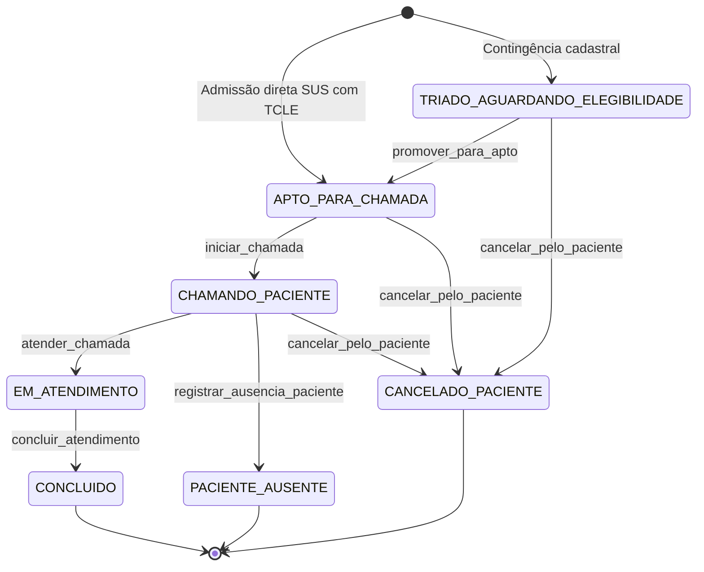

# Queue Domain

> Fila virtual com score determinístico de 64 bits, alocação atômica via Lua e backpressure estocástico. Decide ordem, trava chamada, suspende admissão sem tocar ato médico.

## 1. Contexto

Queue recebe prioridade clínica e transforma em ordem de chamada. Três peças: score ordena, Lua aloca, admissão freia entrada.

Vocabulário ubíquo: `score` (64 bits), `fila aptos` (ZSET Valkey), `lock médico`, `lock atendimento`, `ring timeout 45s`, `alpha` (margem estocástica), `transbordo`.

Entrada via RF-03 (alocação e chamada) e RF-04 (backpressure). Saída alimenta consulta: médico trava chamada, paciente conecta, atendimento inicia.

Escopo termina na entrega do par médico-paciente. Elegibilidade decide quem fica apto, consulta decide o que acontece dentro do ato médico.

Chaves Valkey concentram-se em `ValkeyQueueEngine` (`src/modules/queue/infrastructure/valkey_queue_engine.py`): `fila:aptos` (ZSET de aptos), `lock:medico:{id}`, `lock:atendimento:{id}`, `lock:consulta_ativa:medico:{id}` (TTL 7200s), `plantao:medicos_ativos` (SET de presença médica), `queue:admissoes:{data}` (contador diário com TTL 48h) e `lock:sweeper:fila_aptos` (TTL 55s).

Parâmetros operacionais vêm dinamicamente de `ConfiguracaoPlantao` (`telemetry`) via `ShiftPolicyReaderPort` (defaults em `ShiftPolicyDTO`: TMA 600s, alpha 1,25, cota diária 300, tolerância ring 45s).

## 2. Regras

- **RN01 — Score 64 bits: prioridade domina, tempo desempata.** `calcular_score` devolve `prioridade * 10^12 + epoch`; menor inteiro chama primeiro dentro do nível, FIFO cronológico puro. [Fonte](../product-specification.md) (RN01)
- **RN01 (bis) — Identidade FIFO via UUIDv7 e Preservação de Antiguidade ($T_0$).** `Atendimento` usa `uuid7()` como PK. Na regularização ou promoção para `APTO_PARA_CHAMADA`, o timestamp original de acolhimento (`data_entrada_fila` ou `criado_em`) é rigorosamente preservado (NC-QUE-04 / US-05). [Fonte](../product-specification.md) (RN01, RN03)
- **RN02 — Lua 4-Keys anti-overbooking e seleção atômica com ring de 45s.** `alocar_chamada.lua` e `alocar_proximo.lua` validam `KEYS[1]` (`lock:medico:{id}`) e `KEYS[4]` (`lock:consulta_ativa:medico:{id}`) antes de checar `KEYS[2]` (`lock:atendimento:...`) e remover de `KEYS[3]` (`fila:aptos`), aplicando TTL de ring; `0` médico ocupado/em consulta (`MedicoOcupadoError` HTTP 409), `-1` indisponível, `1` sucesso. [Fonte](../product-specification.md) (RN02)
- **RN02 (bis) — No-show determinístico.** `iniciar_chamada` abre janela CHAMANDO; sem resposta em 45s, `registrar_ausencia_paciente` fecha em PACIENTE_AUSENTE e libera médico. [Fonte](../product-specification.md) (RN02)
- **RN05 — Backpressure com α, presença real e cota atômica.** `FilaService.admitir_paciente` lê `plantao:medicos_ativos` (alimentado por `AuthService` via `DoctorPresencePort`, `/chamar-proximo` e `/ws/doctor/{id}`), aplica parâmetros de `ShiftPolicyReaderPort`, reserva cota diária via `consumir_cota_ou_bloquear` (`INCR` + `DECR` compensatório; `estornar_cota_diaria` em rollback de BD) e suspende entrada com `AdmissaoFilaSuspensaError` (HTTP 503) + log estruturado quando `SEM_MEDICOS_ATIVOS`, `COTA_ATINGIDA` ou `CAPACIDADE_EXCEDIDA`. [Fonte](../product-specification.md) (RN05)
- **RN07 / ADR-007 — Trilha de Auditoria Clínica Append-Only.** Todo evento do ciclo de vida da fila (`ADMISSAO_PACIENTE`, `ELEGIBILIDADE_CONFIRMADA`, `CHAMADA_INICIADA`, `CHAMADA_ATENDIDA`, `TIMEOUT_CHAMADA_NO_SHOW`, `ATENDIMENTO_CANCELADO_PACIENTE`, `PIORA_CLINICA_REGISTRADA`) persiste atomicamente um `AuditEvent` via `AuditTrailPort` antes do commit do service. Catálogo canônico: [Catálogo de Eventos](../../reference/audit/event-catalog.md). Prova viva: `tests/unit/test_queue_audit_events.py` e `tests/integration/test_clinical_audit_integration.py`.

Guardiões: `Atendimento.__init__` valida `status` eagerly; `promover_para_apto` exige TCLE prévio e preserva timestamp $T_0$; `iniciar_chamada` exige médico não vazio; `cancelar_pelo_paciente` aceita opcionalmente `motivo` higienizado e bloqueia `EM_ATENDIMENTO`; `atualizar_prioridade` preserva soberania diagnóstica.

Alpha fora de `1,20–1,30` é erro de configuração, não de domínio: função valida `alpha > 0` e TMA positivo, resto é política de deploy via `ConfiguracaoPlantao`.

Exemplo numérico RN01: emergência (1) com epoch atual gera ~`1000000000000 + epoch`; eletivo (5) gera ~`5000000000000 + epoch`. Diferença de nível vale `10^12`, espera máxima humana vale `10^8`; prevalência garantida por magnitude.

Lua executa de forma indivisível: `alocar_proximo.lua` varre `ZRANGE fila:aptos 0 (max_scan - 1)` em 1 round-trip, pulando candidatos com `lock:atendimento:{cand}` e retornando `{1, cand}` para o primeiro elegível — eliminando corridas em cascata sob >3 médicos simultâneos.

Admissão avalia em ordem fixa: `SEM_MEDICOS_ATIVOS`, `COTA_ATINGIDA` (reserva atômica no Valkey antes da transação SQL, estornada se houver exceção), carga estocástica `CAPACIDADE_EXCEDIDA`. Todas as mutações em Valkey (`inserir_ou_atualizar_fila`, `remover_da_fila`, `liberar_ring`, `liberar_consulta`) ocorrem estritamente **pós-commit** no PostgreSQL.

## 3. Máquina de estados

Sete estados em `StatusAtendimento` (`src/modules/queue/domain/enums.py`), três terminais em `TERMINAL_STATUSES` (CONCLUIDO, PACIENTE_AUSENTE, CANCELADO_PACIENTE). Toda transição passa por `_assegurar_nao_finalizado` primeiro.



`promover_para_apto` só sai de TRIADO e exige `tcle_hash` presente. Sem consentimento, sem fila; guarda RN07 dentro da transição RN03.

`iniciar_chamada` só sai de APTO e grava `medico_id` + `chamada_iniciada_em`. Lua garante reserva distribuída, modelo garante reserva de estado; ambos precisam concordar.

`atender_chamada` só sai de CHAMANDO. Conexão do paciente é o único evento que abre EM_ATENDIMENTO; nenhum atalho de código pula esse passo.

`registrar_ausencia_paciente` só sai de CHAMANDO e carimba `chamada_finalizada_em`. Terminal: ausência encerra jornada, retorno exige novo atendimento.

`concluir_atendimento` só sai de EM_ATENDIMENTO. Único caminho para CONCLUIDO; consulta decide quando, queue apenas registra.

`cancelar_pelo_paciente` aceita TRIADO, APTO e CHAMANDO, recusa EM_ATENDIMENTO. Ato médico em curso nunca sofre corte administrativo.

O hash do TCLE é validado e fixado na criação do atendimento (SHA-256 obrigatório como pré-condição de `promover_para_apto`).

Helpers de leitura espelham estados sem mutar: `is_em_fila`, `is_apto_para_chamada`, `is_chamando`, `is_em_atendimento`, `is_ativo`, `is_finalizado`. Painel usa esses predicados; nunca compara string de status na mão.

Métricas derivadas vivem no agregado: `tempo_espera_segundos` (`chamada_iniciada_em - data_entrada_fila`), `duracao_chamada_segundos` (`chamada_finalizada_em - chamada_iniciada_em`). Nulos quando evento ainda não ocorreu; sem exceção, sem zero falso.

## 4. Relações

- Admissão SUS direta e imediata (ADR-012 / ADR-013). O acolhimento via `POST /api/v1/fila/admissao` (`AdmissaoRequest`, sem `medicos_ativos`) valida TCLE e risco ACR via `TriagePort`, lê política via `ShiftPolicyReaderPort` e presença real em `plantao:medicos_ativos`, reserva cota atômica e persiste `Atendimento` em `APTO_PARA_CHAMADA`, inserindo no ZSET `fila:aptos` somente pós-commit.
- Isolamento profundo via `QueueEnginePort` (`src/modules/queue/application/ports/queue_engine_port.py`) implementado por `ValkeyQueueEngine` (`src/modules/queue/infrastructure/valkey_queue_engine.py`): concentra scripts Lua 4-Keys (`AlocacaoCodigo`), cota diária, presença médica, lock de sweeper e Pub/Sub (eliminando `LuaScriptPort`, `QueueOverflowNotifierPort` e `DoctorCallNotifierPort`).
- Persiste em tabela `atendimentos` (FKs `pacientes` e `profissionais` com `RESTRICT`, índices `idx_atendimentos_status`, `idx_atendimentos_paciente`, `idx_atendimentos_medico` e `idx_atendimentos_fila`). [Modelo](../architecture/data-model.md)
- Publica ausência via `PacienteAusenteNotifierPort` (`paciente_ausente_notifier.py`) e eventos realtime Pub/Sub (`INCOMING_CALL`, `CALLED`, `CALL_CANCELLED`) via `QueueEnginePort`.
- Transação única com `consultation` (ADR-001 §6): `QueueStorePort.concluir_atendimento(..., auto_commit=False)` carrega com `with_for_update=True` e executa apenas `flush()` dentro de `PEPService.finalizar_consulta`, liberando `lock:consulta_ativa:medico:{id}` após o commit único via `liberar_consulta_ativa_medico`.
- Orquestra concorrência e compensação segura conforme desenho de filas e locks (`devolver_para_fila(..., nx=True)` em rollback de alocação e proteção pós-commit de `enqueue_job` em `_compensar_falha_agendamento`). [Concorrência](../architecture/concurrency-and-queues.md)
- Notifica convocação médica protegida por taxa via `NotificationPort.send_whatsapp`, decorada na raiz de composição por `RateLimitedNotificationAdapter` sobre Valkey.
- Auto-cura e reconciliação via sweeper blindado: `reconciliar_fila_orphans_task` (`src/worker/tasks/sweeper.py`) adquire `lock:sweeper:fila_aptos` (`NX EX 55`), pagina em lotes keyset (`batch_size=200`), verifica locks em 1 pipeline (`esta_bloqueado_para_reconciliacao`) e reinjeta órfãos confirmados com `ZADD NX`.
- Routers REST finos expõem as operações centrais da fila clínica em conformidade com ADR-001/ADR-008:
  - `POST /api/v1/fila/chamar-proximo`: Médico adquire atomicamente o próximo paciente via `alocar_proximo.lua` (HTTP 200 `{alocado: true|false}` ou HTTP 409 `MEDICO_OCUPADO`).
  - `GET /api/v1/fila/posicao/{atendimento_id}`: Retorna `PosicaoFilaResponse` com posição 1-based, `prioridade_clinica`, `chamada_iniciada_em`, `ttl_segundos` (suportando restauração de countdown pós-F5) e estimativa usando `policy.tma_padrao_segundos`.
  - `POST /api/v1/fila/atendimentos/{atendimento_id}/regularizar`: Regularização ou contingência assistencial preservando antiguidade original $T_0$ (RN01, RN03, US-05).
  - `POST /api/v1/fila/cancelar/{atendimento_id}`: Cancelamento voluntário ou recusa explícita do toque (`CHAMANDO_PACIENTE`) com `with_for_update=True`, limpeza pós-commit no Valkey e evento `CALL_CANCELLED` no canal do médico.
  - `POST /api/v1/fila/piora`: Salvaguarda clínica via `PioraClinicaInput` (`Protocol`) + `TriagePort`, mutando Valkey apenas pós-commit com `atendimento.prioridade_clinica` e retornando `PioraClinicaResponse` sem campos espelho duplicados (RF-06).
- Transmite posição e avanço em tempo real via WebSocket (`/ws/queue/{atendimento_id}`) autenticado pré-accept via `?token=` (HMAC ou JWT) com posse Anti-IDOR em sessão efêmera (códigos 4401/4403).

## 5. Peculiaridades

- Score determinístico, sem aprendizado de máquina. Mesmo `(prioridade, epoch)` sempre devolve mesmo inteiro; auditoria reproduz ordem sem replay de eventos.
- Prioridade multiplica por `10^12`, epoch soma segundos Unix. Nível urgente jamais perde para eletivo antigo; invariante de prevalência clínica vira aritmética.
- Double-lock previne overbooking nos dois sentidos. Médico ocupado retorna `0` (HTTP 409), atendimento capturado retorna `-1` (retry); nunca meio-estado.
- TTL de 45s é deadlock breaker, não SLA clínico. Expirou sem conexão, lock some sozinho; fila nunca trava por crash de worker.
- Despacho de notificação não-bloqueante (best-effort). Falha de rede ou exaustão de cota no rate limiter de notificações nunca aborta nem dá rollback na transação de alocação da fila nem no ring do médico.
- `calcular_score` no domínio de scoring (`src/modules/queue/domain/scoring.py`) valida `1 <= prioridade <= 5` (`ValidationError` fora dessa faixa) e aceita `timestamp_epoch: int | float | datetime | None = None`, assumindo `int(datetime.now(UTC).timestamp())` quando `None`; na fila e na regularização, o serviço passa explicitamente `atendimento.data_entrada_fila` para preservar $T_0$.
- Ato médico nunca cortado — ponte RN06. Nenhum timer, quota ou backpressure transiciona EM_ATENDIMENTO para fora; TMA gera só sinal visual discreto. [Fonte](../product-specification.md) (RN06)
- Admissão suspensa protege quem já entrou. Transbordo fecha a porta, nunca despeja a sala; contingência vira evento externo, não cancelamento interno.
- UUIDv7 como PK dá FIFO aproximado até sem score. Inserção ordenada por tempo correlaciona id com chegada; índice de fila refina com prioridade.
- `atualizar_prioridade` permite reclassificar sem sair da fila. Soberania do assistente (RN-REG-01) sobrepõe triagem inicial; score recalcula no próximo ciclo.
- `CheckConstraint` no banco espelha validação do modelo. Status e prioridade 1–5 checados em DDL e em `__init__`; invariante sobrevive a escrita fora da ORM.
- Erros de domínio tipados, não genéricos. `TransicaoEstadoInvalidaError` para salto ilegal, `ValidationError` para dado inválido, `AtendimentoNaoEncontradoError` (404), `MedicoOcupadoError` / `AtendimentoNaoDisponivelError` (409) e `AdmissaoFilaSuspensaError` (503) na borda de serviço.
- `FilaService` delega o cálculo de score diretamente para a função pura `scoring.calcular_score` e isola toda manipulação Valkey atrás de `QueueEnginePort`.

## 6. Onde no código

- `src/modules/queue/domain/scoring.py`
- `src/modules/queue/domain/models/atendimento.py`
- `src/modules/queue/infrastructure/lua/alocar_chamada.lua`
- `src/modules/queue/infrastructure/lua/alocar_proximo.lua`
- `src/modules/queue/infrastructure/valkey_queue_engine.py` (`ValkeyQueueEngine`)
- `src/modules/queue/infrastructure/lua_loader.py` (`LuaScriptManager`)
- `src/modules/queue/application/ports/queue_engine_port.py` (`QueueEnginePort`)
- `src/modules/queue/application/ports/shift_policy_reader_port.py` (`ShiftPolicyReaderPort`, `ShiftPolicyDTO`)
- `src/modules/queue/application/ports/queue_store_port.py` (`QueueStorePort`)
- `src/modules/queue/application/services/fila_service.py` (`FilaService`)
- `src/modules/queue/application/ports/triage_port.py` (`TriagePort`, `TriageEvaluationDTO`)
- `src/modules/queue/presentation/schemas.py` (`AdmissaoRequest`, `PosicaoFilaResponse`, `PioraClinicaResponse`, `ChamarProximoResponse`)
- `src/modules/queue/presentation/routers/admissao_router.py` (`POST /api/v1/fila/admissao`)
- `src/modules/queue/presentation/routers/alocacao_router.py` (`POST /api/v1/fila/chamar-proximo`)
- `src/modules/queue/presentation/routers/fila_router.py` (`GET /posicao/{id}`, `POST /cancelar/{id}`, `POST /piora`, `POST /atendimentos/{id}/regularizar`)
- `src/modules/queue/presentation/routers/queue_ws_router.py` (`/ws/queue/{atendimento_id}`)
- `src/modules/queue/presentation/dependencies.py`
- `src/modules/queue/application/services/alocacao_service.py` (`AlocacaoChamadaService`)
- `src/modules/queue/application/services/controle_admissao_service.py` (`ControleAdmissaoService`)
- `src/modules/queue/application/ports/allocation_port.py` (`AlocacaoCodigo`)
- `src/modules/queue/application/ports/notification_port.py`
- `src/modules/queue/composition.py` (`build_queue_engine`, `TelemetryShiftPolicyReaderAdapter`, `get_notification_adapter`)
- `src/modules/queue/infrastructure/notifications/rate_limited_adapter.py`
- `src/modules/queue/infrastructure/notifications/rate_limiter.py`
- `src/modules/queue/infrastructure/notifications/logging_adapter.py`
- `tests/doubles.py` (`FakeQueueEngine`, `FakeShiftPolicyReader`, `FakeTriagePort`)
- `tests/unit/test_queue_schemas.py`
- `tests/unit/test_queue_store.py`
- `tests/unit/test_admissao_service.py`
- `tests/unit/test_alocacao_service.py`
- `tests/unit/test_alocacao_service_notifications.py`
- `tests/unit/test_composition_wiring.py`
- `tests/unit/test_atendimento_model.py`
- `tests/unit/test_controle_admissao.py`
- `tests/unit/test_fila_service.py`
- `tests/unit/test_fila_regularizacao.py`
- `tests/unit/test_notifications.py`
- `tests/unit/test_queue_cota_diaria.py`
- `tests/unit/test_fila_service_operacoes.py`
- `tests/unit/test_alocacao_router.py`
- `tests/unit/test_fila_router.py`
- `tests/integration/test_admissao_integrada_flow.py`
- `tests/integration/test_alocar_chamada_concurrency.py`
- `tests/integration/test_valkey_rate_limiter.py`
- `tests/integration/test_regularizacao_flow.py`
- `frontend/src/features/queue/components/virtual-waiting-room.tsx`
- `frontend/src/features/queue/components/incoming-call-ring-modal.tsx`
- `frontend/src/features/queue/components/piora-clinica-modal.tsx`
- `frontend/src/features/queue/components/cancelar-fila-dialog.tsx`

Prova viva:

```bash
ls tests/unit | rg -i "alocacao|atendimento|admissao|fila|queue"
# test_admissao_service.py, test_alocacao_service.py, test_atendimento_model.py, test_controle_admissao.py, test_fila_service.py, test_queue_store.py
```

## 7. Verificação

```bash
rg -n "def calcular_score|def iniciar_chamada|def registrar_ausencia_paciente" src/modules/queue/domain/
# scoring.py:11 def calcular_score; atendimento.py:214 iniciar_chamada, :271 registrar_ausencia_paciente

rg -n "KEYS\[4\]|class ValkeyQueueEngine" src/modules/queue/infrastructure/
# alocar_chamada.lua:5 | alocar_proximo.lua:5 | valkey_queue_engine.py:ValkeyQueueEngine

uv run pytest tests/unit/test_alocacao_service.py tests/unit/test_atendimento_model.py -q --no-cov
```

Sem corrigir código. Divergência entre doc e guardião real exige atualizar doc, nunca relaxar transição clínica.

## 8. Ver também

- [Product Specification](../product-specification.md) — RN01, RN02, RN05, RN06 contratuais
- [Data Model](../architecture/data-model.md) — tabela `atendimentos` e índices clínicos de fila
- [Concurrency and Queues](../architecture/concurrency-and-queues.md) — ZSET, double-lock Lua, TTL 45s
- [Domains Index](./index.md) — visão conceitual por domínio
