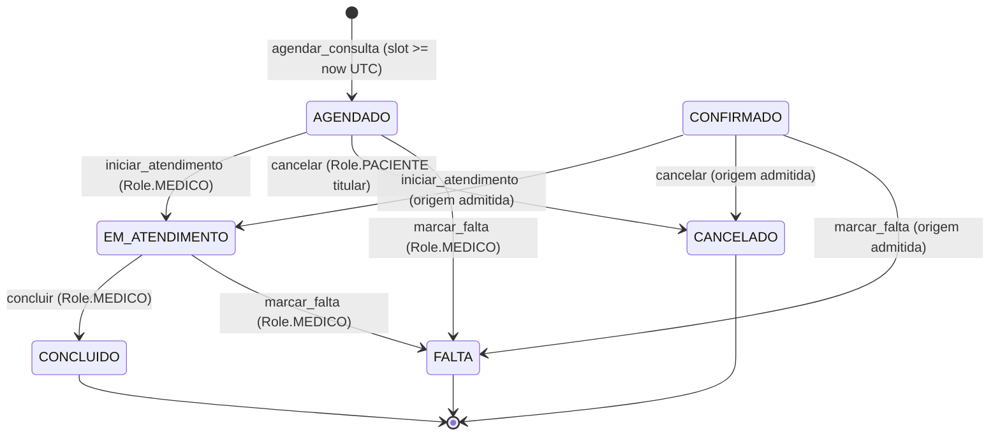

# Scheduling Domain

> Agenda programada multiprofissional (eMulti: Psicologia e Nutrição) com geração dinâmica de slots, lock pessimista em mutações e prevenção de double-booking por exclusão temporal GiST no PostgreSQL 17.

## 1. Contexto

O domínio de Agendamento (`scheduling`) orquestra consultas programadas das equipes multiprofissionais (**eMulti**, Portaria GM/MS nº 635/2023) em paralelo à fila de pronto-atendimento espontâneo (`queue`). Enquanto `queue` ordena urgências imediatas no Valkey, `scheduling` mantém janelas semanais recorrentes de atendimento e reservas nominais no PostgreSQL 17.

Vocabulário ubíquo: `EspecialidadeAgenda` (`PSICOLOGIA`, `NUTRICAO`), `AgendaDisponibilidade` (janela semanal em horário UTC), `Agendamento`, `StatusAgendamento`, `SlotDisponivelDTO`, `excl_agenda_disp_sobreposicao`, `excl_agendamento_slot_ativo`, `excl_agendamento_paciente_ativo` (exclusões temporais GiST), `AttendanceLookupPort`, `SqlAttendanceSnapshotReader`.

Plataforma única: `agenda_disponibilidades` e `agendamentos` operam com FKs diretas para `profissionais`, `pacientes` e `atendimentos`, sem `organizacao_id` nem RLS. Todas as datas operam normalizadas em UTC (`normalizar_utc`).

## 2. Regras

- **RN-SCH-01 — Catálogo de especialidades eMulti.** `ESPECIALIDADE_CATALOGO` publica `PSICOLOGIA` (duração padrão 50 min) e `NUTRICAO` (duração padrão 30 min); `validar_especialidade_agenda` normaliza entradas e rejeita códigos desconhecidos com `ValidationError`. [Fonte](../../user-stories/US-16-portal-cidadao-e-agendamento-emulti.md)
- **RN-SCH-02 — Janelas semanais e detecção de sobreposição concorrente.** `AgendaDisponibilidade` exige `dia_semana` entre `0` (segunda) e `6` (domingo), horários naive UTC com `hora_fim > hora_inicio` e `duracao_minutos` entre `15` e `120`. `cadastrar_disponibilidade` adquire `pg_advisory_xact_lock` por `(profissional_id, dia_semana)` via `adquirir_lock_disponibilidade`, verifica `sobrepoe()` e é protegido no banco pela constraint GiST `excl_agenda_disp_sobreposicao` (`numrange` sobre época de `hora_inicio`/`hora_fim`, `where ativo IS TRUE`), traduzindo violações em `SlotIndisponivelError` (HTTP 409).
- **RN-SCH-03 — Grade estrita, corte do passado e anti-double-booking.** `AgendaDisponibilidade.gerar_slots_disponiveis` filtra `slot_inicio >= agora_utc` em `GET /slots` enquanto `listar_agendamentos_ocupados` restringe a consulta aos `profissional_ids` das janelas ativas. `agendar_consulta` bloqueia `slot_inicio < now(UTC)` (`ValidationError`), resolve o intervalo por `AgendaDisponibilidade.resolver_slot_em_janelas` e checa `buscar_agendamento_conflitante(..., paciente_id=...)`. No banco, `uq_agendamento_slot_ativo`, `excl_agendamento_slot_ativo` (por `profissional_id`) e `excl_agendamento_paciente_ativo` (por `paciente_id`, `USING gist` com `tstzrange(slot_inicio, slot_fim, '[)')` e `where status NOT IN ('CANCELADO', 'FALTA')`) garantem atomicidade concorrente, traduzindo `23505`/`23P01` em `SlotIndisponivelError`.
- **RN-SCH-04 — Ciclo de estados completo com transições guardadas.** `StatusAgendamento` declara seis estados (`AGENDADO`, `CONFIRMADO`, `EM_ATENDIMENTO`, `CONCLUIDO`, `CANCELADO`, `FALTA`). Agendamentos nascem em `AGENDADO`, transicionam via `iniciar_atendimento()` para `EM_ATENDIMENTO` (`AGENDADO | CONFIRMADO`), via `concluir()` para `CONCLUIDO` (`EM_ATENDIMENTO`), via `marcar_falta()` para `FALTA` (`AGENDADO | CONFIRMADO | EM_ATENDIMENTO`) ou via `cancelar()` para `CANCELADO` (`AGENDADO | CONFIRMADO`). Saltos ilegais disparam `TransicaoAgendamentoInvalidaError` (HTTP 409); conflito em `uq_agendamento_atendimento_id` ao iniciar executa `rollback()` e lança `ConflictError` (HTTP 409) com os IDs ofensivos.
- **RN-SCH-05 — Anti-IDOR, RBAC e leitura com lock (`for_update=True`).** Rotas públicas do catálogo (`GET /especialidades`, `GET /slots`) dispensam credencial de paciente e limitam consultas a janelas de até `_MAX_JANELA_SLOTS_DIAS` (`31` dias). Operações do paciente exigem `Role.PACIENTE` (`PacienteSchedulingAuthDep`) extraindo `paciente_id` do JWT; operações de agenda (`/disponibilidades`, `/agenda/dia`, `/iniciar`, `/concluir`, `/falta`) exigem `Role.MEDICO` (`ProfissionalSchedulingAuthDep`). Mutações carregam registro via `buscar_agendamento_por_id(..., for_update=True)` antes de transicionar.

Guardiões: `Agendamento.__init__` valida `slot_fim > slot_inicio` e `observacoes <= 500` caracteres; `_validar_atendimento_vinculado` valida titularidade de `paciente_id` e `medico_id` via `AttendanceLookupPort` (dependência obrigatória de `SchedulingService`) antes de vincular `atendimento_id`.

## 3. Máquina de estados



O método privado `_transicionar` valida pertencimento ao conjunto de origens permitidas, atualiza `status` e `atualizado_em = datetime.now(UTC)` e delega o `commit()` único ao `SchedulingService` (ADR-001 §6).

## 4. Relações

- **Referências relacionais (FKs `RESTRICT`):** `agenda_disponibilidades` referencia `profissionais.id`; `agendamentos` referencia `pacientes.id`, `profissionais.id` e `atendimentos.id` (nullable, índice único parcial `uq_agendamento_atendimento_id`). [Schema](../../reference/database/schema.md)
- **Integração cross-module desacoplada (SQL read-only leve):** `AttendanceLookupPort` (`src/modules/scheduling/application/ports/attendance_lookup_port.py`, obrigatório no construtor de `SchedulingService`) é adaptada em `src/modules/scheduling/composition.py:QueueAttendanceSnapshotLookupAdapter` sobre `src/modules/queue/composition.py:build_attendance_lookup_reader` (`SqlAttendanceSnapshotReader`), sem instanciar `Redis`, `LuaScriptManager` nem `TriageService`.
- **Persistência e apresentação fina:** `SchedulingRepositoryPort` é implementada por `SqlSchedulingRepository`; `scheduling_router.py` agrega rotas sob `/api/v1/scheduling` delegando a `SchedulingServiceDep` (`composition.py`).
- **Frontend Feature-Driven:** `frontend/src/features/scheduling/` consome contratos `@/api/generated` em `/agendar` (`ScheduleAppointmentPage`) e na aba de agenda de `/medico` (`ProfessionalSchedulePanel`).

## 5. Peculiaridades

- **Exclusões temporais e de janela (`btree_gist`):** `excl_agenda_disp_sobreposicao` impede janelas semanais ativas sobrepostas por profissional; `excl_agendamento_slot_ativo` protege o profissional; `excl_agendamento_paciente_ativo` impede que o mesmo paciente ocupe horários sobrepostos com profissionais diferentes enquanto ativo (`status NOT IN ('CANCELADO', 'FALTA')`).
- **Corte temporal em `GET /slots`:** `AgendaDisponibilidade.gerar_slots_disponiveis` omite slots com `slot_inicio < agora_utc` no dia corrente e `SchedulingService.listar_slots_disponiveis` filtra `listar_agendamentos_ocupados` apenas pelos `profissional_ids` das disponibilidades ativas.
- **Default UTC na agenda do dia:** `GET /api/v1/scheduling/agenda/dia` resolve datas omitidas (`data`, `data_inicio`, `data_fim`) para a data UTC corrente via `_resolver_periodo_agenda`.
- **Sinalização de violação de grade vs ocupação:** Quando o horário pedido cai dentro de uma janela ativa mas diverge da duração ou alinhamento de passos, `AgendaDisponibilidade.resolver_slot_em_janelas` responde HTTP 422 (`ValidationError`) em vez de 409 (`SlotIndisponivelError`).

## 6. Onde no código

- `src/modules/scheduling/domain/models.py`
- `src/modules/scheduling/domain/exceptions.py`
- `src/modules/scheduling/application/dtos.py`
- `src/modules/scheduling/application/ports/scheduling_repository_port.py`
- `src/modules/scheduling/application/ports/attendance_lookup_port.py`
- `src/modules/scheduling/application/services/scheduling_service.py`
- `src/modules/scheduling/infrastructure/adapters/sql_scheduling_repository.py`
- `src/modules/scheduling/composition.py`
- `src/modules/queue/infrastructure/attendance_snapshot_reader_sql.py`
- `src/modules/queue/composition.py`
- `src/modules/scheduling/presentation/schemas.py`
- `src/modules/scheduling/presentation/dependencies.py`
- `src/modules/scheduling/presentation/routers/scheduling_router.py`
- `migrations/versions/0001_initial_schema.py`
- `migrations/versions/0003_scheduling_gist_constraints.py`
- `frontend/src/features/scheduling/pages/schedule-appointment-page.tsx`
- `frontend/src/features/scheduling/components/professional-schedule-panel.tsx`

Prova viva:

```bash
ls tests/unit | rg scheduling
# test_scheduling_models.py
# test_scheduling_router.py
# test_scheduling_service.py

ls frontend/src/features/scheduling/tests
# fixtures.ts
# professional-schedule-panel.test.tsx
# schedule-appointment-page.test.tsx
```

## 7. Verificação

```bash
rg -n "excl_agendamento_slot_ativo|excl_agendamento_paciente_ativo|AttendanceLookupPort|SchedulingService" src/modules/scheduling/
# models.py:455 excl_agendamento_slot_ativo | models.py:469 excl_agendamento_paciente_ativo
# attendance_lookup_port.py:17 | scheduling_service.py:142

uv run pytest tests/unit/test_scheduling_models.py tests/unit/test_scheduling_service.py tests/unit/test_scheduling_router.py -q --no-cov
```

## 8. Ver também

- [Product Specification](../product-specification.md) — suporte eMulti (RT-01) e universalidade SUS
- [ADR-012](../../adrs/ADR-012-Transicao-100-SUS-Consorcios-Intermunicipais-e-Autenticacao-Tripartida.md) — atendimento agendado multiprofissional eMulti
- [Database Schema](../../reference/database/schema.md) — tabelas `agenda_disponibilidades` e `agendamentos`
- [US-16 Portal do Cidadão e Agendamento eMulti](../../user-stories/US-16-portal-cidadao-e-agendamento-emulti.md) — critérios BDD e interface
- [Queue Domain](./queue-domain.md) — fila imediata de pronto-atendimento por demanda espontânea
- [Domains Index](./index.md) — catálogo geral dos domínios da aplicação
