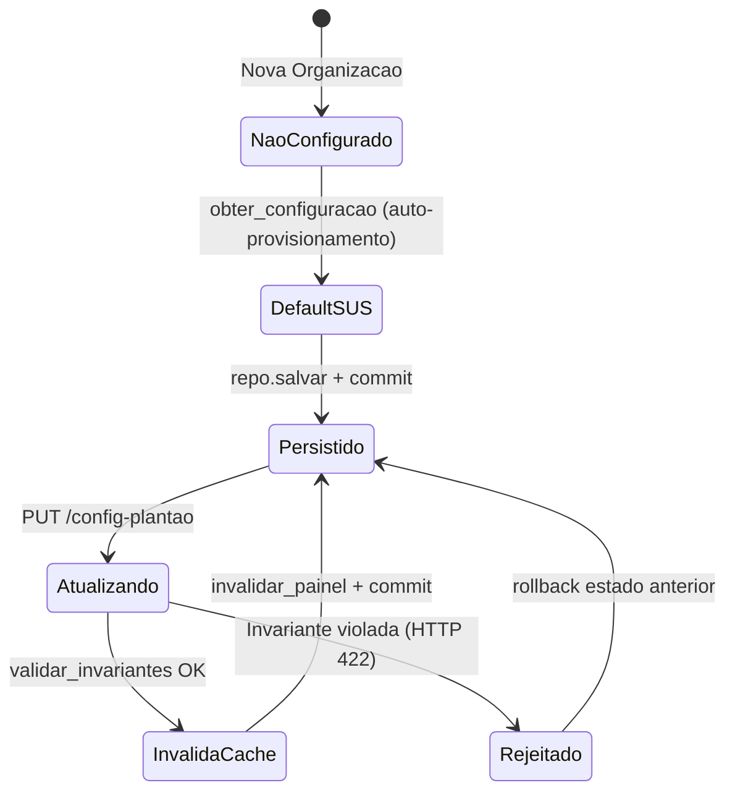
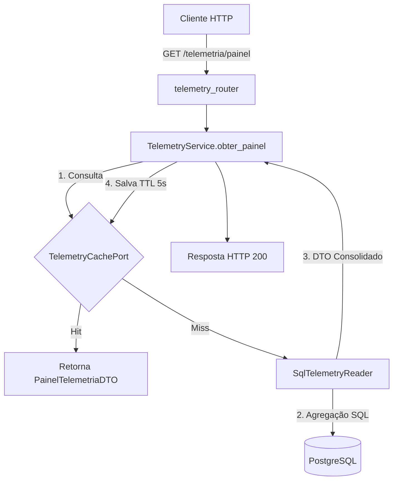

# Telemetry Domain

> Governança dinâmica de políticas de plantão e projeção analítica em tempo real com CQRS. Parametriza capacidade estocástica e monitora conformidade de SLAs sem onerar o banco relacional transacional.

## 1. Contexto

O domínio de Telemetria reúne a governança de parâmetros operacionais do plantão virtual (RF-09 / US-12) e a consolidação do painel analítico em tempo real (RF-10 / US-13).

A telemetria desacopla os parâmetros de despacho clínico do código estático, permitindo calibrar cotas diárias, quantidade de médicos escalados, tempos médios e tolerâncias de ring em tempo de execução para cada unidade de saúde.

O painel operacional agrega indicadores críticos: Tempo Médio de Espera (TME) geral e estratificado pelos 5 níveis clínicos de acolhimento, Tempo Médio de Atendimento (TMA) geral e por médico, taxa de abandono (evasão), índice de no-show (ausências) e taxa de cumprimento de SLA ($\ge 95\%$).

A segregação Command Query Responsibility Segregation (CQRS) preserva o banco transacional: leituras analíticas utilizam leitor SQL especializado e cache distribuído no Valkey sob a chave `telemetry:painel:{organizacao_id}` com TTL volátil de 5 segundos (resolvendo NC-TEL-01, RNF-10 e Meta SMART 5).

Vocabulário ubíquo: `alpha_backpressure`, `tma_padrao_segundos`, `tempo_tolerancia_ring_segundos`, `cota_diaria_maxima`, `modo_operacao` (SUS/PRIVADO), `read model`, `painel operacional`, `tme_medio`, `tma_medio`, `no_show_rate`, `evasao_rate`, `sla_compliance`.

Multitenancy estrito: todas as consultas e parametrizações operam vinculadas ao `organizacao_id`, com isolamento garantido por chaves compostas e Row-Level Security (RLS) no PostgreSQL.

## 2. Regras

- **RN-TEL-01 — Parametrização estocástica com limites estritos.** `alpha_backpressure` restrito ao intervalo $[1{,}20; 1{,}30]$ (`Decimal("1.20") <= alpha <= Decimal("1.30")`), `tma_padrao_segundos >= 60s`, `tempo_tolerancia_ring_segundos >= 10s`, `medicos_ativos_planejados >= 1`. Valores fora desses limites disparam `ValidationError`. [Fonte](../product-specification.md) (RN05)
- **RN-TEL-02 — Read Model CQRS analítico puro.** Leitura desacoplada do fluxo de escrita transacional via `TelemetryReaderPort` e `SqlTelemetryReader`. Executa consultas SQL agregadas diretamente sobre `atendimentos` e `profissionais`, computando métricas temporais sem locks relacionais. [Fonte](../../user-stories/US-13-telemetria-painel-operacional.md)
- **RN-TEL-03 — Caching volátil com TTL de 5s.** `TelemetryService.obter_painel` consulta primeiramente `TelemetryCachePort`. Em cache miss, consulta o reader e persiste na chave `telemetry:painel:{organizacao_id}` com TTL de 5 segundos, assegurando respostas <100ms. [Fonte](../../user-stories/US-13-telemetria-painel-operacional.md)
- **RN-TEL-04 — Invalidação de cache sob mutação de política.** Ao atualizar parâmetros em `ConfigPlantaoService.atualizar_configuracao`, o serviço invoca `invalidar_painel(organizacao_id)` no Valkey antes do `commit` relacional, prevenindo leituras inconsistentes no painel. [Fonte](../../user-stories/US-12-parametrizacao-politicas-plantao.md)
- **RN-TEL-05 — Capacidade operacional horária.** `ConfiguracaoPlantao.capacidade_atendimento_hora` calcula `(medicos_ativos_planejados * 3600.0) / tma_padrao_segundos`, fornecendo a vazão máxima teórica da unidade para balizar a admissão e backpressure. [Fonte](../architecture/concurrency-and-queues.md)

Guardiões: `ConfiguracaoPlantao` valida tipos numéricos, integridade do enum `ModoOperacao` (SUS ou PRIVADO), cotas positivas e SLAs de níveis 1 a 5 não negativos no construtor e no método `atualizar_parametros`.

## 3. Máquina de estados

O domínio contempla o ciclo de vida da configuração de plantão e o fluxo de consulta analítica via CQRS.



Fluxo de leitura segregada com cache distribuído:



Auto-provisionamento: organizações sem registro prévio recebem automaticamente configuração padrão SUS (`alpha = 1.25`, `tma = 600s`, `cota = 300`, `ring = 45s`, `medicos = 1`).

## 4. Relações

- Consumo por outros domínios: o módulo `queue` utiliza as diretrizes de `ConfiguracaoPlantao` para balizar o cálculo de backpressure estocástico ($\alpha$), saturação de admissão e tolerância de no-show (ring 45s).
- Projeção de leitura desacoplada: `SqlTelemetryReader` consulta tabelas `atendimentos` e `profissionais` exclusivamente via projeções de agregação (`SELECT ... FILTER ...`), sem dependência de escrita ou acoplamento com modelos de outros módulos.
- Cache desacoplado via porta: `TelemetryCachePort` é implementada por `ValkeyTelemetryCache` em produção e `MemoryTelemetryCache` em testes de unidade em memória.
- Repositório de persistência: `ConfigPlantaoRepositoryPort` persiste e recupera `ConfiguracaoPlantao` via `SqlConfigPlantaoRepository`.
- Rotas REST finas: `telemetry_router.py` expõe endpoints delegando execução a `TelemetryServiceDep` e `ConfigPlantaoServiceDep`, sem lógica de negócio na camada HTTP.

## 5. Peculiaridades

- Read model puro: o subsistema de painel nunca altera o status de atendimentos nem grava registros clínicos.
- Auto-provisionamento SUS: consultas a organizações sem configuração prévia instanciam a entidade com defaults públicos e efetuam o commit relacional de forma transparente.
- CheckConstraints DDL em espelho: o banco de dados possui restrições DDL (`chk_config_plantao_alpha`, `chk_config_plantao_tma`, `chk_config_plantao_ring`, `chk_config_plantao_modo`) que espelham exatamente os guardiões do modelo rico.
- Precisão Decimal estrita: o atributo `alpha_backpressure` utiliza `Decimal` de precisão fixa (`Numeric(4, 2)`), eliminando incertezas de ponto flutuante IEEE 754 em cálculos de capacidade.
- Invalidação antes do commit: garante que o cache volátil seja limpo antes que a nova transação relacional finalize, assegurando eventual consistency imediata.

## 6. Onde no código

- `src/modules/telemetry/domain/models.py`
- `src/modules/telemetry/application/dtos.py`
- `src/modules/telemetry/application/ports/config_plantao_port.py`
- `src/modules/telemetry/application/ports/telemetry_reader_port.py`
- `src/modules/telemetry/application/ports/telemetry_cache_port.py`
- `src/modules/telemetry/application/services/config_plantao_service.py`
- `src/modules/telemetry/application/services/telemetry_service.py`
- `src/modules/telemetry/infrastructure/config_plantao_repository.py`
- `src/modules/telemetry/infrastructure/telemetry_reader_sql.py`
- `src/modules/telemetry/infrastructure/valkey_telemetry_cache.py`
- `src/modules/telemetry/presentation/routers/telemetry_router.py`
- `src/modules/telemetry/composition.py`
- `migrations/versions/0006_telemetry_config_plantao.py`

Prova viva:

```bash
ls tests/unit | rg telemetry
# test_telemetry_infra.py
# test_telemetry_model.py
# test_telemetry_service.py

ls tests/integration | rg telemetry
# test_telemetry_router.py
```

## 7. Verificação

```bash
rg -n "ConfiguracaoPlantao|TelemetryService|SqlTelemetryReader" src/modules/telemetry/
# models.py:44 class ConfiguracaoPlantao
# telemetry_service.py:16 class TelemetryService
# telemetry_reader_sql.py:16 class SqlTelemetryReader

uv run pytest tests/unit/test_telemetry_model.py tests/unit/test_telemetry_service.py tests/unit/test_telemetry_infra.py -q --no-cov
# 30 passed
```

Sem corrigir código. Divergência entre documentação e invariantes do modelo exige ajuste na documentação para refletir as regras clínicas vigentes.

## 8. Ver também

- [Product Specification](../product-specification.md) — RF-09 governança de plantão, RF-10 painel analítico, RNF-10 latência de telemetria
- [Data Model](../architecture/data-model.md) — tabela `configuracoes_plantao` e RLS por `organizacao_id`
- [Concurrency and Queues](../architecture/concurrency-and-queues.md) — fator estocástico $\alpha$, TMA e dimensionamento de filas
- [Queue Domain](./queue-domain.md) — consumo de cotas e regras de admissão
- [Domains Index](./index.md) — catálogo geral dos domínios da aplicação
