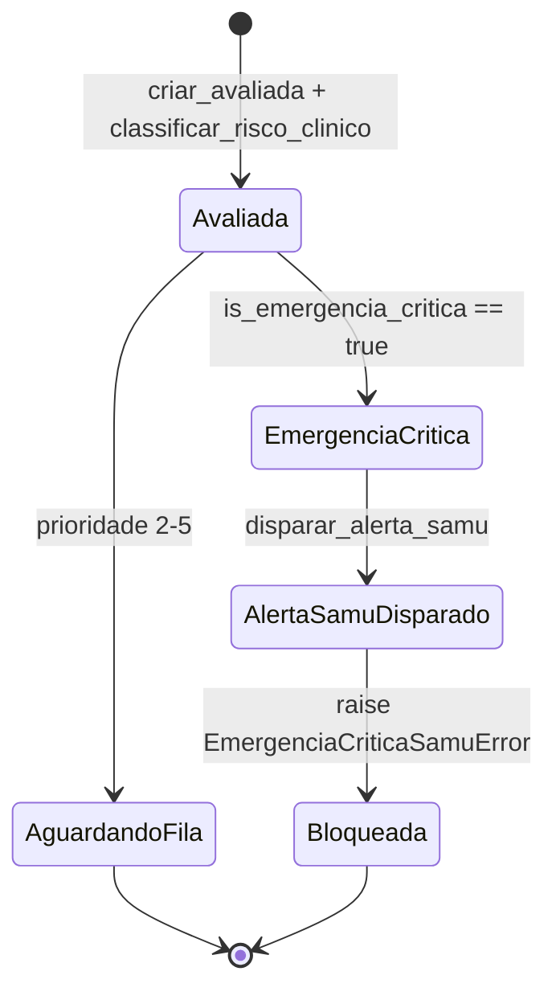

# Triage Domain

> Classificação clínica de risco e salvaguarda SAMU. Decide prioridade, bloqueia fila em emergência, prova consentimento por hash.

## 1. Contexto

Acolhimento gera `Triagem` 1:1 com atendimento. Função pura classifica, agregado valida, serviço aplica salvaguarda.

Vocabulário ubíquo: `queixa_principal`, `sintomas_alerta`, `escala_dor` (0–10), `prioridade_calculada` (1–5), `alerta_samu_disparado`, `avaliado_em` (UTC).

Entrada via RF-01 (queixa + dor 0–10 + sinais + aceite TCLE). Saída alimenta ordenação da fila sem chamar módulo queue.

Escopo termina na decisão. Fila, chamada e consulta pertencem a outros domínios.

## 2. Regras

- **RN01 — 5 níveis alimentam score da fila via dado.** `classificar_risco_clinico` devolve 1 (Emergência) a 5 (Não Urgente); queue ordena por esse inteiro sob taxonomia clínica aberta (ACR). [Fonte](../product-specification.md) (RN01)
- **RN04 — Nível 1 bloqueia PA Virtual e dispara SAMU 192 (Parecer CREMESP nº 278.262/2023).** De-Manchesterização via checklist eliminatório de Red Flags (rebaixamento de consciência, dor torácica aguda, dispneia em repouso, convulsão ativa); `disparar_alerta_samu` marca flag + `self._notifier` emite instrução 192 e impede admissão virtual. [Fonte](../product-specification.md) (RN04)
- **RN07 — TCLE vinculado por hash, acolhimento ágil <45s.** `calcular_hash_tcle` (SHA-256) amarra termo aceito ao prontuário, append-only UTC. [Fonte](../product-specification.md) (RN07)

Guardiões: `Triagem.criar_avaliada()` normaliza sintomas uma única vez, executa `classificar_risco_clinico` sem reclassificação dupla em `__init__` (`_pre_avaliada=True`) e aciona `disparar_alerta_samu()` quando `prioridade == 1`. Quando instanciado diretamente, `__init__` rejeita queixa vazia, prioridade fora de 1–5, dor fora de 0–10 (`TriagemInvalidaError`) e valida a coerência clínica da prioridade.

Sinais Nível 1 vencem tudo: conjunto `SINAIS_ALARME_NIVEL_1` (ex.: `dor_toracica_irradiada`, `dispneia_grave`, `inconsciencia`, `hemorragia_grave`, `anafilaxia`) ou palavra-chave em `_PALAVRAS_CHAVE_EMERGENCIA_NIVEL_1` na queixa normalizada força retorno 1 antes de avaliar dor.

Taxonomia canônica e aliases (`_ALIASES_SINTOMAS_CANONICOS` via `normalizar_sintomas`):
- Aliases de UI/legado são mapeados antes da cascata: `dor_no_peito` / `dor_toracica` $\to$ `dor_toracica_irradiada` (Nível 1), `falta_de_ar` $\to$ `dispneia_grave` (Nível 1), `tontura_desmaio` $\to$ `inconsciencia` (Nível 1), `sangramento_grave` $\to$ `hemorragia_grave` (Nível 1), `febre_alta` $\to$ `febre` (Nível 3).
- Entradas vazias ou em branco (ex.: `[" "]`) são descartadas por `normalizar_sintomas`, impedindo promoção indevida do Nível 5 para o Nível 4.

Cascata determinística: N1 sinais/palavras-chave → N2 (dor 8–10 ou `cefaleia_intensa`, `dor_toracica_moderada`, `confusao_mental`) → N3 (dor 5–7 ou `febre`, `vomitos_persistentes`, `desidratacao_moderada`) → N4 (dor 1–4 ou qualquer sintoma válido restante) → N5 eletivo.

## 3. Máquina de estados

Estados derivam de `prioridade_calculada` + `alerta_samu_disparado`. Sem coluna de status. Guardiões reais: `criar_avaliada`, `is_emergencia_critica`, `disparar_alerta_samu`, `adicionar_sintoma_alerta`.



`is_emergencia_critica` retorna verdadeiro quando `prioridade_calculada == 1` ou flag já disparada. Caminho crítico nunca alcança fila.

`disparar_alerta_samu` apenas liga `alerta_samu_disparado = True`. Envio externo cabe a `EmergencyNotifierPort`, nunca ao agregado.

`adicionar_sintoma_alerta` normaliza (trim + lower) e ignora duplicata. Não reclassifica sozinho; reavaliação exige nova chamada ao classificador.

## 4. Relações

- Consome nada. Nenhuma dependência síncrona de outro módulo. Entradas são primitivas (queixa, sintomas, dor, texto ou hash TCLE) em plataforma única sem `organizacao_id` (ADR-013).
- Expõe avaliação via seam único `TriagePort` (`src/modules/queue/application/ports/triage_port.py`): `TriageService` retorna `TriageRiskEvaluationDTO` (`prioridade_clinica`, `tcle_hash`, `alerta_samu_disparado`, `instrucao_redirecionamento`) satisfazendo `TriageEvaluationDTO`, persiste `Triagem` 1:1 via `registrar_triagem` e consulta queixas via `obter_queixas_por_atendimentos` (eliminando `ResultadoTriagemDTO`, `ClassificadorManchester` e `TriageQueixaReaderPort`).
- Persiste em tabela `triagens` (1:1 com `atendimentos`, `ON DELETE RESTRICT`). [Modelo](../architecture/data-model.md)
- Notifica via porta abstrata. `EmergencyNotifierPort.notificar_emergencia_samu` recebe `EmergencyAlertDTO` imutável; `SamuEmergencyNotifierAdapter` valida o webhook HTTP via `response.raise_for_status()` e registra `httpx.HTTPError` com `exc_info=True`, mantendo dublês de teste isolados em `FakeEmergencyNotifier` (`tests/doubles.py`).
- Falha de emergência via exceção de domínio `EmergenciaCriticaSamuError`, convertida na borda em resposta HTTP 422 (`EMERGENCIA_CRITICA_SAMU_192`).

## 5. Peculiaridades

- Acoplamento via dado e porta única, não chamada reversa. Triage nunca importa queue, nunca chama fila. Contraste com queue, que importa Valkey e orquestra atomicamente.
- Emergência é bloqueio de admissão, não prioridade alta. Nível 1 não entra na fila; retorna instrução SAMU e levanta erro de domínio (ou retorna DTO quando `raise_on_emergency=False` em piora clínica).
- Validação criptográfica rigorosa de TCLE: `_resolver_tcle_hash` exige `tcle_texto` não-vazio ou `tcle_hash` hexadecimal válido de 64 caracteres (`^[0-9a-f]{64}$`), levantando `ValidationError` com o valor ofensivo quando malformado ou ausente.
- Normalização dupla: sintomas com `normalizar_sintomas` (`strip().lower()` + descarte de vazios + resolução de `_ALIASES_SINTOMAS_CANONICOS`), queixa com NFKD sem diacríticos. Evita bypass por caixa alta, acento ou nomenclatura divergente de UI.
- `avaliado_em` sempre UTC com default `datetime.now(UTC)`. Auditoria RN07 depende desse carimbo, não do relógio do cliente.
- Sem enum de prioridade. Inteiro 1–5 com `CheckConstraint` no banco espelha validação do `__init__`.

## 6. Onde no código

- `src/modules/triage/domain/models/triagem.py` (`Triagem.criar_avaliada`)
- `src/modules/triage/domain/classification.py` (`normalizar_sintomas`, `classificar_risco_clinico`, `_ALIASES_SINTOMAS_CANONICOS`)
- `src/modules/triage/application/ports/emergency_notifier.py`
- `src/modules/triage/application/services/triage_service.py` (`TriageService`, `_resolver_tcle_hash`)
- `src/modules/triage/application/dtos.py` (`TriageRiskEvaluationDTO`)
- `src/modules/triage/infrastructure/adapters/samu_emergency_notifier_adapter.py`
- `src/modules/triage/composition.py`
- `src/modules/queue/application/ports/triage_port.py` (`TriagePort`, `TriageEvaluationDTO`)
- `src/modules/queue/application/services/fila_service.py` (Admissão e Triagem desacopladas via `TriagePort`)
- `src/modules/queue/presentation/routers/admissao_router.py` (`POST /api/v1/fila/admissao`)
- `tests/doubles.py` (`FakeEmergencyNotifier`, `FakeTriagePort`)
- `tests/unit/test_triage_model.py`
- `tests/unit/test_admissao_service.py`
- `tests/integration/test_admissao_integrada_flow.py`

Prova viva:

```bash
ls tests/unit | rg -i triag
# tests/unit/test_triage_model.py
```

## 7. Verificação

```bash
rg -n "def classificar_risco_clinico|def normalizar_sintomas|def criar_avaliada" src/modules/triage/
# classification.py:57 normalizar_sintomas, :86 classificar_risco_clinico; triagem.py:129 criar_avaliada

uv run pytest tests/unit/test_triage_model.py -q --no-cov
```

Sem corrigir código. Divergência entre doc e guardião real exige atualizar doc, nunca relaxar validação clínica.

## 8. Ver também

- [Product Specification](../product-specification.md) — RN01, RN04, RN07 contratuais
- [Data Model](../architecture/data-model.md) — tabela `triagens` com unicidade 1:1 por atendimento
- [Concurrency and Queues](../architecture/concurrency-and-queues.md) — como queue consome prioridade via dado
- [ambulatory domain](./ambulatory-domain.md) — produção ambulatorial SUS e qualificação cadastral
- [ADR-012: Transição 100% SUS](../../adrs/ADR-012-Transicao-100-SUS-Consorcios-Intermunicipais-e-Autenticacao-Tripartida.md)
- [ADR-013: Plataforma Única e Remoção de RLS](../../adrs/ADR-013-Simplificacao-Plataforma-Unica-e-Remocao-RLS.md)
- [Domains Index](./index.md) — visão conceitual por domínio
